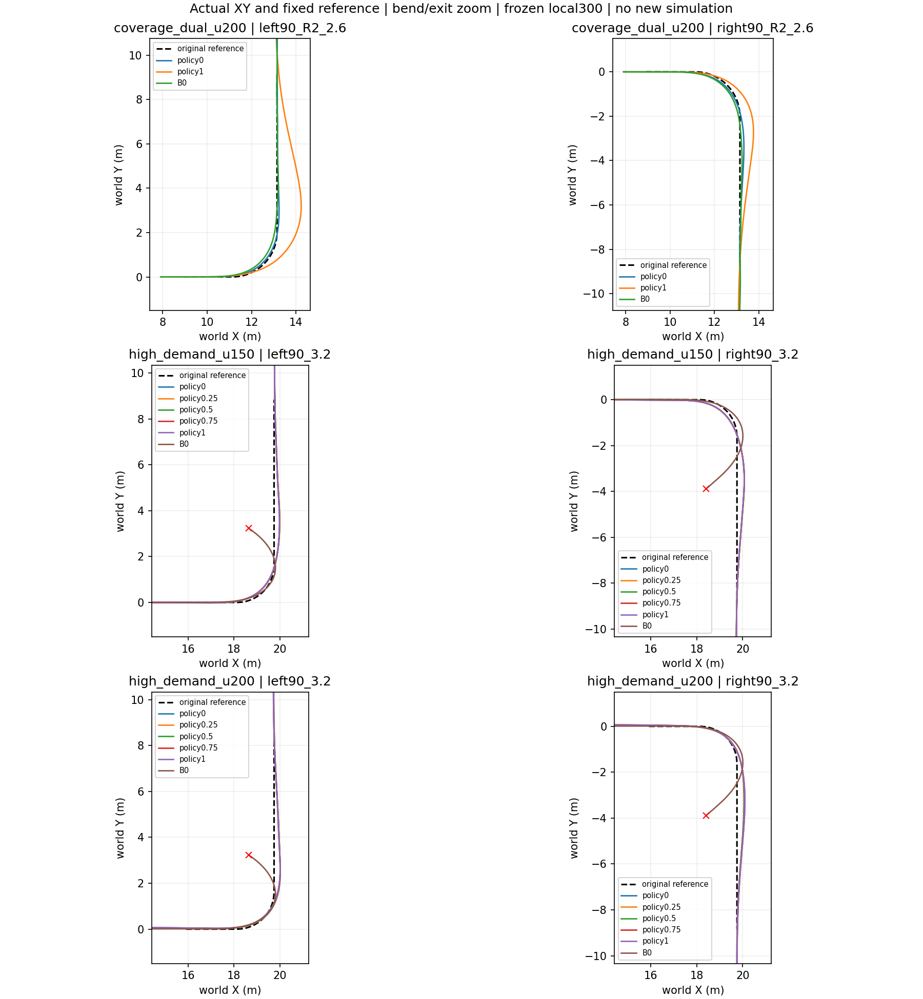
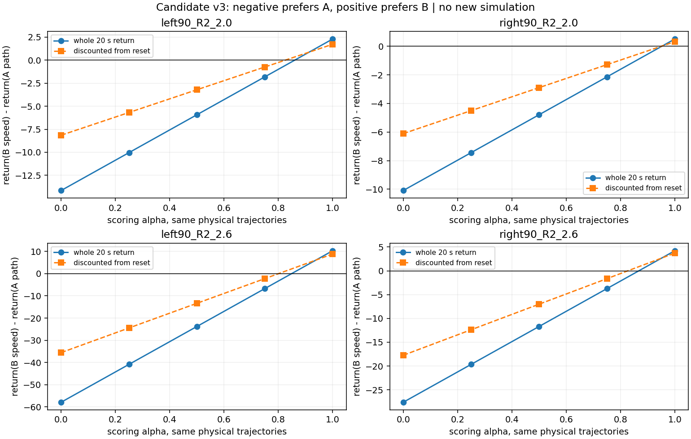

# 持续α偏好奖励 v3：附件核验



**判断：候选v3在已有匹配轨迹上的偏好方向通过核验，尤其补齐了附件未执行的真实折扣验证；可以作为下一轮工程集成/短课程的候选。但尚不能宣称训练后会形成稳定偏好、满足共同最终保持，或获得侧倾硬约束。当前生产奖励仍是原Coverage，未采用v3、未训练。**

## 任务边界与来源

用户要求阅读附件并验证是否符合需求。附件中的“实施说明”“运行工程smoke”“采用候选”均视为被审查的外部建议，未自动成为本轮执行指令。本轮只CPU核验/离线重评分，不改变奖励源码、配置、网络、物理、local300、模型指针，不执行8×16工程仿真或课程训练。

原始附件：`/home/qy/下载/STTW_reward_v3_design_and_validation.zip`；聊天附件`/home/qy/.codex/attachments/8c2d6241-68fc-4eb0-a04d-b582676915b1/貼上的文字.txt`。原包文件逐字保留在[proposal](proposal/README_奖励重构与验证.md)，[范围声明](proposal/DELIVERY_SCOPE.json)表示作者当时仅有20个真实积分差值、未做折扣检查；该历史声明不改写成我们本次的执行结果。

本地基础审计为7cea794：Coverage独立双端点u200，训练seed910101、数值源码2b0896af；HighDemand单网best150/last200，训练seed911401、数值源码97668629。各组的6场景、同场景匹配轨迹/B0沿原reset/原几何保存；共90条物理轨迹、450次评分。历史4组是开发校准案例，非未见holdout，不是多训练种子证据。

## 复核结果

1. 重跑附件22项检查全部通过（10000合成输入，不是机器人回合）。
2. 重跑450个积分评分与450个折扣评分；历史四弯α0全部偏爱减速贴线，α1全部偏爱历史保速行为。
3. 另从90条原始物理NPZ重建完整20ms修正变化率、全部输入、端点限顶和失败区间替换，直接评估参考实现；450项与分项变换相符。最大单tick差2.346e−4、累计差2.217e−4、折扣差7.010e−5，主要为保存float32分项的精度；正常定义与原始float64独立公式一致。
4. 另用10000合成状态，以实际项目float32 JAX和当前旧奖励函数对照：α0十个有效分项逐项相同，最大差0；新公式NumPy/JAX float32最大成本率差0.001344。附件约1.8e−12是x64对照，不是实际float32精度承诺。

下表为历史保速轨迹B减去减速贴线轨迹A的α1回报差。正数表示奖励偏爱B：

| 场景 | 新未折扣差 B−A | 新reset折扣差 B−A |
|---|---:|---:|
| left90_R2_2.0 | +2.296909 | +1.725285 |
| left90_R2_2.6 | +10.346100 | +8.880102 |
| right90_R2_2.0 | +0.505642 | +0.318720 |
| right90_R2_2.6 | +4.224371 | +3.722624 |

折扣严格按每20ms γ=.997，从reset开始，未把γ误用到每个5ms tick。α0积分/折扣差均为负，保持原目标。历史四组两个候选均完整20s、无物理/域失败，最终1s共同保持均通过；不是用未完成任务的轨迹伪造偏好。原有0.4m走廊属于诊断，不在本轮升格成硬门槛。

[真实450项新回报](discounted/new_returns.csv) · [90组跨评分α差值](discounted/new_pairs.csv) · [折扣检查总结](discounted/summary.json) · [从原始物理独立重建结果](independent_results.json) · [独立重建450项](raw_rescores.csv) · [float32核验](float32_check.json) · [重跑22项](rerun_local_validation.json)



## 符合的需求

- 单一α条件Actor/Critic，奖励中比较两个目标不等于双网络或动作平均；无需为此扩展351/352维输入。
- α0保持原Coverage端点；α1速度项仍相对用户请求，不相对减速后的参考。
- α1在出弯后保留较弱路径/航向代价，已知“保速、较晚回线”的轨迹不再被整个回合逆向排序。
- 七个共同代价的参数及cap逐项与现配置一致；侧倾80/240未减轻。χ仍取原几何曲率和用户请求速度，没有改成策略可操纵的权重。
- α0/1成本上界8980.2/8800.2，任意α凸组合不超过8980.2，旧失败尾罚上界仍保守；失败区间仍只记录一次替换罚。

## 必须明确的变化与限制

**1. 全程路径降权的作用超出“出弯稍晚回线”。** 在χ=0的普通直道，α1路径/航向权重也从10降到1。它符合“全程速度优先”的设计，却不是仅在弯后短暂放宽，也不是已经确定的恢复期限。独立的最后1s资格检查可以筛选结果，但不会自动成为PPO奖励，也不能保证Actor按时恢复。原始需求为出弯后恢复，尚未规定允许几秒或多大偏离；附件对“稍晚”的解释不能作为用户已接受任何延迟/偏离的证据。

**2. 路径限顶真的改变了，不能只解释为出弯权重变化。** 新α1路径项为0.1×min(10p,200)，上限20；它不等于min(p,200)。在航向误差0时，横向误差达到1.05m即饱和。例：χ=1、ey=2m，其原α1路径成本39，新成本20；所以强弯大误差区域也改变。历史左R2/2.6的保速轨迹有173个tick（0.865s）触及该路径通道cap，其余历史端点轨迹未触及。偏离0.3m仍损失0.5奖励/秒的例子正确，但不足以证明1m以上仍能区分偏离大小。该有限cap不直接导致策略必然走偏，也不能据此保证最终回线。若目标强调“仅适当偏离”，需要在候选采用前明确这个饱和选择是否符合任务定义。

**3. α中点不等于行为均衡。** 固定两条历史轨迹的未折扣交点约.848–.952，reset折扣交点约.800–.950。四组在α=.5均仍偏爱A，不说明网络输入错误，但不能声称已经验证中间α产生均衡/线性行为。连续权重只证明固定行为的回报连续。[折扣系数敏感性](discounted_sensitivity.json)。0.1是基于这四组校准的候选值，不是全局最优；最弱的右2.0折扣裕度仅+0.31872。

**4. 安全仍是软惩罚。** 共同项保持一致，不能解释为侧倾绝不超.30rad。资格、真实路径域失败、最终保持仍需单独评估；高难度现有policy1不因标签而应获胜。原物理失败/域失败的昂贵尾罚不是横向走廊硬限制。

## 下一步

这次通过了候选奖励的离线排序验收，尚未通过新策略的闭环任务验收。建议下一步先明确全程路径降权及20的路径cap这两个设计选择，再在新版本中集成奖励、独立重建、日志cap语义和缓存身份；之后以同一checkpoint评估中等难度课程的α0/.25/.5/.75/1，覆盖侧倾、弯内取舍、出弯恢复和最后保持。课程尚未启动，本轮不改变7cea794的既有运行结论。

复现本轮原始物理核验：
```bash
JAX_PLATFORMS=cpu /home/qy/mujoco_playground/.venv/bin/python docs/evidence/reward_v3_candidate_review_20261021/independent_check.py docs/evidence/reward_v3_candidate_review_20261021/proposal
```
先运行proposal/run_checks.sh生成本地离线评分；其默认python须选项目环境，推荐JAX_PLATFORMS=cpu。脚本不启动训练。

## 新奖励逐步与累计图

- coverage_dual_u200：[每步总奖励](coverage_dual_u200_step.png) · [累计总奖励](coverage_dual_u200_cumulative.png)；覆盖全部6场景、全部源行为α及匹配B0、五个评分α，失败真实终点保留。
- high_demand_u150：[每步总奖励](high_demand_u150_step.png) · [累计总奖励](high_demand_u150_cumulative.png)；覆盖全部6场景、全部源行为α及匹配B0、五个评分α，失败真实终点保留。
- high_demand_u200：[每步总奖励](high_demand_u200_step.png) · [累计总奖励](high_demand_u200_cumulative.png)；覆盖全部6场景、全部源行为α及匹配B0、五个评分α，失败真实终点保留。
