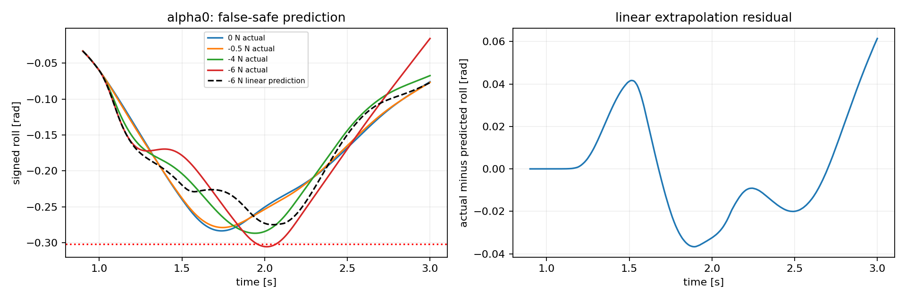

# Right-turn transfer: false-safe result and decision

2026-10-22. [All 14 actual/reference XY trajectories and roll](../../../runs/right_transfer_v1/xy_and_roll.png) inspected. Both frozen Coverage u200 endpoints, local300 unchanged. 14/14 completed, 56000 lower ticks plus 8 preflight, 1089.70 seconds, zero training. Bark completion accepted by server.

## Result

9/14 pass including six nominal/probe cases. Of eight +/-4 and +/-6 N validation cases, 7 classifications agree and one is false-safe; no conservative rejection in this panel. Five actual failures are working-roll violations only; all fourteen reach the goal and pass final hold, with zero physical/domain failure.

The false-safe case is alpha0, right90_R2, onset1s, negative6N lasting0.1s. Small-probe predictor claims a negative-direction bound10.469987N and predicts success. Actual peak0.30560362rad exceeds0.302. Negative4N passes at0.28681505. Thus the tested negative-direction transition is between4 and6N; no continuous interval certification.

This invalidates adopting unqualified small-probe linear extrapolation as a reliable training constraint or physical safety margin. It does not invalidate the algebra for its stated linear model.

## Diagnosis from saved data

Nominal alpha0 peak0.28350186rad at1.74s; negative0.5N reduces it to0.27884829rad at1.75s. Negative4N raises the peak back to0.28681505rad near1.945s, and negative6N raises it to0.30560362rad near2.015s. A small initially helpful force direction becomes harmful at larger amplitude; the limiting peak shifts later.

Linear prediction at negative6N has maximum absolute roll0.27487981rad. At the actual peak it predicts -0.2739967rad versus actual -0.30559754rad, an error about0.03160rad. The control-tick maximum already exceeds the threshold; its difference from the physics-substep maximum is only0.00000608rad. Thus missed substeps do not explain this false-safe case. Controller saturation/contact/branch-specific attribution remains untested.

For alpha1, linear predicted peaks at +/-4 and +/-6 N differ from actual substep peaks by approximately0.000006 to0.000036rad. This contrast shows endpoint dependence at these states; it does not establish that alpha1 is globally linear or safer.

A post-hoc quadratic diagnostic using the SAME +/-0.5 N probes is worse: alpha0 negative6N predicted peak0.461820rad; alpha0 negative4N0.346973rad would incorrectly reject a success. Maximum timewise residuals also increase for all eight cases (see diagnostic.json). Do not adopt second-order extrapolation merely because one missed failure becomes classified correctly. This is post-hoc analysis, not a new validation score.

## Decision and next finite step

1. Preserve the original prediction and false-safe case. Keep the proxy in diagnostic status; no reward adoption, surrogate training, or policy switching. Model effort-budget/force-map calibration remains incomplete.
2. Next local-validity panel, not yet launched: reuse each right-turn complete t=1s snapshot and genuine saved prefix. Per endpoint forces0,+1,+2,+3,-1,-2,-5N, duration0.1s, original20s deadline and common criteria. 14 suffixes, 53200 new lower ticks plus preflight; no amplitudes beyond current6N range. Before outcomes, use the frozen +/-0.5 N predictor. This locates the positive boundary, tests intermediate linearity, and narrows the alpha0 negative4..6 transition. No further automatic expansion.
3. Only after validity is characterized, decide an explicit finite domain or a different cheap state proxy; independent states and matched ordinary roll/rate/static-model controls are still required. Repeated calibration alone is not completion of the training-side objective.
