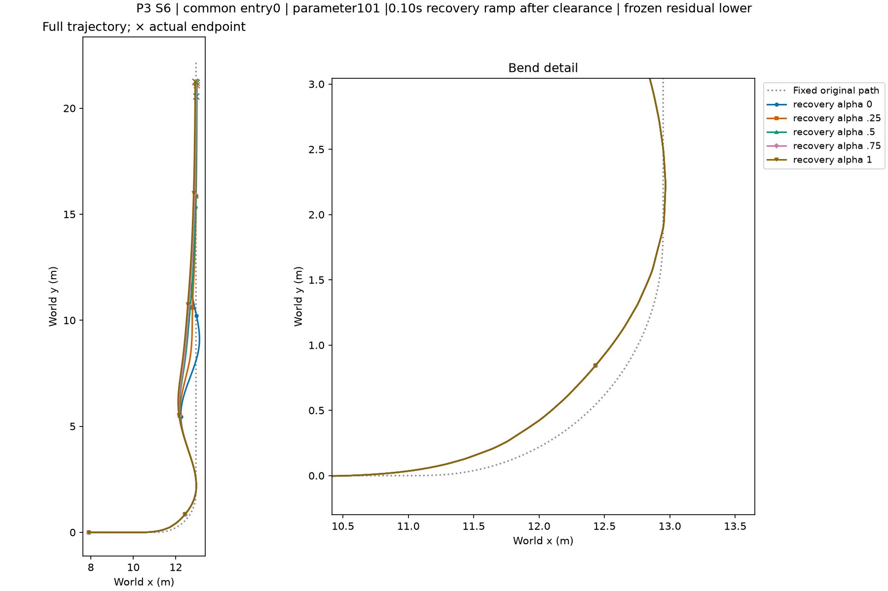

# P3 actual/reference XY and source data

The complete case matrix is in [trajectory_index.json](trajectory_index.json); coordinates, validity, native reward and failure flags are in [trajectories.npz](trajectories.npz). All failures are retained. Absolute source paths are provenance links to local data, not remotely hosted files.

## Case 0: entry0_seed101

