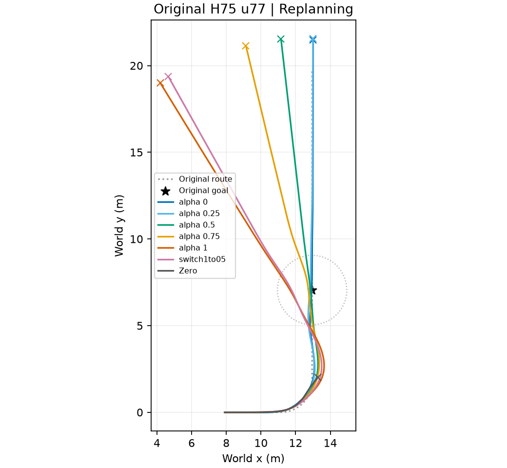
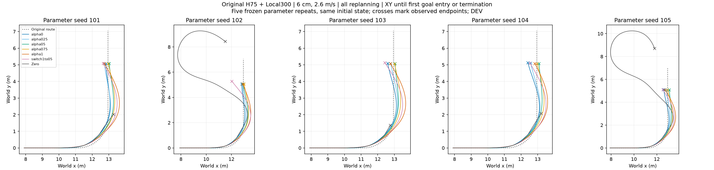

# STTW 越野偏好控制：近期证据包

先看实际轨迹，再看统计。原始 H75 u77 + 已选橙色 Local300；五档 alpha=0/.25/.5/.75/1。Zero 为同一冻结 Local300+ECBC/ESO、没有 H75 修正，不是纯 ECBC。全部为仿真 DEV 证据，不是实车或独立训练种子泛化验证。

## 论文主线

单轨双轮机器人通过非平坦地形时，速度与路径跟踪存在耦合。冻结强底层之上的偏好条件策略共同修正速度和转向参考，使同一策略提供可选的路径—速度工作点。任务权重或道路空间约束决定采用哪个工作点；外部给定偏好变化可在弯内执行。

投稿目标不是所有场景最优或方法无敌，而是核心行为成立、证据覆盖相应范围、基线与任务定义公平。未成立的候选机制不列为核心贡献。本包不涉及第三章/跨技能任务。

## 正面证据与解释

|证据|已观察结果|论证作用|
|---|---|---|
|多速度/幅度重复|5速度×4地形×5参数种子，每组五alpha+Zero，共600轨迹；500条H75均10秒存活并到达原goal；Zero71/100满窗|偏好行为在多种地形、速度和参数下存在；满窗与到达分别统计|
|连续起伏/全路粗糙|14条件，H75 70/70到达且满窗，64/70最终保持；Zero14/14到达、12/14满窗、3/14保持|能力不限于单个凸起；到达、持续运行和最终保持不混用|
|任务条件下alpha选择|2/4cm、2.6m/s校准：eta=.533平方代价选.75；全10秒峰值<=.4m约束下速度优先选.5|两种最优不矛盾，来自不同目标与约束；不主张普适最优alpha|
|留一参数重复选择|100折DEV；条件选alpha平均代价相对全局固定.5下降11.13%；71更好、5更差、24相同|已测条件下有按任务/地形选择的价值；不是独立TEST，也不是每项误差同时改善|
|共同状态双通道干预|50次同状态查询均改变两通道；30次短保持有可测闭环作用；两通道有限干预非加性|alpha作用不仅来自不同轨迹的状态差异，双通道相互作用可观察|
|负有效拖距|6cm两速度五alpha均出现瞬时负值；分解中接触点前移为主要负贡献|解释地形接触如何改变有效转向几何；不等于证明失稳原因|
|既定弯内1→.5切换|6cm/2.6m/s seed101：相对固定1到达前路径RMSE .3167→.2509m，速度RMSE .1206→.1163m/s；六H75到达且满窗|切换可改善固定速度优先端点；初始单参数实例，后续五参数重复见下文，不声称优于所有固定alpha|

## 直接入口

- [全部100条件、五alpha与Zero的实际XY图](repeats/xy/)；[五组重复均值与离散](repeats/tradeoff_repeated_mean_h75_window.png)；[全部逐条件数值](repeats/tradeoff_repeated_raw_h75_window.csv)。这些H75统计用全10秒，Zero完整终止资料在原运行保存。
- [粗糙与连续起伏14条件XY](rough_waves/xy/)；[任务指标](rough_waves/feasibility_metrics.json)。
- [alpha选择完整数值](repeats/alpha_selection.json)、[权重敏感性](repeats/selection_sensitivity.json)、[留一参数重复比较](repeats/alpha_transfer_comparison.png)、[留一详细结果](repeats/alpha_transfer.json)。
- [同状态查询](channels/same_state_alpha_overview.png)、[入口干预XY](channels/entry_projection_all_alpha.png)、[出口干预XY](channels/exit_projection_all_alpha.png)、[干预数值](channels/channel_effect_summary.json)、[非加性分析](channels/channel_interaction.json)。
- [有效拖距曲线](contact/trail_two_speeds.png)、[几何分解与支承点预测结果](contact/trail_decomposition.json)。
- [曲线形状/拟合](curve/tradeoff_shape_analysis.png)、[拟合数值](curve/tradeoff_shape_analysis.json)、[动力学量](curve/tradeoff_bend_dynamics.json)。
- [切换指标](switch/metrics.json)、[实际切换轨迹](switch/xy_switch.png)、[每步/累计奖励与误差](switch/original_responses.png)、[奖励分项](switch/original_reward_components.png)、[逐步数据](switch/data/)。
- [代码与配置快照](source/learning/)、[文件来源/大小/SHA256/源码commit](MANIFEST.json)。

## 必须一并保留的结论边界

1. 2.4m/s²不是已证实的硬上限：保存轨迹有持续超过值。[核验](physics_checks/acceleration_threshold_check.json)。
2. 负拖距并不必然失稳；全部十条H75接触案例仍存活。名义椭球支承点预测只命中35个负值样本中的12个，漏23个、误报4个；13.16°/5.96cm不是已验证精确阈值。
3. 协调限速候选在已有对照中没有证明收益，不作为现有创新或投稿前置要求。
4. 倒数拟合是描述性，不是已从物理独立推导出的普适定律。截图给定eta=.533时求得Ey=.140926m、Ev=.097403m/s，不能写成Ey=.1142或alpha解析最优约.52。[计算核验](physics_checks/task_cost_check.json)。
5. 原goal前，重复矩阵所有alpha0都能到达并满足.4m路径峰值界；不能把到达后继续跟踪的偏离写成alpha0无法完成任务。[时域核验](repeats/goal_window_check.json)。
6. 初始seed101切换峰值.554m，仍不满足.4m界；固定.5峰值.338m。Zero约2.475秒终止。共同0–2.475秒窗与个体到达前窗均报告，不能只展示有利窗口。
7. 参数种子是冻结摩擦/质量/增益/延迟等参数重复，不是独立训练种子。共享2.3m/s热启动，低速请求包含减速过程。没有删除大误差点。

## 已补齐：同一切换方案的五参数重复

固定切换位置不变，seed101原结果复用，新增102–105共28lane一次GPU批次（166.857秒仿真），没有训练。合计30条H75均到达并满10秒；Zero2/5到达满窗。

配对共同到达前窗口：切换对固定1的路径RMSE在5/5重复下降，均值.310274→.256584m（下降17.30%）；路径峰值5/5下降，平均下降16.36%。速度RMSE均值.119616→.118651m/s（下降.81%），其中4/5降低、1/5升高。对固定.5则速度RMSE5/5降低（平均25.73%），路径RMSE5/5升高。固定.5满足.4m峰值界5/5，切换0/5。该结果支持可重复的取舍，而非普适支配。

[全部35条结果与配对原始数值](switch_repeats/summary.json)；[配对差值及样本标准差](switch_repeats/paired_differences.png)。这是既有参数下的DEV重复，不是独立训练种子或未见TEST。

[论文观点与证据映射](CLAIMS.md)。

## 后续与投稿准备

主线不以普适支配、所有场景排序或微小仿真误差为门槛。已有范围足以进入论文组织准备；冻结切换方案的五参数重复已完成；不重新训练、不搜索切换点来制造优势。用户此前要求先看证据，因此本包是证据总览，不替代主稿。后续论文重点报告可控取舍、任务选择和对应接触/通道解释。

## 包大小与复现范围

约30MiB，PNG仅一份，无PDF/ZIP重复，无模型权重、大训练日志或完整仿真缓存。含114张完整条件XY图以避免只保留漂亮案例。切换逐步NPZ可重算本包切换指标；其他系列含汇总/逐条件数据与来源。source目录是相关源码快照，不能单独运行完整仿真：完整资产/冻结权重依赖原仓库及MANIFEST对应运行目录，不宣称完整复现实验环境。

用于成稿的配对数值：[CSV](switch_repeats/paired_table.csv)、[LaTeX表格](switch_repeats/paired_table.tex)。均由同一汇总脚本生成，±为五参数配对差值的样本标准差，不是置信区间。

## 最新增量：接触采集修复短测

[五档4秒XY、完成记录与采集源码](contact_acquisition/README.md)。正式机制分析尚未完成；与前面的已完成任务证据分开。
