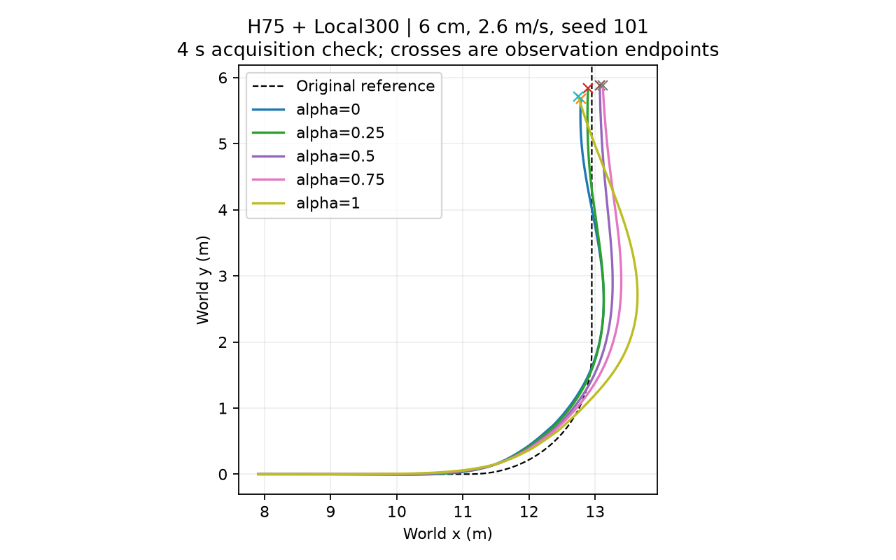

# 最新接触采集交付（工程短测）

冻结原H75 u77＋橙色Local300，6cm地形、2.6m/s、参数seed101，五alpha各4秒，0优化更新。修复后100000 lane物理步完成，仿真101.755秒；五档均满窗，没有物理失败。此为采集接口短测，不是正式150条P0或机制结论。

新增代码逐0.2ms保存法向/摩擦各自作用点、力、索引、车体/关节状态与显式电机力矩。修复了先读摩擦API会覆盖法向共享索引的问题，法向数据现在先复制。旧错误采集保存在本地invalid_shared_buffer_indices，其力矩数值无效，不纳入论文证据。

完整原始接触块留在本地runs/h75_contact_acquisition/evaluation/physics_contacts（索引见raw_contact_index.json）；本精简包只提供XY/alpha/存活/奖励及原始参考坐标、合同、完成记录、对应源码。完整力矩分解、因果干预及P0统计尚未完成，不把本次存活当作负拖距因果验证。没有新训练或修改论文。

源码版本：9e5ddf3d；source为此时相关文件快照。完整仿真仍依赖原资产、冻结网络与运行环境。
