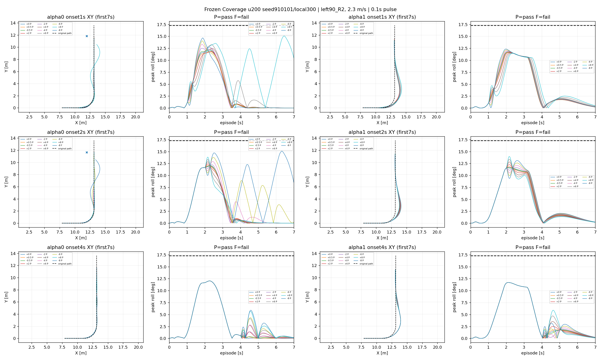
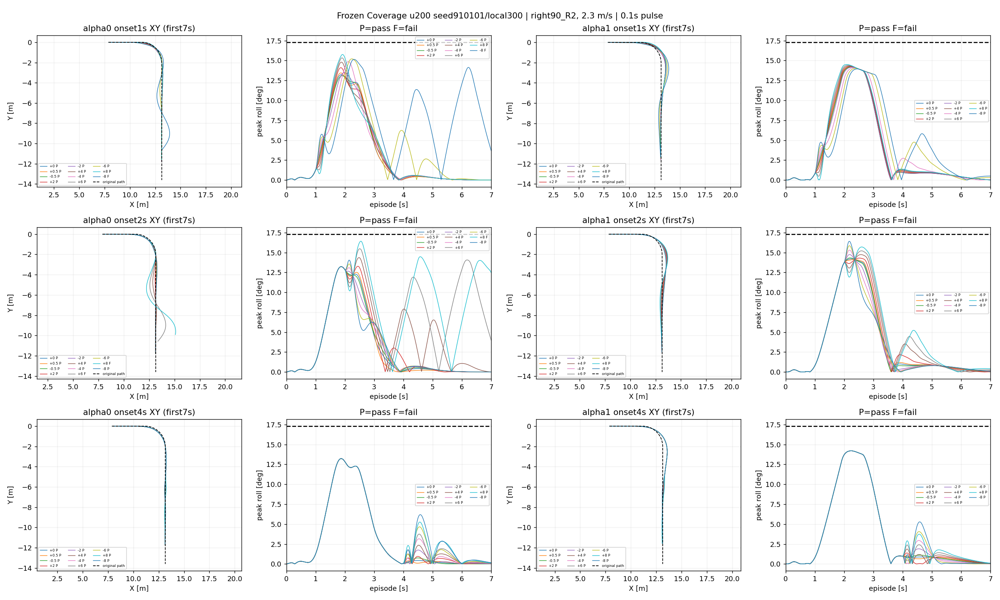
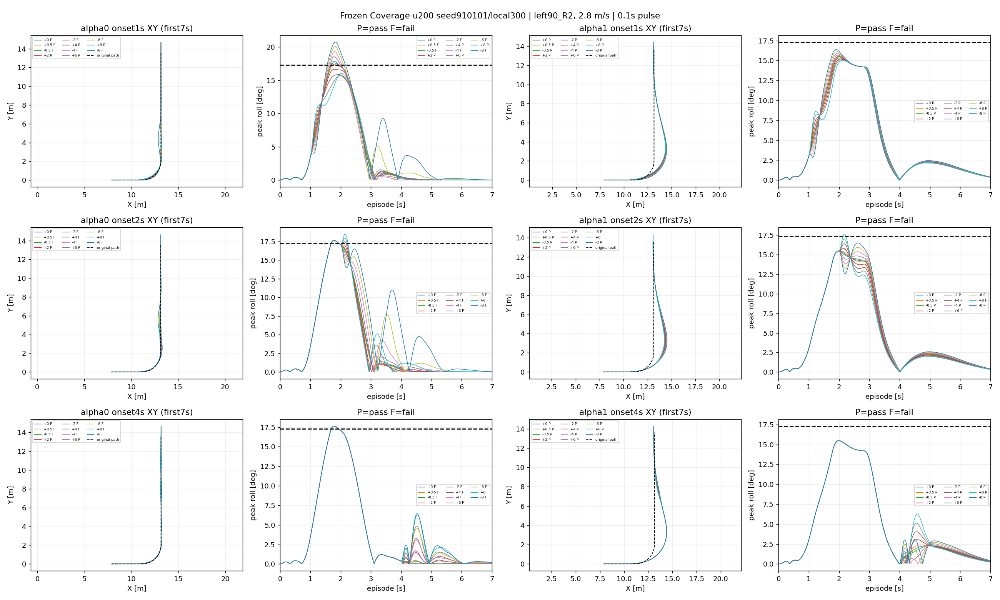
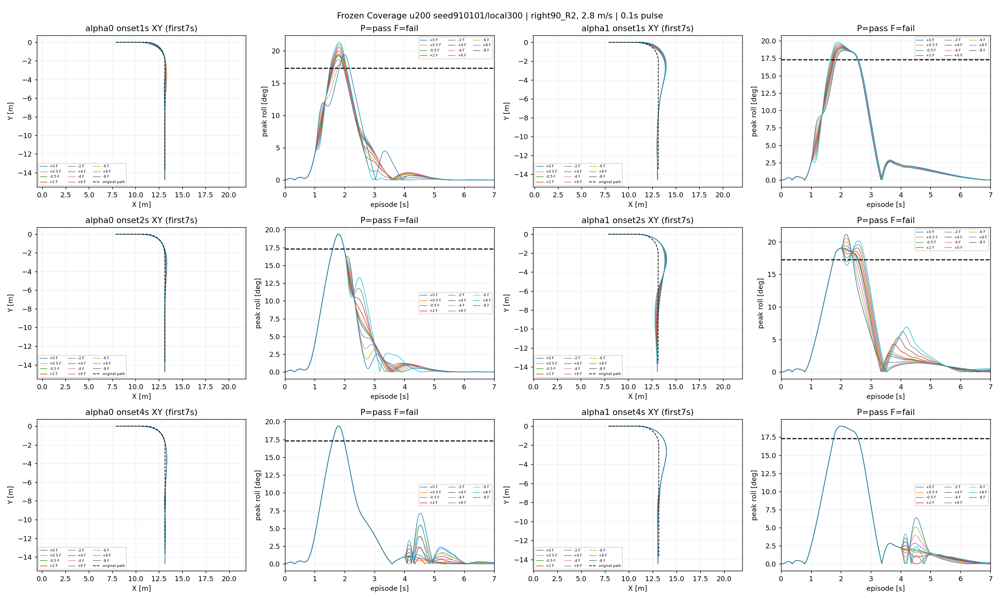

# Cross-state directional tolerance calibration






All original frozen policies, physics and success criteria retained; no training.

```json
{
  "calibration": {
    "cases": 132,
    "successes": 127,
    "physical_failures": 0,
    "working_failures": 0,
    "domain_failures": 2,
    "nominal_failures": 0,
    "scored": 96,
    "correct": 92,
    "false_safe": 4,
    "conservative": 0
  },
  "speed_transfer": {
    "cases": 132,
    "successes": 36,
    "physical_failures": 0,
    "working_failures": 96,
    "domain_failures": 0,
    "nominal_failures": 9,
    "scored": 24,
    "correct": 24,
    "false_safe": 0,
    "conservative": 0
  }
}
```

2.3m/s is calibration; 2.8m/s is speed-transfer DEV. Predictions are local extrapolations from +/-0.5N, not certified bounds. Report nominal failures separately. Do not fit on speed-transfer outcomes and continue calling them untouched validation. See summary.json for all finite-grid statuses and predictions.
