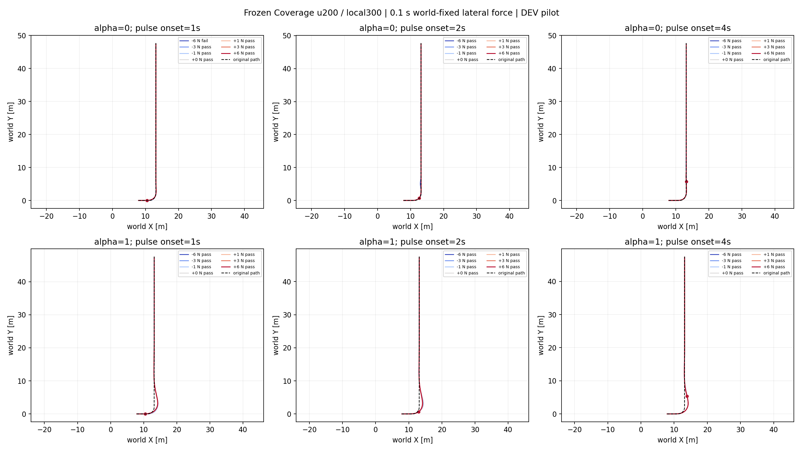

# Directional pulse pilot v1

Frozen Coverage u200 endpoints and local300; 42 declared trajectories completed. No training.

Success: 41/42 (six zero-force repetitions included; not independent statistical trials).

| alpha | pulse time (s) | direction | sampled success amplitudes (N) | first sampled failure (N) |
|---|---|---|---|---|
| 0 | 1.0 | -1 | [1.0, 3.0] | 6.0 |
| 0 | 1.0 | +1 | [1.0, 3.0, 6.0] | None |
| 0 | 2.0 | -1 | [1.0, 3.0, 6.0] | None |
| 0 | 2.0 | +1 | [1.0, 3.0, 6.0] | None |
| 0 | 4.0 | -1 | [1.0, 3.0, 6.0] | None |
| 0 | 4.0 | +1 | [1.0, 3.0, 6.0] | None |
| 1 | 1.0 | -1 | [1.0, 3.0, 6.0] | None |
| 1 | 1.0 | +1 | [1.0, 3.0, 6.0] | None |
| 1 | 2.0 | -1 | [1.0, 3.0, 6.0] | None |
| 1 | 2.0 | +1 | [1.0, 3.0, 6.0] | None |
| 1 | 4.0 | -1 | [1.0, 3.0, 6.0] | None |
| 1 | 4.0 | +1 | [1.0, 3.0, 6.0] | None |

Positive sign means force toward left at pulse start, not force coming from left. Force point is subtree COM equivalent wrench on chassis. Pulse direction stays fixed in world coordinates.

No continuous tolerance boundary is certified. All-pass at 6 N is test-range censoring, not proof of 6 N continuous tolerance. A sampled failure bracket is not an exact boundary. Nominal failures must remain separate.

Mathematical primitives are repaired, but force mapping, effort budget and full closed-loop sensitivity remain uncalibrated. These data establish an initial physical test panel; they do not establish superiority of dynamic UCEDT.
