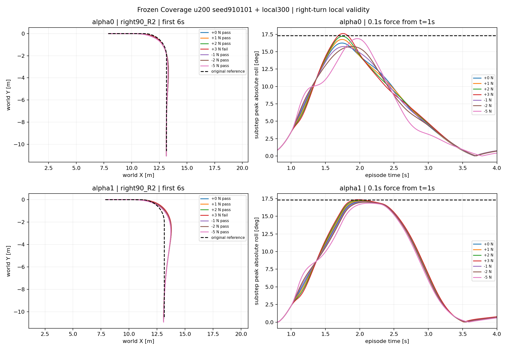

# Right-turn local validity

Completed 14 cases, 12 passes. No training. Scored 12 validation amplitudes: 11 correct, 0 false-safe, 1 conservative rejections.

| case | predicted pass | actual pass | peak roll rad |
|---|---|---|---|
| alpha0_t1_F+1 | True | True | 0.292470 |
| alpha0_t1_F+2 | False | True | 0.300356 |
| alpha0_t1_F+3 | False | False | 0.307343 |
| alpha0_t1_F-1 | True | True | 0.274827 |
| alpha0_t1_F-2 | True | True | 0.274912 |
| alpha0_t1_F-5 | True | True | 0.294628 |
| alpha1_t1_F+1 | True | True | 0.299809 |
| alpha1_t1_F+2 | True | True | 0.301203 |
| alpha1_t1_F+3 | False | False | 0.302724 |
| alpha1_t1_F-1 | True | True | 0.297466 |
| alpha1_t1_F-2 | True | True | 0.296510 |
| alpha1_t1_F-5 | True | True | 0.294167 |

Predictions: [{"alpha": 0, "sign": -1, "status": "PREDICTED", "bound_N": 10.469986915588379, "active_constraint": "roll"}, {"alpha": 0, "sign": 1, "status": "PREDICTED", "bound_N": 1.982056736946106, "active_constraint": "roll"}, {"alpha": 1, "sign": -1, "status": "PREDICTED", "bound_N": 38.09672927856445, "active_constraint": "roll"}, {"alpha": 1, "sign": 1, "status": "PREDICTED", "bound_N": 2.5388996601104736, "active_constraint": "roll"}]

Predictions copied from the prior right_transfer_v1 +/-0.5 N probes before this execution. No refitting; this panel tests intermediate amplitudes at the same DEV states. Zero-force continuation roll must reproduce the saved baseline exactly. This is a route-transfer development test, not final TEST. Roll predictor samples control ticks while actual success uses physical-substep peak; report any resulting mismatch. No upper bound inferred from all-pass results, and no automatic force expansion. Theory force map and effort budget remain uncalibrated.
