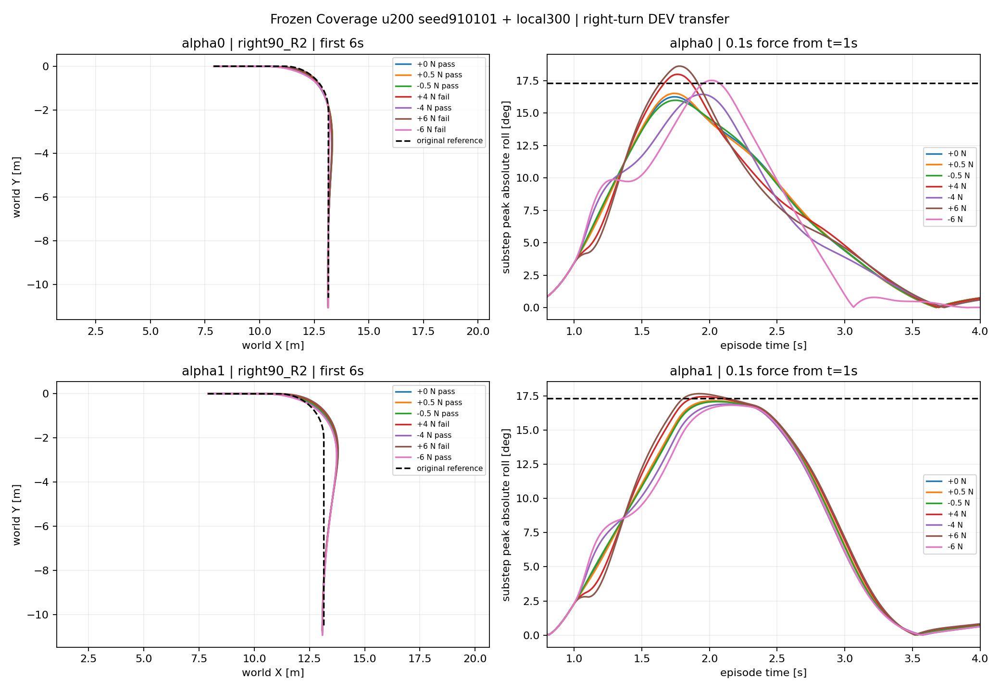

# Right-turn tolerance transfer

Completed 14 cases, 9 passes. No training. Scored 8 validation amplitudes: 7 correct, 1 false-safe, 0 conservative rejections.

| case | predicted pass | actual pass | peak roll rad |
|---|---|---|---|
| alpha0_t1_F+4 | False | False | 0.313736 |
| alpha0_t1_F-4 | True | True | 0.286815 |
| alpha0_t1_F+6 | False | False | 0.324777 |
| alpha0_t1_F-6 | True | False | 0.305604 |
| alpha1_t1_F+4 | False | False | 0.304393 |
| alpha1_t1_F-4 | True | True | 0.294876 |
| alpha1_t1_F+6 | False | False | 0.308174 |
| alpha1_t1_F-6 | True | True | 0.293516 |

Predictions: [{"alpha": 0, "sign": -1, "status": "PREDICTED", "bound_N": 10.469986915588379, "active_constraint": "roll"}, {"alpha": 0, "sign": 1, "status": "PREDICTED", "bound_N": 1.982056736946106, "active_constraint": "roll"}, {"alpha": 1, "sign": -1, "status": "PREDICTED", "bound_N": 38.09672927856445, "active_constraint": "roll"}, {"alpha": 1, "sign": 1, "status": "PREDICTED", "bound_N": 2.5388996601104736, "active_constraint": "roll"}]

Prediction algorithm frozen before simulation; only +/-0.5 N and zero logs read before writing frozen_probe_predictions.json. Probe/large amplitude simulations ran in the same batch. This is a route-transfer development test, not final TEST. Roll predictor samples control ticks while actual success uses physical-substep peak; report any resulting mismatch. No upper bound inferred from all-pass results, and no automatic force expansion. Theory force map and effort budget remain uncalibrated.
