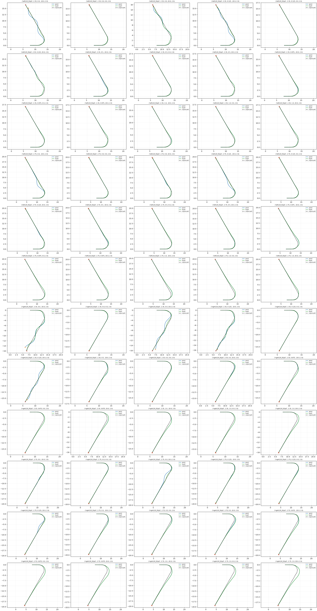

# Fixed-Actor low-speed DEV rollout check

| Policy | Task /60 | Disturbed /40 | Nominal /20 | Working /60 | Domain |
|---|---:|---:|---:|---:|---:|
| parent | 53 | 33 | 20 | 26 | 0 |
| taught | 58 | 38 | 20 | 28 | 0 |

Paired task improvements: 5; regressions: 0.

Fixed final400 supervised actor, ordinary closed-loop interface. These DEV contexts were not used as teaching samples; they have been used in prior development diagnosis and are not final TEST. No automatic adoption.
