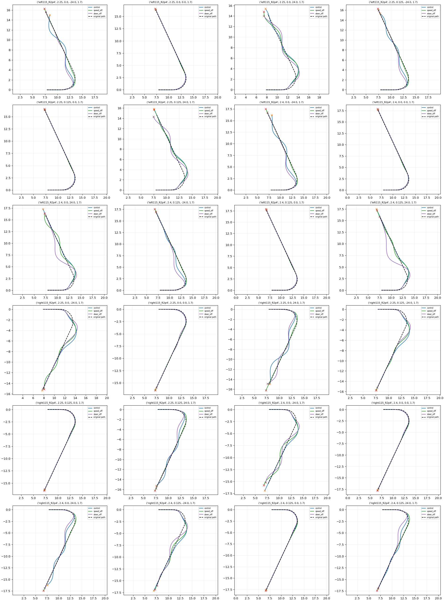

# TRAIN coordination feasibility results

| Arm | Task | Disturbed | Nominal | Working | Domain |
|---|---:|---:|---:|---:|---:|
| control | 17/24 | 9/16 | 8/8 | 15/24 | 0 |
| speed_off | 18/24 | 10/16 | 8/8 | 10/24 | 0 |
| steer_off | 17/24 | 9/16 | 8/8 | 10/24 | 0 |

speed_off: paired task improvements 6, regressions 5.

steer_off: paired task improvements 5, regressions 5.

All outcomes retained. These are forced diagnostic rollouts, not evidence of learned recovery. Selection of training targets must retain their full-state provenance and use only deployment-available observations; the present screen lacks full observation-target arrays. Do not train on DEV interventions or claim this panel as final TEST.

## Decision

Speed-off yields six newly recovered TRAIN cases and five regressions. All six gains also improve original V3 logged return (+22.36 to +76.58), with peak roll increasing 0.0069–0.0260 rad; their final task errors recover. Original working-roll flags remain failures and are reported, but are not an automatic veto on useful recovery examples. Steer-off gains increase roll more (0.0447–0.0716 rad) and all reduce logged return, so they are not the initial teaching candidates.

The three-arm hindsight union recovers 15/16 disturbed contexts versus control 9/16. This is neither a deployable selector nor an oracle physical upper bound. Six speed-off candidates are indexed with hashes in recovery_candidates.json. Next collect deployment-available observation/action pairs on TRAIN branches, preserve control/nominal successes and the five regressions, and test whether the existing actor can learn state-dependent coordination. No force/time/context oracle input and no permanent off switch. Full policy learning and held-out evaluation remain unperformed.
