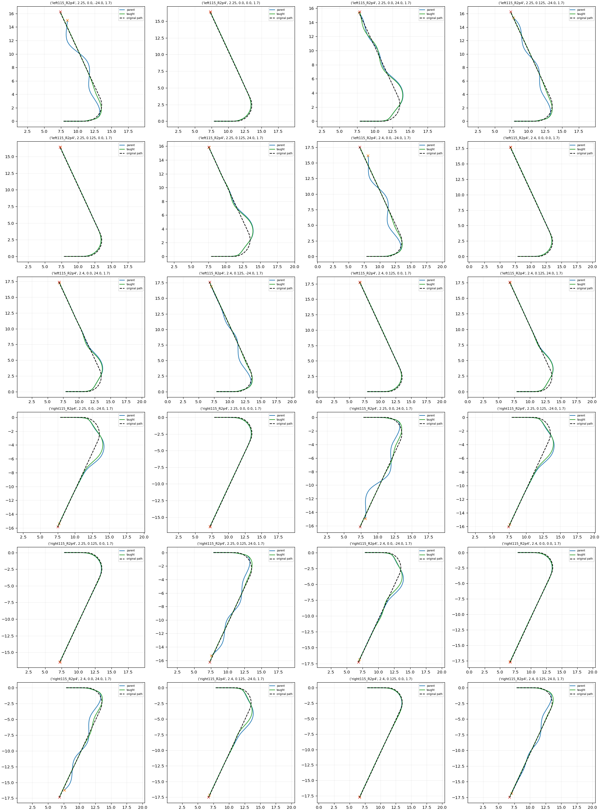

# Unmasked TRAIN rollout check

| Policy | Task /24 | Disturbed /16 | Nominal /8 | Working /24 | Domain |
|---|---:|---:|---:|---:|---:|
| parent | 17 | 9 | 8 | 15 | 0 |
| taught | 23 | 15 | 8 | 14 | 0 |

Paired task improvements: 6; regressions: 0.

Fixed final400 supervised actor, ordinary closed-loop interface. These contexts generated teaching data, so this is an execution sanity check, not held-out evaluation. No automatic adoption.
