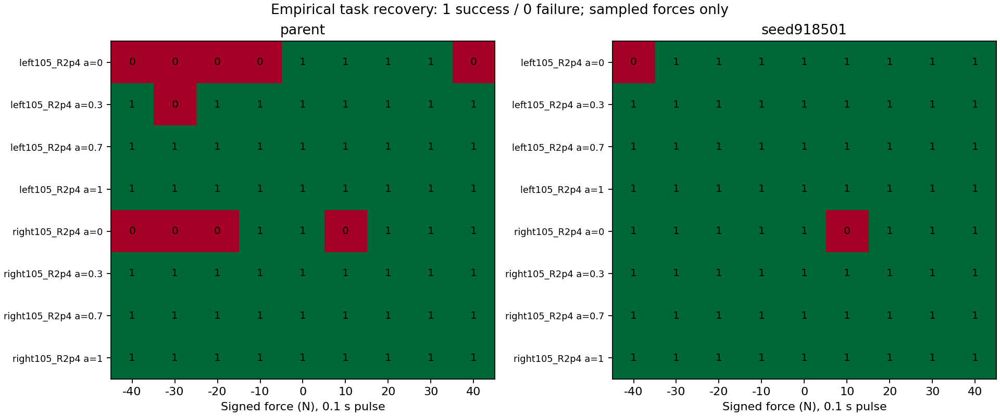

# 经验方向容扰度：首轮结果

固定父策略和教学主候选；新105°R2.4、v2.35、四α、左右弯、0±10±20±30±40N持续.1s。144/144完成，约244秒，285820实际lower ticks，0新训练。声明9566228，候选/物理/V3/原10s截止未变。

**任务成功parent62/72→candidate70/72，配对8改善0退化；域退出2→0。无扰各8/8。**

| α | parent任务/18 | candidate任务/18 | parent working | candidate working |
|---|---:|---:|---:|---:|
|0|9|16|6|7|
|0.3|17|18|8|8|
|0.7|18|18|8|7|
|1|18|18|7|7|

## 方向性例子与公式含义

- 左弯α0负方向：parent的10/20/30/40N均失败，candidate前三档成功、40N失败。
- 右弯α0负方向：parent仅10N成功，candidate四档全部成功。
- 右弯α0正方向：两策略都是10N失败、20/30/40N成功。
- parent左弯α.3负方向：10/20N成功、30N失败、40N又成功。

共3条策略—方向曲线存在失败后又成功。任务恢复不必随力幅单调，因此最大成功档不能代替连续容扰边界，直接二分也可能漏掉内部失败。analysis.json同时保存完整离散标签、首次失败档、此前全通过档和顶端删失；这些不是连续区间证明。

两策略在相同初态与任务请求运行，但起扰前由各自策略到达；每个策略自己的各力档共享完整前缀。此结果体现部署行为下的经验抗扰改善，不是同一个起扰状态下切换策略的因果能力上界。单快照确定性扫描限制保留。

## 对新路线的判断

容扰度作为经验评价有用：它具体指出改善集中在哪些α/方向，而不是只报总成功率。旧解析单阈值无法完整表示这些闭环非单调任务结果；这不等于其代数错误。后续若做预测，宜预测指定幅值/方向下的恢复或可救性，或者在局部可信区间定义余量，不应继续强迫全局单调边界。

首轮示范搜索在主16查询未优于均匀，不能把本轮候选改善归因于公式。新策略是实验前已固定的教学模型。本轮并未训练新策略。允许失败，保留正负结果，不自动扩力/扫参。

完整逐α轨迹、原V3奖励分项、轮速代理和真实速度、真实失败终点已由既有report工具生成于服务器full_report；文件SHA见report_manifest.json。原始轨迹SHA见trace_manifest.json。
