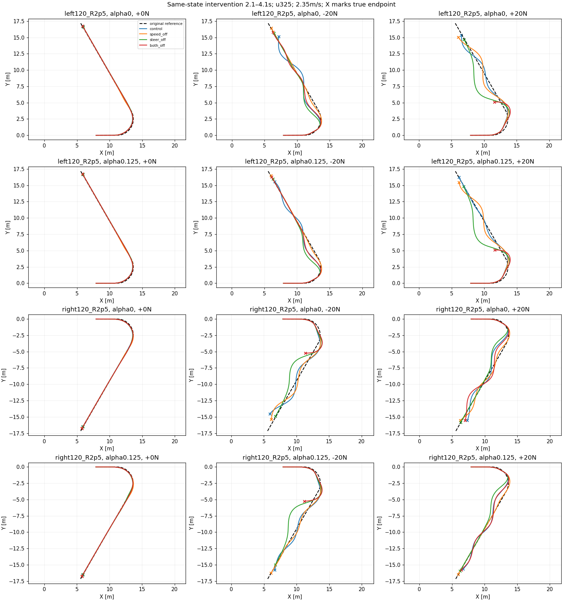

# 同状态有限干预：恢复协调诊断

48/48完成，92,024底层tick，290.71秒，0PPO。保持u325、原V3与local300，左右120°R2.5、2.35m/s、α0/.125、0±20N。2.1s相同完整状态分支，2.1–4.1s取消指定修正目标，经原滤波/变化率限制，随后恢复原策略到10s。四组各12例，其中4例无扰、8例有扰。

| 干预 | 全部任务 | 非零扰动任务 | 工作性能 | 域退出 | 相对control任务改善/退化 |
|---|---:|---:|---:|---:|---:|
| control | 5/12 | 1/8 | 5/12 | 0 | — |
| speed_off | 8/12 | 4/8 | 5/12 | 0 | 4/1 |
| steer_off | 8/12 | 4/8 | 4/12 | 0 | 4/1 |
| both_off | 5/12 | 1/8 | 4/12 | 4 | 1/1 |

全部无扰任务均4/4。没有记录物理摔倒，但both_off的4例域退出后物理时域未知。按相同状态配对，单通道干预有恢复改善也有退化；工作侧倾通过数没有一起提高，不能直接部署关掉修正的方案。

有效性：逐数组核对48条轨迹2.1s前的实际XY/速度/姿态/原始与修正指令与对应control完全相同；指定窗口的目标通道确实为0，4.1s后目标重新有非零输出。完整状态复制收据保留。control与此前同任务的成功标签一致，最大XY差约0.0245m，沿用已接受数值差异，不宣称逐位回放。12项CPU边界与兼容性检查已通过。

可支持结论：在这批失败工况中，改变一个中层修正通道能改变交回后的恢复成败，速度与转向修正的协调值得改进。两者同时取消更易域退出，不能把整个中层判为无用。不能据此唯一定位跟随器/网络/底层的根因，亦不说明在线改变α已验证。

下一步不扫描干预时长。优先设计含完整恢复尾段的训练：保持α和名义锚定，覆盖低速真实扰后状态，检验网络能否学到恢复期协调并在干预关闭的正常部署接口上提高任务表现。延长训练片段与增加状态覆盖若同时变化，应声明联合改变或拆开对照；4秒片段过短目前只是待检验假设。保留当前无扰偏好能力和原父策略，不以奖励曲线替代完整任务评价。

完整逐例与逐α配对见summary.json；全部逐步奖励/分项曲线由同run的analysis生成，渲染完成状态独立于仿真完成。
