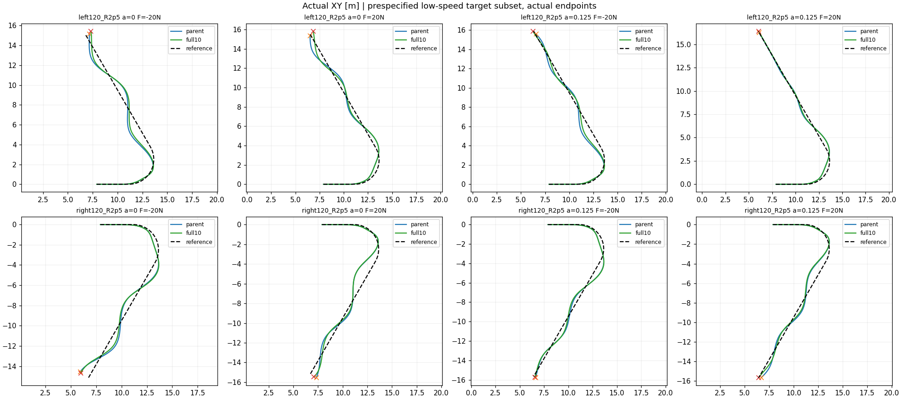

# 已知低速失败检查：完整尾段结果

60新例数值完成、120,000lower ticks，父策略60例认证复用，0PPO。全部任务parent/full10=53/52，working均26，domain均0。预声明2.35m/s、α0/.125、非零推力8例，两者均1/8；固定阈值下无新增恢复。

连续误差有所改善：左转α.125负向推力末段路径19.7→10.2cm；左转α0正向推力67.2→43.1cm；右转α0负向推力99.7→89.6cm。另有退化，逐例见continuous_review.json。完整尾段尚未解决小α的大幅偏离，不能把1/8相同解释为完全没有学习效果。唯一新丢失是2.75m/s、α1的末段路径10.02cm，约0.2mm越线，不作为实质恶化。

当前保留父u325作为参考，full10保留诊断候选，不直接替换。下一问题应是训练低速恢复状态覆盖是否不足：原320状态库未专门覆盖这里的低速宽角弯。下一轮从同一父策略出发，只改变TRAIN状态覆盖，保留完整尾段、V3/local300、名义锚定和固定α语义，与已有full10对照；使用不同训练路径/速度/起扰状态，禁止把这60个已观察案例直接当独立测试。先检查采样器和实际状态分布，再声明训练协议，不再扫描公式或单纯延长同一PPO。

本报告为开发诊断，详细图已生成；尚无独立种子或最终TEST结论。

[航向误差](matched_curves/path_heading_error.png) · [路径误差](matched_curves/path_cross_track.png) · [真实速度](matched_curves/actual_forward_speed.png) · [逐tick奖励](matched_curves/scored_tick_reward.png) · [累计奖励](matched_curves/cumulative.png) · [全部60例分项报告](analysis/REPORT.md)

补充：左转α.125负向推力虽然末段路径降至10.2cm，但末秒航向最大误差仍0.147rad，属于尚未完成恢复；不能只据路径接近阈值认定恢复成功。
