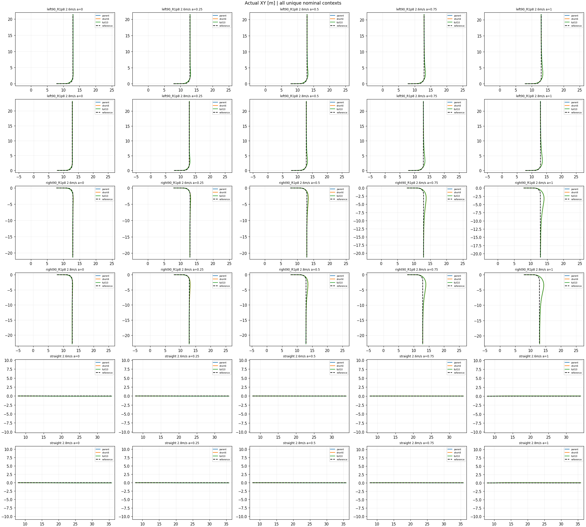

# 完整恢复尾段训练：标准面板数值复盘

[每个底层tick奖励](nominal_review/scored_tick_reward.png) · [累计奖励](nominal_review/cumulative.png)

固定final u27；父u325与旧4s uniform的820例认证复用，full10新410例完成，810,440新评测lower ticks。完整分项图仍由后台生成，本页只声明数值与名义同图已完成。单训练种子、开发面板，未采用候选。

| 策略 | 唯一无扰任务 | 中等扰动任务 | 强扰动任务 | 强扰动域退出 |
|---|---:|---:|---:|---:|
| 父u325 | 30/30 | 200/200 | 189/200 | 9 |
| short4 | 30/30 | 200/200 | 186/200 | 8 |
| full10 | 30/30 | 200/200 | 186/200 | 8 |

四个弯道/速度组合上，三策略的速度RMSE均随五个α严格递减。full10路径端点取舍方向4/4，但不代表各中间α路径RMSE单调；原始曲线数值见nominal_review/summary.json。full10无扰working29/30，唯一越线是已记录的约0.00136rad小侧倾超限。

强扰动full10相对父策略0新增3丢失，相对short4为1新增1丢失。父策略丢失的3例全是α1末段路径超10cm约4.9–8.3mm，速度航向恢复且通过目标，不作重大失控解释。中等面板working143/148/136，新增越线幅度见moderate/CONTINUOUS_REVIEW.md；不据严格计数单独否决。

本轮标准面板表现接近，未证明完整尾段提高抗扰。训练次数相同但full10扰动事件4016、short4为7589，尾段覆盖与事件数量存在取舍，训练事件数不是成功率。低速120°失败检查另在preference_full_tail_failure_check_v1运行，当前不据未完成结果下结论。
