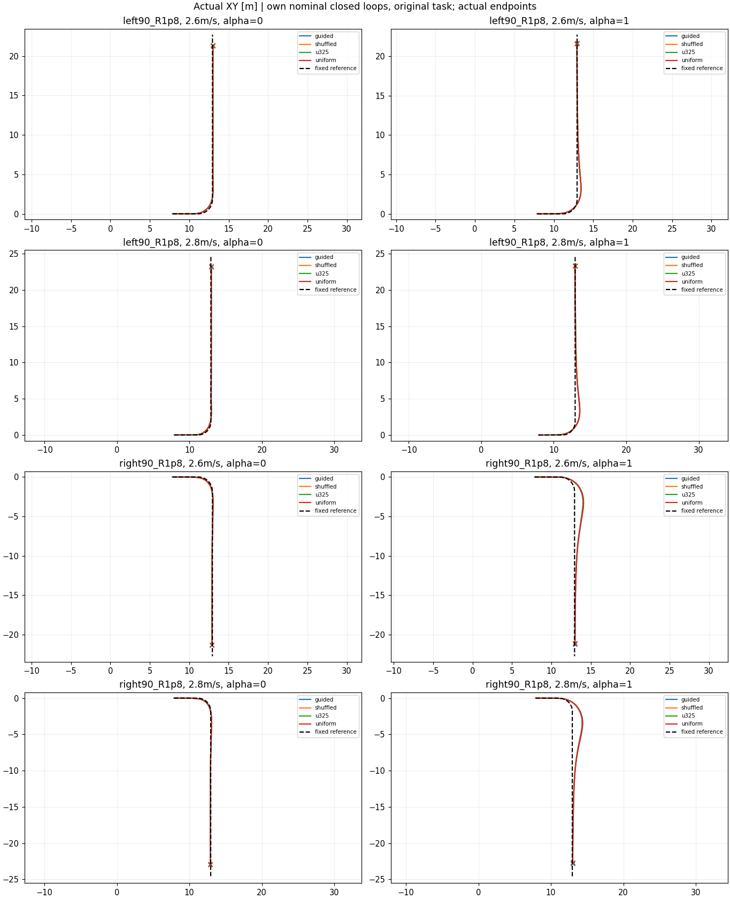

# 动态平衡约束下的可调偏好控制：任务层复盘

主问题来自台账STTW-CORE-OBJECTIVE：用户调α后获得速度—路径取舍，同时保持平衡和原始任务恢复。容扰度是需验证用途的组件。

## 无扰任务与偏好响应

| 策略 | 唯一名义任务 | 工作性能 | 速度端点改善的弯道数 | 路径端点改善的弯道数 |
|---|---:|---:|---:|---:|
| guided | 30/30 | 30/30 | 4/4 | 3/4 |
| shuffled | 30/30 | 30/30 | 4/4 | 4/4 |
| u325 | 30/30 | 30/30 | 4/4 | 3/4 |
| uniform | 30/30 | 30/30 | 4/4 | 4/4 |

各弯道/速度/α的连续RMSE及端点差值见summary.json；端点差符号不是新的硬门槛，小偏差保留原数值。

## 完整任务抗扰表现

| 面板 | 策略 | 任务恢复 | 工作性能 | 域退出 | 记录摔倒 | 完整时域物理存活未知 |
|---|---|---:|---:|---:|---:|---:|
| moderate | guided | 200/200 | 143 | 0 | 0 | 0 |
| moderate | shuffled | 200/200 | 146 | 0 | 0 | 0 |
| moderate | u325 | 200/200 | 143 | 0 | 0 | 0 |
| moderate | uniform | 200/200 | 148 | 0 | 0 | 0 |
| strong | guided | 189/200 | 65 | 9 | 0 | 9 |
| strong | shuffled | 191/200 | 67 | 7 | 0 | 7 |
| strong | u325 | 189/200 | 67 | 9 | 0 | 9 |
| strong | uniform | 186/200 | 66 | 8 | 0 | 8 |

## 容扰度的额外价值

逐α配对新增/退化全部保留在summary.json的matched_comparisons；必须同时比较uniform、guided和shuffled。训练回报或公式排序更好不能替代任务收益，不预设哪一种α更抗扰。

[实际逐tick奖励](nominal_reward.png) · [实际累计奖励](nominal_cumulative_reward.png)。只在相同α/奖励协议下比较模型；原始完整分项和受扰曲线保留在各panel/analysis。此页新增名义同图对照，不替代全部原面板。

单种子开发证据；在线α切换、独立场景/种子和最终测试未由本报告证明。候选采用仍待研究判断。
