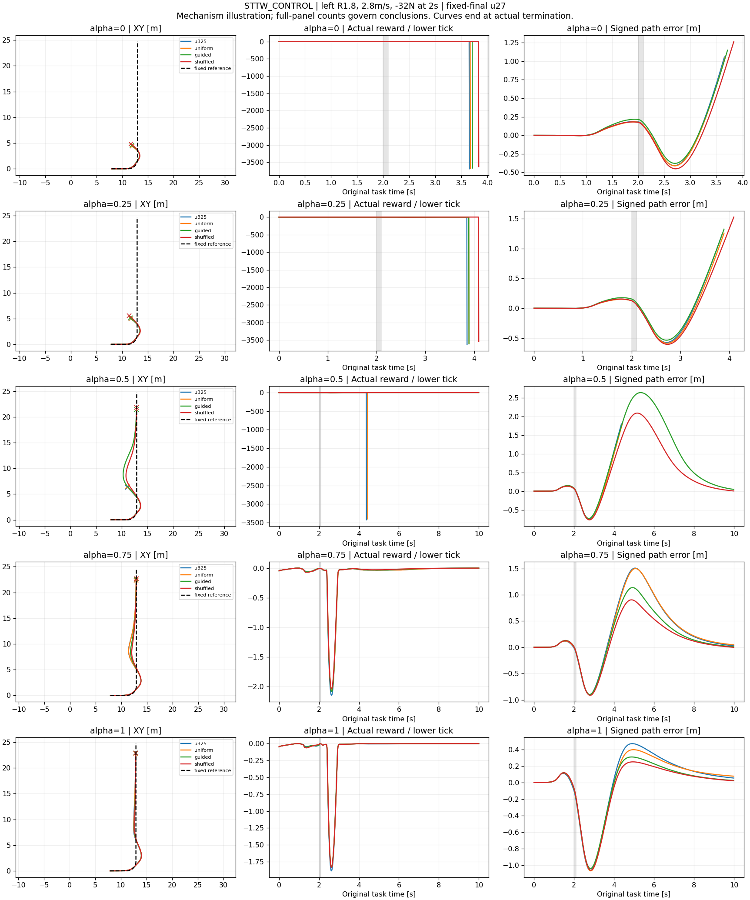

# 容扰度＋单网络偏好策略：科学审查（2026-10-23）

图为强扰动 left90/R1.8、2.8m/s、2秒施加−32N的机制示例，全部五个α同场景叠加四策略；不是全局优胜依据。原始参考固定，曲线到真实终止点截止，终止罚保留。[源文件与终点](strong_paired_xy_reward_sources.json)。完整面板报告保存在原运行的moderate/strong/analysis目录；本轮未另跑纯ECBC外力对照，u325是匹配父策略基线。

## 审查对象与结论

实际仓库为 STTW_CONTROL 的 tolerance-calibration worktree，分支 experiment/tolerance-calibration-20261022；不是 IDE 中的 RecoveryBridge/JIT。审查使用 scientific-critical-thinking 与 experimental-design 技能，核对源码、冻结声明、逐更新指标和完成的评测；下面的建议不是已经取得的结果。

**保留研究目标，保留冻结底层，暂不把物理引导认定为有效方法。** 目标应表述为：同一个中层策略保持 α 对速度—路径取舍的调节，在受扰后更可靠地完成原始任务；考察方向性物理余量能否提高训练样本的价值。公式不必精确，然而“保守”与“适合挑选训练难例”是两个不同性质，必须分别验证。

目前的关键问题不是再拟合几位小数，而是：模型接近边界的状态，对现有闭环策略是否真的具有学习价值？如果实际仍容易恢复，围着模型边界训练可能减少有效难例；如果几乎不可恢复，也会浪费样本。应以实测恢复结果和连续误差检查这个联系。

## 1. 问题、量与可证伪假设

| 层次 | 我们要回答什么 | 当前证据与边界 |
|---|---|---|
| 描述 | α 是否改变闭环速度和路径行为？ | u325 的固定 α 名义弯道行为支持可调偏好；不等于连续 α 插值、动态切换或 Pareto 最优。 |
| 预测 | 简化物理量能否指示方向性恢复困难？ | 余量内的完成率高，但余量外也大量完成；正例饱和不能验证排序或真实摔倒边界。 |
| 因果 | 用该量挑选状态是否比相同预算的普通采样更有用？ | 当前三臂试验直接检验；中等扰动结果尚无引导优势，强扰动与名义保留正在回收。 |
| 外推 | 效果能否跨训练种子、未见几何和 α 复现？ | 尚未完成；单个训练种子下的多个确定性工况不是独立训练重复。 |

可证伪主假设：固定父策略、训练预算、奖励和扰动档位后，真实余量引导相比 uniform 与 α 内打乱余量两种对照，提高完整任务恢复，同时保留名义任务与偏好行为。若只提高训练回报，或与打乱余量相当，不支持物理信息的增益。

## 2. 公式与控制解释

实现见 `learning/src/sttw_control/margin_state_sampling.py` 与 `tolerance_shaping.py`。不稳定坐标 z、有限时域 Gramian W、脉冲起点折算 K 组成线性近似下的控制努力判据，量纲与正负方向必须绑定当前动力学/力接口。

- E_b 是等效 L2 控制努力预算；不是电机峰值、闭环保证或严格物理可恢复集。γ 与 E_b 的旧校准可作为冻结先验，但对新速度、α 和闭环策略的可迁移性仍需检查。
- 模型中的控制输入及其自由选择，与当前中层实际能修改的速度/转角参考不是同一控制权限。冻结 ECBC、ESO、local300、滤波和速率限制后，解析最优控制不一定能被该策略实现。
- 以 r=|z+KF|/sqrt(E_b W) 接近 1 作为训练难度，是建模假设；不能从能量公式直接推出“成功率约一半”或“梯度最有价值”。
- 简化模型的保守性可以用于建议，但不能自动称为安全余量保证：跨工况仍可能存在预测可恢复、实际失败的反例。

这类不稳定分量与 capture-point 思路有共同的动力学基础，但车体侧倾/转向/ESO 坐标和人形位置 capture point 不是同一物理量，不能说二者公式完全等同。相关原始工作：[Pratt et al., Capture Point, 2006](https://usa.honda-ri.com/w/capture-point-a-step-toward-humanoid-push-recovery)。本次不是穷尽检索，不据此声称首次。

## 3. 当前三臂设计的优点与实际限制

统一使用真实单网 u325 完整权重和 Critic、V3、local300、原始10秒任务时钟、4秒恢复片段；各臂2次 Critic 预热＋25次 PPO，固定最终 u27。总计5,308,416策略转移，21,233,664底层控制 tick。无中途按 DEV 挑最好 checkpoint，无改奖励/输入/物理。

训练状态来自新320个完整真实前缀；不是评测快照回灌。随机数计数相同的 reset 下，精确 α、力档与启用标志一致；只有条件状态分布变化。打乱对照保留每个 α/力档内权重集合，有助于分离“非均匀采样”和“物理信息”的效果。这是相较旧 force-guided 试验的重要改进。

但仍有六个实际限制：

1. **独立实验单位是训练种子。** 当前每臂一个种子，只能作匹配开发试验；数百工况不是数百次独立算法重复。配对工况增减可描述固定面板差异，不能替代种子间不确定性。
2. **实际暴露不完全匹配。** 提前退出使 reset 次数不同；条件选状态还会改变路径族、相位与时间分布。这些是当前采样算法总效应的一部分，但不能进一步声称单独的物理状态特征有因果贡献。
3. **4秒片段存在后段信用分配风险。** 保留原始任务时钟和 timeout bootstrap 是正确处理；但训练最晚只直接看到约7.5秒，可能漏掉最终保持段的延迟振荡。完整10秒评测必需，不能用短片段回报代替。
4. **父 Critic 外推可能有偏。** 2次预热是工程选择，不是已证明足够。需观察恢复窗口/尾段价值误差，再决定是否改变；不能仅凭猜测增加特权输入。
5. **训练 α 只有五个取值。** 端点/内部占比约40/20/40，不能默认继承原连续偏好训练的插值表现；需要未训练 α 与动态切换检查。
6. **跨策略评测是各自前缀。** 这适合衡量完整闭环任务鲁棒性；不同策略在起扰时可能处于不同状态，不能解释为同一状态下恢复控制权限的纯对照。额外的同状态分支适合机制诊断，不应替代实际任务评测。

完整暴露审计见 [training_exposure_audit.json](training_exposure_audit.json)。三组均完成27次/25次PPO，实际接受400个 actor minibatch，各组训练没有记录物理摔倒。累计域退出 uniform/guided/shuffled=804/287/887；这不是同分布恢复率。实际触发脉冲=7589/7388/7610；引导更高的训练奖励与更少退出，可能来自更容易的状态分布，也可能来自学习，单看这些不能区分。

三臂 α 的实际 tick 占比接近但不完全相等；路径族占比变化更大。原始矩阵均保留，不通过重加权悄悄改变当前主估计目标。TensorBoard http://localhost:6008 三臂实际 train/mean_step_reward 均已核验到 step27。

## 4. 已完成的中等扰动结果

中等扰动面板：2方向弯道、2速度、5个 α、2起扰时刻、0/±8/±12N，10秒完整任务。每策略200例，父策略200例按完整身份复用，三个候选600例真实新评测完成。

| 策略 | 原始任务恢复 | 再加工作侧倾要求的性能达标 | 各 α 性能达标（每项/40） |
|---|---:|---:|---|
| u325 | 200/200 | 143/200 | 33,31,28,25,26 |
| uniform | 200/200 | 148/200 | 33,32,30,26,27 |
| guided | 200/200 | 144/200 | 33,32,28,25,26 |
| shuffled | 200/200 | 145/200 | 33,31,28,26,27 |

guided 相对 uniform 工作性能有1例改善、5例退化，净−4；任务恢复无差异。工作侧倾越线不是摔倒。零力重复工况不当作独立重复；本表是冻结面板计数，不能据此宣称统计显著或普遍劣势。来源：`runs/preference_recovery_post_v1/moderate/paired_results.json`。

该面板原始任务已饱和，所以更重要的是强扰动下9个域退出和2个末段保持失败是否改善，以及连续路径/姿态峰值、恢复时间、名义偏好是否保留。约厘米级阈值擦边保留原标签，同时报告连续误差，不因小误差暂停主线。

强扰动600例现已完成（新实际1,174,996底层tick，241.80秒）；原父策略200例按身份复用。全局报告生成与直线评测仍由原流水线接续：

| 策略 | 任务恢复/200 | 工作性能/200 | 域退出 | α=0/.25/.5/.75/1任务恢复（各/40） |
|---|---:|---:|---:|---|
| u325 | 189 | 67 | 9 | 35,38,38,39,39 |
| uniform | 186 | 66 | 8 | 35,38,38,38,37 |
| guided | 190 | 65 | 8 | 35,38,38,39,40 |
| shuffled | 193 | 68 | 5 | 35,39,39,40,40 |

没有记录物理摔倒；提前域退出后的完整时域存活仍不能推定。真实引导未胜过打乱对照，不采用为已验证改进。shuffled 只作为值得诊断的候选，不把看过结果的最好一组当作独立测试优胜者。

进一步推进的机制审计见 [margin_difficulty_diagnosis.json](margin_difficulty_diagnosis.json)。合并父策略两面板320个非零力工况，风险[0,1)、[1,1.5)、[1.5,2)、[2,3)、[3,∞)的任务失败为0/103、0/53、0/57、2/65、9/42。当前固定TRAIN题库的理论 enabled 抽样中，guided 将风险≥3的质量从uniform11.76%降到3.53%，shuffled则为13.51%；风险[1,1.5)由18.28%增到38.33%。这些量可由已有数据直接复算，不需新物理仿真。

**由此提出、尚未证实的机制解释：** 保守模型的边界与实际困难区间错位，引导削弱了较难区域的暴露。TRAIN和DEV是不同状态总体，上述两个分布不能直接拼成因果证据，也不能把看过DEV后选出的风险阈值2或3宣称为独立校准。后续应使用TRAIN自身同状态扰动结果检查排序/难度，再声明新的采样方案；避免只把target从1改成3并报告同一DEV面板上的最佳结果。

## 5. 对此前任务建议的判断

| 建议 | 审查意见与理由 |
|---|---|
| 短回合、完整状态起点 | 适合提高脉冲暴露；已实施。完整时钟、历史、ESO与末段任务评测不能丢。 |
| 50Hz外环无法瞬时抵消0.1秒冲击，所以应解冻底层 | 推论过强。外环仍可影响起扰状态与数秒恢复，是否权限不足要看同状态可实现动作的实测，不能仅看频率。当前无物理摔倒证据，不优先解冻。 |
| 第0步看不到随机力使任务无效 | 不成立。未知突发扰动下先验动作相同是合理部署条件；历史/ESO随后提供反馈。随机延迟会改变预备控制分布，不是无损修复。 |
| 特权 Critic 能降低方差 | 合理候选，非必然收益；需要独立对照、保持 Actor 部署输入与 checkpoint 兼容，先定位实际价值误差。 |
| 减小 KL、放宽姿态恢复时路径惩罚 | 可能有用，但当前三臂保持共同目标才能检验采样。实际400个 actor minibatch均执行，不能称 actor 被完全锁死。改奖励属于下一实验，不能归因为余量增益。 |
| 容扰度应立刻进奖励或在线切 α | 证据不足。当前先验证训练采样价值；在线改变 α 会改变用户偏好语义，需额外设计与单独评测。 |

## 6. 创新定位与继续推进的决策

偏好条件策略不是新概念：[Yang et al., NeurIPS 2019](https://arxiv.org/abs/1908.08342) 已研究跨偏好的统一表征。合适难度的自动课程也已有工作：[Florensa et al., ICML 2018](https://proceedings.mlr.press/v80/florensa18a.html)。本任务可能成立的贡献是：针对冻结底层的欠驱动车辆，利用方向性物理先验安排恢复状态训练，在不牺牲可部署偏好调节的条件下提高任务恢复效率；它需要实证，而不能靠组合术语成立。

下一步只保留三项：

1. **回收现有强扰动和直线评测。** 完成全10秒任务、名义30个唯一工况/策略、各 α 连续偏好比较；明确实际新增恢复、退化与域退出，不以训练回报作优胜依据。
2. **根据结果作一次机制判断。** 若 guided 在有区分度面板优于两个对照且名义保留，再做独立训练种子/未见路径确认。若相当或更差，先复用现有完整状态和失败例检查模型排序与实际困难的联系，候选是用实测困难校正采样；不反复微调 E_b 强求 guided 赢，也不立即扩展三组长训。
3. **补偏好泛化缺口。** 优先冻结候选检查未训练 α 与动态 α 变化的闭环任务；新的几何/时刻/α 面板必须执行前落声明，标明为开发验证，最终测试继续封存。若 nominal 已退化，先解决保留，再推进强扰动提升。

候选尚未采用；目标未完成。当前评测保持运行，不重启、不改中途协议。此审查收拢科学问题，并不撤销用户允许近似模型、小误差和全速推进的要求。

方法来源：本次采用的程序性审查技能出自 [Kassis et al., Scientific Agent Skills, 2026, arXiv v2](https://arxiv.org/abs/2609.00065v2)；已核对题名、作者与版本。该技能库不是本控制方法有效性的证据。
