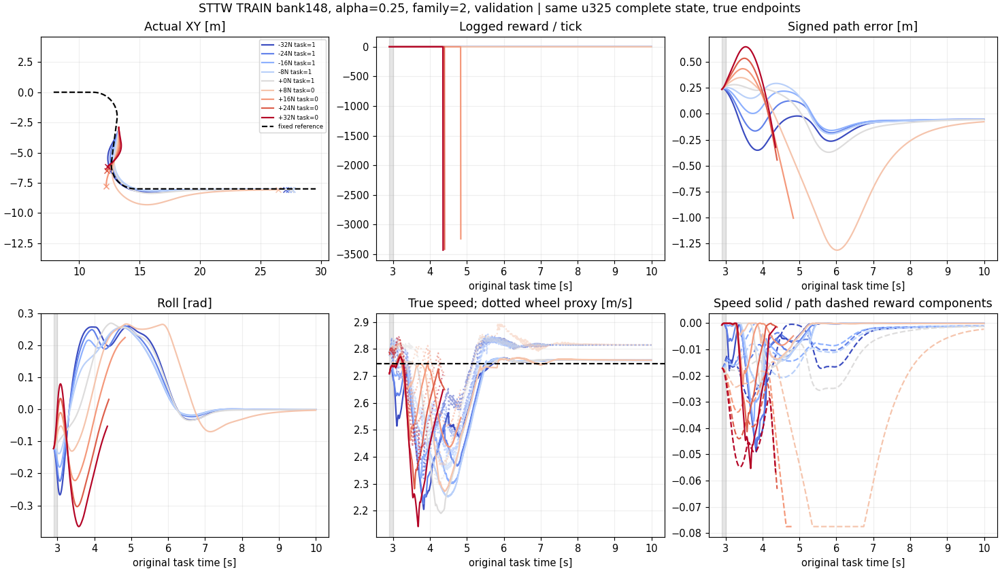

# 同状态TRAIN恢复难度：公式排序有用，训练关注区间需要校正

图示α=.25的检查状态148；−32到+32N与零力均从同一真实状态、同一u325接续。这里+8N风险约.973却未满足原始末段路径阈值（约.1205m），没有摔倒或域退出，保留为保守公式的反例，不将其说成物理危险。本例用于解释标签，不代替完整540例统计。

## 目的和实际执行

保留原始公式、V3、冻结local300、10秒任务截止和完整历史/ESO/滤波状态；不做PPO。60个完整TRAIN状态按5个α各随机12个选择，不看DEV结果或模型风险；每个状态0/±8/±16/±24/±32N、0.1秒，共540个真实分支。各α前8个校准、后4个检查，共40/20个状态。来源是原始u325前缀，后缀也是同一u325；并非新策略泛化验证。原题库已被上一轮三个学习器使用，不能称这些状态对它们未见。

已完成540/540，实际786,672底层tick（声明上限1,080,000），152.80秒，0PPO，工程故障无记录。完整任务恢复394/540，域退出52，无记录物理摔倒；域退出后的完整时域物理存活仍为UNKNOWN。中文STTW_CONTROL Bark完成通知有当前运行的accepted记录，无pending；通知接受不代表用户已经阅读。

## 首先分开名义失败与扰动损失

零力54/60完成原任务；另外6例没有域退出或摔倒，是末段路径保持不达标，偏差约.119–.412m。这些不算“脉冲造成的失败”。以下难度比较只使用零力本来完成的状态：校准35个、检查19个，分别280/152个非零分支。

| 状态划分 | 脉冲任务失败/非零分支 | 模型风险失败AUC | 仅推力大小失败AUC |
|---|---:|---:|---:|
| 校准 | 63/280 | .792 | .707 |
| 检查 | 31/152 | .854 | .748 |

AUC是固定状态面板上的描述性排序，多个力档共享同一状态，不是独立算法重复，也没有由此宣称统计显著。各α、每个状态和每例结果全部见[summary.json](summary.json)。α1校准的名义可行状态只有5个且非零任务全通过，AUC为null，不补造区分能力。

| 固定模型风险区间 | 校准任务失败/分支 | 检查任务失败/分支 |
|---|---:|---:|
| [0,1) | 1/61 | 1/32 |
| [1,2) | 14/99 | 3/51 |
| [2,3) | 27/82 | 16/51 |
| ≥3 | 21/38 | 11/18 |

在本面板上模型风险有难度排序信息，值得保留；但原来的risk≈1采样中心主要落在容易恢复区域。余量内的两个任务失败都是约12–13cm的末段偏差，没有域退出；不因这两个小误差否定物理思路，也不静默改原阈值。

## 对idea的更新

目标保持：冻结底层的单个α条件中层网络，在保留速度—路径偏好的同时提高受扰任务恢复。原解析量提供方向性先验；其数值边界不是实测闭环极限。

下一步候选是**校正采样难度尺度，保留原公式参数**。探索性建议关注风险2–3附近（例如target=2.5，bandwidth=.5），因为校准失败约1/3，仍有大量可恢复样本。该选择来自已查看的开发数据，不称预注册最优目标；检查数据已看过，不再称最终未见测试。不能通过把E_b调大后把新范围称为安全边界。

实现现在支持声明中的`state_sampler.target/bandwidth/strength/shuffle_seed`；旧声明缺省仍为1/.2/.7/918204。uniform在修改target/带宽后概率表保持不变，实际α、力档和原始完整状态继续匹配。相关测试通过，尚未启动新的PPO，不能称新采样已经有效。

新学习对照应比较相同父权重/预算/奖励下的uniform、校准尺度物理引导、α内打乱引导；关注任务新增/退化、域退出、恢复时间和正常偏好保留。原三臂负结果保留。是否复用已完成uniform必须先认证整个训练协议；不能仅因为名字相同复用。

## 数据与图

- [冻结运行manifest](manifest.json)、[完成状态](status.json)、[启动身份](launch.json)，collector提交da720b7。
- [α0](bank111.png)、[α.25](bank145.png)、[α.5](bank149.png)、[α.75](bank187.png)、[α1](bank250.png)：按冻结声明每12状态的首例选取，不据图挑选优胜。
- 全60状态×9力档图与完整索引在服务器：`runs/preference_train_difficulty_v1/analysis/INDEX.md`。覆盖60/60，原NPZ保留全部10个effective cost分项、实际逐tick奖励、原始XY/参考、速度与轮速代理。
- 远端为精简图样和完整逐例标量；原始NPZ与全图留服务器，未新跑纯ECBC对照。图中零力u325是匹配基线，不能称ECBC单独效果。

## 同状态方向信息补充（2026-10-23，事后离线诊断）

[等幅正负推力审计](directional_audit/REPORT.md)固定同一完整状态与力幅值，只比较两个方向结果不同的力对。calibration为39/51方向正确（多数方向基线37/51）；状态检查集29/29（多数方向基线16/29），分别来自23/13个状态。6个无扰已失败状态排除并显式记录。说明这批数据含方向预测信息；不证明安全认证、训练效用或独立重复。原guided未改善父策略的负结果不变；没有新增仿真或训练。
