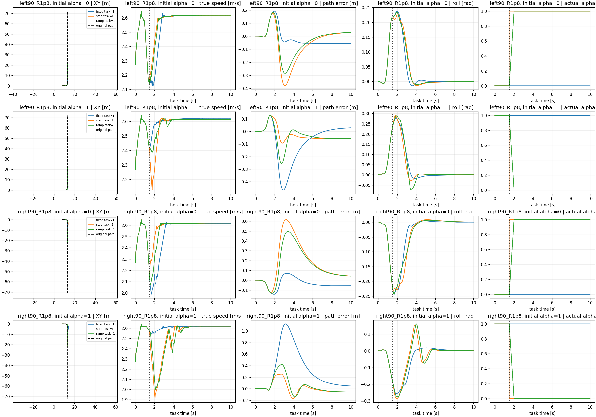

# Dynamic preference engineering check

Actual schedule verified for all12 cases; paired pre-switch maximum difference=6.67572e-06. Original path and speed retained. Fixed/step/ramp share full initial state; only alpha changes. Reward follows actual alpha; different schedules have different reward weights, so return is not a common performance ranking.

| route | initial alpha | mode | task | working | peak roll | post path RMSE | post speed RMSE |
|---|---:|---|---:|---:|---:|---:|---:|
| left90_R1p8 | 0.0 | fixed | 1 | 1 | 0.2378 | 0.0740 | 0.1336 |
| left90_R1p8 | 1.0 | fixed | 1 | 1 | 0.2783 | 0.1837 | 0.0311 |
| right90_R1p8 | 0.0 | fixed | 1 | 1 | 0.2438 | 0.0628 | 0.1801 |
| right90_R1p8 | 1.0 | fixed | 1 | 1 | 0.2580 | 0.5235 | 0.0192 |
| left90_R1p8 | 0.0 | step | 1 | 1 | 0.2292 | 0.1539 | 0.0812 |
| left90_R1p8 | 1.0 | step | 1 | 1 | 0.2908 | 0.0606 | 0.1033 |
| right90_R1p8 | 0.0 | step | 1 | 1 | 0.2305 | 0.2945 | 0.0704 |
| right90_R1p8 | 1.0 | step | 1 | 1 | 0.2867 | 0.1065 | 0.1952 |
| left90_R1p8 | 0.0 | ramp | 1 | 1 | 0.2341 | 0.1190 | 0.0948 |
| left90_R1p8 | 1.0 | ramp | 1 | 1 | 0.2887 | 0.0843 | 0.0532 |
| right90_R1p8 | 0.0 | ramp | 1 | 1 | 0.2419 | 0.2429 | 0.1192 |
| right90_R1p8 | 1.0 | ramp | 1 | 1 | 0.2761 | 0.1562 | 0.1854 |

Engineering evidence only. A small undisturbed panel cannot establish preference-switch novelty, robustness, or general superiority. Original raw reward components and speed proxy remain in saved NPZ files.
