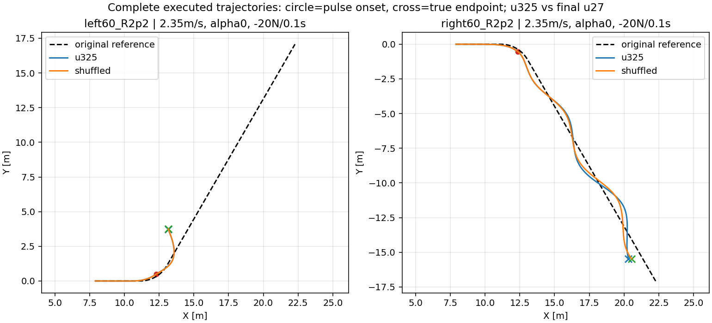

# 新几何下的偏好控制与恢复验证

240/240例完成，467,804底层tick，0PPO。固定父u325与校准训练shuffled最终u27；V3/local300/10s不变。新60°R2.2与120°R2.5、左右方向、速度2.35/2.75、α0/.125/.5/.875/1、0±20N、2s起扰0.1s。新增开发组合，与历史训练分布有重叠，不是最终测试。

| 面板 | 策略 | 无扰任务 | 全面板任务 | 工作性能 | 域退出 |
|---|---|---:|---:|---:|---:|
| 60°R2.2 | u325 | 20/20 | 51/60 | 43/60 | 5 |
| 60°R2.2 | shuffled | 20/20 | 52/60 | 44/60 | 5 |
| 120°R2.5 | u325 | 20/20 | 53/60 | 26/60 | 0 |
| 120°R2.5 | shuffled | 20/20 | 53/60 | 27/60 | 0 |

两策略各40/40无扰任务通过，8/8弯道/速度组合的速度RMSE随α增大严格下降；路径端点取舍方向各6/8，并非路径误差处处单调。见[完整逐α连续指标](completed_numeric_review.json)。α改变行为的证据与抗扰提升的证据分开。

120°失败集中在2.35m/s、α0/.125：到达目标后末段仍有明显路径/航向/速度误差。60°另有各5例域退出；退出后的完整时域物理存活未知，不能用无记录摔倒代替任务恢复。约11–12cm路径擦边单独看连续数值，不当作全部失败的解释。

[60°全部场景与α轨迹/奖励](angle60_R2p2/analysis/REPORT.md) · [120°全部场景与α轨迹/奖励](angle120_R2p5/analysis/REPORT.md) · [低速小α控制响应诊断](control_diagnosis/REPORT.md)。每面板48张PNG保留；原始NPZ、checkpoint与PDF留服务器，精简发布不重复二进制轨迹。

结论：偏好调节在这些新组合中保留；shuffled只有少量开发案例改善，不据此采用或声称训练方法优越。低速小α受扰后出现持续摆动，需要同状态控制干预辨别机制。容扰度引导的前一轮负结果保持，不再自动扫代理参数。接续48例机制诊断尚待结果，不能提前声称根因已确定。
