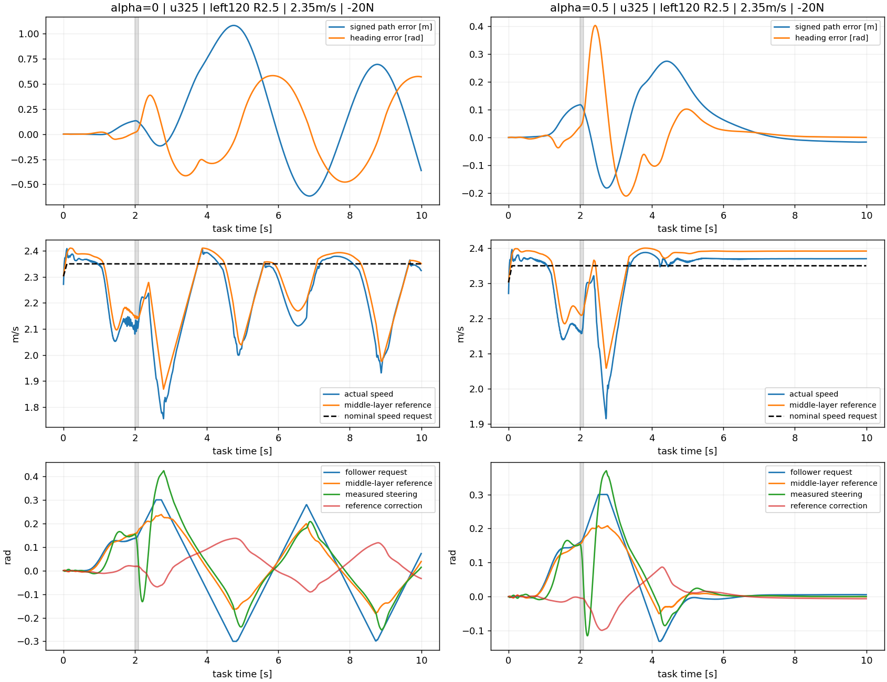

# 低速路径优先模式：受扰恢复诊断

数据来自已完成120°面板；没有新增仿真或训练。原始实际XY和终点在对应panel/analysis/curves中。

u325左120°、2.35m/s、−20N脉冲：α0在5–10s仍持续偏摆，路径RMS约0.497m，名义转向请求RMS约0.162rad，中层转向修正RMS约0.061rad；α0.5对应约0.058m、0.0052rad、0.0074rad。α0速度参考仍在1.976–2.393m/s变化。两者后半程参考转向达到±0.35rad硬边界的比例均0。

名义转向请求是根据实际偏差更新的跟随器输出，不是固定开环信号。因此不能从这些曲线单独判定跟随器、中层网络或底层哪一个造成振荡；也不能把参考未饱和推断为执行器永不饱和。保存的筛选轨迹缺少完整执行器限幅标志。

可支持的判断：无扰任务通过，低速小α受扰后出现持续恢复摆动；换成固定α0.5的另一次完整运行更易恢复。不能把不同α各自前缀视为同一扰后状态，也未验证在线切换。

下一步应以同一真实扰后完整状态做有限干预，分别检查原策略、暂时减弱中层转向修正、保持α不变的原名义控制；同时保留α0.5仅作另一控制选择的诊断。先明确干预窗口及恢复原策略后的完整任务口径，再启动小对照。该建议尚未实施，不能直接作为部署或声称根因已确定。后续训练应覆盖完整恢复尾段；4秒训练片段是否足以学习5–10秒衰减仍为待验证假设。
