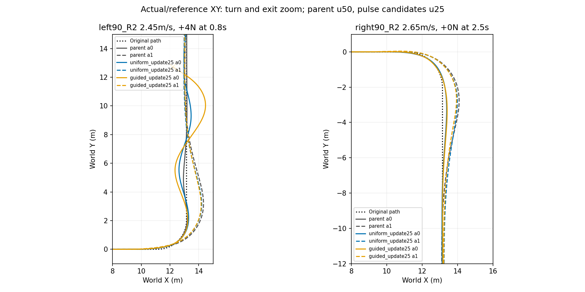

# 真实扰动训练对照：结果与研究判断

四组训练全部完成25轮，共6,553,600策略步。统一评测864/864例完成，用时929.43秒、3,429,092活动底层步；原始完整XY图共144张。parent是上一轮baseline u50，候选是本轮uniform/guided u25。两个独立α端点、同一冻结local300，使用历史任务奖励；没有混入单网络V3奖励。下述均为同一训练种子、已使用开发面板证据。

## 总体判断

容扰度引导采样没有带来一致优于均匀采样的抗扰收益。α0引导组减少工作侧倾超限，但增加跟踪域终止；α1引导组比均匀组的终端偏差更小、速度更好，但没有超过父模型的完整任务表现。当前候选不替换父模型，不延长同一训练。

| α | 模型 | 原始任务成功 | 实用恢复诊断 | 物理失败 | 跟踪域失败 |
|---|---|---:|---:|---:|---:|
| 0 | parent | 133/144 | 142/144 | 0 | 2 |
| 0 | uniform | 133/144 | 143/144 | 0 | 0 |
| 0 | guided | 133/144 | 134/144 | 0 | 10 |
| 1 | parent | 141/144 | 144/144 | 0 | 0 |
| 1 | uniform | 0/144 | 144/144 | 0 | 0 |
| 1 | guided | 72/144 | 144/144 | 0 | 0 |

实用诊断：完整20s、目标到达、无物理/域失败、末1s最大路径误差≤0.15m/航向≤0.05rad/速度≤0.1m/s、峰值侧倾≤0.33rad。它是允许小偏差后的敏感性分析，原始标签保留。无扰行在四个起扰时间分组中重复，不是16个独立初态。

## 为什么不能只看原始成功率

α0 uniform→guided有10例改善、10例退化，净成功数为0。工作侧倾失败10→3，但跟踪域失败0→10；guided主要问题集中在左转早期受扰后的出弯/回线。所有案例都到达过目标截面，不能据此忽略后续跟踪失败。uniform也有1例虽跑满20s但最终路径误差约1.83m，已保留为失败。

α1 uniform的末1s路径偏差0.1130–0.1396m，guided为0.0927–0.1138m，parent为0.0402–0.0503m。原10cm阈值使uniform全失败、guided一半通过；uniform/guided的末段速度误差分别≤0.0349/0.0233m/s，航向≤0.0011rad。按用户接受的小误差，两者都能恢复到实用要求。不能把72 vs0理解为72例避免摔倒，所有组物理失败均0。

完整轨迹逐例RMSE均值（存在α0提前终止时长差异）：α1 guided相对uniform路径0.2380 vs0.2567m、速度0.0330 vs0.0410m/s，均更好；相对parent路径0.2656m更好、速度0.0302m/s稍差，末段偏差也更大。这是任务取舍变化，不是所有维度优胜。

## 扣除各自无扰行为后，扰动响应是否改善

各模型与自身同场景零外力轨迹作同一时刻相减，统计起扰后2s RMS；每端点128个非零力上下文，三模型都具有完整有效窗口。包含进度差异，不能当成同一状态的因果策略比较。后续提前终止仍保留在完整任务结果中。

| α | 模型 | 侧倾增量RMS(rad) | 路径增量RMS(m) | 速度增量RMS(m/s) |
|---|---|---:|---:|---:|
| 0 | parent | .02329 | .04790 | .03311 |
| 0 | uniform | .02369 | .05063 | .03603 |
| 0 | guided | .02483 | .05631 | .04772 |
| 1 | parent | .01879 | .05090 | .00659 |
| 1 | uniform | .01923 | .04919 | .00767 |
| 1 | guided | .01941 | .04953 | .00697 |

α0 guided相对uniform侧倾增量约增加4.8%、路径11.2%、速度32.4%，没有抗扰优势。α1侧倾/路径非常接近，guided速度增量约小9.2%，这是局部有利信号，但不足以覆盖α0退化或支撑广泛鲁棒性结论。guided的α0侧倾峰值p95下降，也不能抵消其路径域失败；提前终止影响整体峰值分布。

## 训练分布与公式的关系

uniform/guided α0平均绝对推力4.9499/5.0563N、脉冲958/960次；α1为4.9591/5.1744N、978/969次。引导改变了采样，但总体力度分布变化较温和；边际分布接近不能证明状态条件引导完全无效。四组无代理无效回退、训练无物理失败。当前结果也不能区分代理排序不准、引导较弱、任务保持不足等解释，更不能推出公式推导错误。

## 下一步

1. 保留父模型与单网络update325开发候选，不采用本轮guided替换现有模型。此次负/混合结果和完整成本保留，不再盲目延长相同25轮实验。
2. 当前优先问题是“扰动训练后怎样保住正常任务和回线”，尤其α0出弯域退出；α1厘米级偏差允许接受，不为变绿另训。可在新的独立协议中从update325及其V3奖励起步，先验证真实脉冲下的任务保持，再以相同父模型、奖励和交互量比较均匀/引导。架构、奖励与回合时长变化必须明示；该实验尚未启动，也不回溯解释本次结果。
3. 容扰度保留作物理解释与训练采样假设；只有新比较显示实际收益，才追加独立种子/新场景验证。现阶段论文可报告推导、局部验证及两种集成尝试，不能声称已证明容扰度引导训练更强。

[机器可读诊断](diagnostics.json)保留全部864例与原始标签；[汇总](FINAL_SUMMARY.json)。原始轨迹留服务器。未新增训练或仿真，本次分析只读取保存结果。
