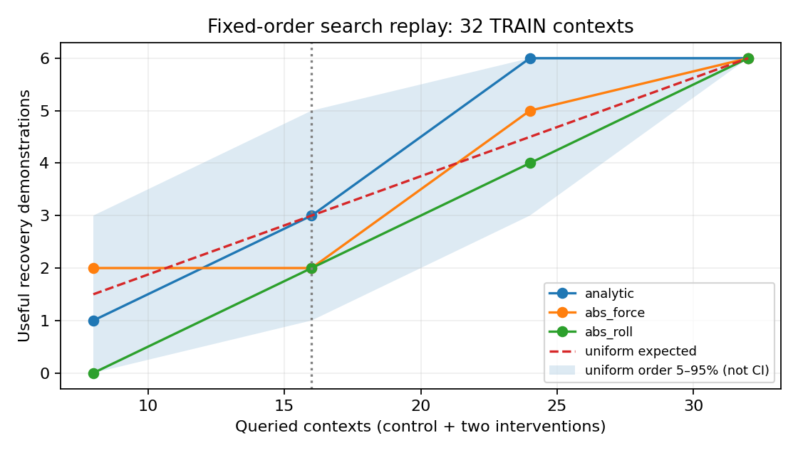

# 容扰度辅助示范搜索：首轮结果

120/120条轨迹完成，约300秒，198264实际lower ticks（上限240000），0训练更新。固定声明d96697b，所有起扰前prefix_valid；原u325/V3/local300未变。执行和排序协议见DESIGN及declaration，逐例results与analysis一并保存。

| 三臂（各40例） | 完成任务 | 相对control改善/退化 | 域退出 | working | 无扰任务 |
|---|---:|---:|---:|---:|---:|
| control |21|0/0|14|15|8/8|
| speed_off |27|6/0|7|16|8/8|
| steer_off |13|0/8|16|11|8/8|

六个speed_off改善均满足预声明有效示范条件（原失败、干预后成功、无域/物理失败且原回报增加）。这证明新的TRAIN工况中存在可利用示范，不等于新网络已学会，也不证明全局关闭速度修正有益。此前面板有反例，不能遗忘。

| 查询上下文数 | 容扰度排序 | 均匀期望 | 力幅排序 | 侧倾排序 |
|---|---:|---:|---:|---:|
|8|1|1.5|2|0|
|**16（主比较）**|**3**|**3.0**|**2**|**2**|
|24|6|4.5|5|4|
|32|6|6|6|6|

主要结果：预声明16查询没有优于均匀期望；24查询找到全部6个是次要正向信号，不替代主比较。均匀1000随机顺序在16查询的5–95%范围为1–5个，不能当独立物理样本置信区间。32上下文同初态、仅8个路径/速度/α起扰状态，不能把32当独立环境重复。

全部预测风险1.848–4.738，六个有效示范风险2.60–4.74。旧“risk≤1”在此不区分样本，而排序仍有变化。这说明旧绝对尺度不能直接解释为真实安全界；本轮未重拟合参数。高风险不等于可获得有用示范，因为还需要干预真的救回来。

成本：所有120条穷举轨迹全部计费。曲线是冻结顺序下的查询回放，并未实际只花16次查询成本；每次查询指一个上下文的control+两干预。无扰8×3条是anchors，不进入32非零上下文排序。

决定：保留六个新TRAIN恢复见证与容扰度主比较无增益结果，不宣布公式搜索有效，不自动扫γ/Eb。下一阶段若继续融合，应区分“容易失败”和“存在可学救法”，优先评估固定闭环任务余量或可救性信号；保留普通采样对照。现有候选不改变，本次没有新增教学或部署。
