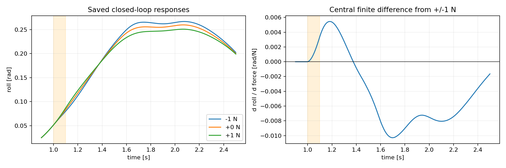

# Boundary verification and closed-loop response audit — 2026-10-22

[All seven boundary cases: original-reference XY and roll](../../../runs/boundary_focus_v1/xy_and_roll.png)

Frozen Coverage u200 endpoints plus frozen local300. Evaluation only; no training or model changes. Original data remain unchanged. Boundary panel completed 7/7, 26600 new lower ticks plus 8 preflight ticks. Bark completion has an accepted delivery receipt.

## Boundary result

For alpha0, left90_R2, requested speed 2.6 m/s, onset 1 s, rightward force lasting 0.1 s:

| Force magnitude N | Peak absolute roll rad | Result |
|---|---|---|
| 0 | 0.259789 | pass |
| 4 | 0.291745 | pass |
| 4.5 | 0.295691 | pass |
| 5 | 0.299756 | pass |
| 5.5 | 0.303587 | working-roll failure |

Working threshold is 0.302 rad. The 5.5 N case still reaches the goal and satisfies final hold; no physical fall or domain failure occurred. This is a sampled transition bracket, not proof of continuous success below 5 N or a precise boundary. Zero-force rerun roll matches the saved baseline exactly.

Prior 1 N secant predicted 4.721686 N; 0.25 and 0.5 N probes predict 4.602745 and 4.638139 N. All are conservative for this state. The original prediction matches 3/4 newly tested large amplitudes and incorrectly rejects 5 N. Small-probe consistency does not establish boundary accuracy.

## Completed next step: trajectory-level sensitivity

Saved trajectories support a central finite difference S_j(t) = [y_j(t,+1 N)-y_j(t,-1 N)]/(2 N). Use y_hat_j(t,F)=y_j(t,0)+F S_j(t). For direction sigma and signed constraint side s in {-1,+1}, the first linear constraint contact is

    mu_sigma = min_(j,t,s: s*sigma*S_j(t)>0) [L_j-s*y_j(t,0)]/[s*sigma*S_j(t)].

This requires a nominal trajectory satisfying the included constraints. Roll uses the full sampled trajectory; speed error, cross-track error and heading error use the last second. Bounds beyond the sampled force range are unvalidated extrapolations. This formula does not certify unsampled physics substeps, goal attainment, physical/domain failure or controller faults.

The alpha0/t1 negative-direction prediction is 4.579456 N. On 28 amplitude checks across the original six DEV snapshots, 27 agree, one conservatively rejects an actual success (5 N), and zero predict success for an observed failure. There are only TWO failed cases, both from the SAME state; this is post-hoc development analysis, not independent validation or a reliable safety-error estimate. Classification did not improve over the previous secant approach.

At alpha0/t1, central roll sensitivity is +0.003402 rad/N at 1.1 s, -0.003884 at 1.5 s, and -0.009382 at 1.78 s. All six snapshots have positive response at pulse end and negative response 0.5 s after onset. Thus the immediate roll response alone cannot determine the later limiting direction. The observation is verified; attributing it specifically to a particular controller component would require an ablation. No force-sign correction is justified by these data.

The Gramian/effort-budget theory is not yet calibrated to force in N. The trajectory predictor above is a separate empirical approximation of the fixed closed loop; its results must not be presented as validation of the full theoretical formula or optimal-control attainability of the learned policy.

## Next bounded validation protocol (not launched)

1. Freeze both empirical predictors before a new right90_R2 panel. Same frozen endpoints, 2.6 m/s, onset 1 s, 0.1 s pulse, original 20 s deadline. Per endpoint: 0, +/-0.5 N probes and +/-4, +/-6 N validation; 14 cases, 56000 lower ticks plus preflight. Produce predictions from probes before reading large-amplitude outcomes. No retraining or policy switching.
2. Report each constraint, direction, failed case and false-safe/conservative prediction separately. If all large-amplitude cases pass, report censoring and do not automatically widen force or claim boundary accuracy.
3. Only after cross-state validation, decide whether to identify the force map and effort budget of the model formula, or retain it as a mechanistic feature. Deployment/switching and training remain unvalidated.

Reproduce: run analyze_tolerance_response.py with --root pointing to the tolerance-calibration worktree and --out pointing to a NEW output directory, using the mujoco_playground Python environment. No simulator is invoked.
