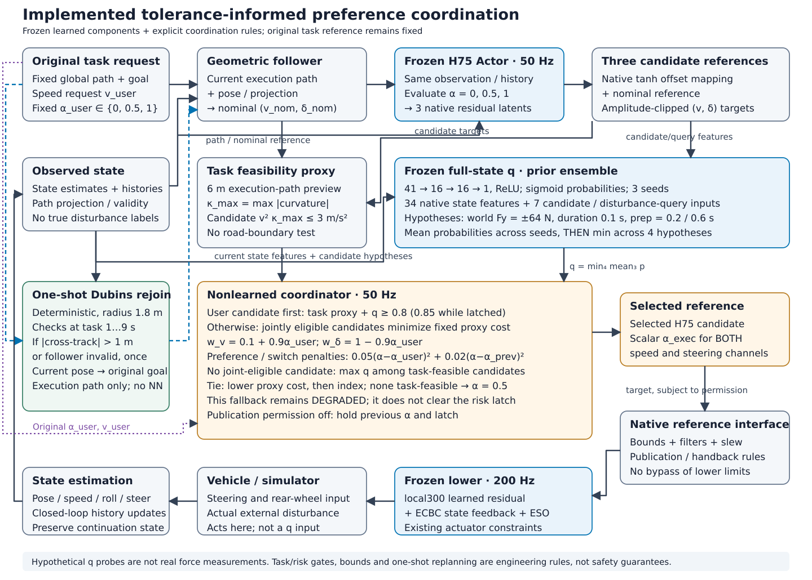

# 冻结底层单轨机器人的偏好条件参考控制与闭环抗扰表现

**Preference Conditioned Reference Control and Closed Loop Disturbance Response of a Single Track Robot with a Frozen Lower Controller**

> 内部研究主稿，证据截止2026-10-28，目标期刊为IEEE Transactions on Control Systems Technology（TCST），非投稿就绪。人类作者核验及最终独立验证尚未完成。当前性能证据见E087–E228，开发机制试验与前瞻冻结确认分开报告。历史试验与反例保留于[EVIDENCE_DETAILS.md](EVIDENCE_DETAILS.md)及各节源报告。

## 摘要

本文研究冻结底层单轨机器人如何在有限参考权限内暂时偏离用户偏好、完成原任务并恢复偏好执行。当前原型冻结ECBC、ESO、local300及偏好条件H75网络，以41维输入、16→16 ReLU容扰MLP评价三个执行α候选，由非学习协调器结合任务代理、风险门和原参考滤波作选择；原世界目标不变，必要时共同执行一次因果Dubins重规划。当前仅验证回合内固定的用户α∈{0,0.5,1}，不宣称连续任意偏好能力。完整状态接续试验提供了准备时间改变真实触地结局的局部证据；在72个相关开发回合中，只改退化规则恢复原方案丢失的9个目标到达并保留其余63个。冻结候选的200回合前瞻确认中，三个用户下候选与guard均18/20到达、无触地；固定用户1为9/20到达且2例触地，速度支持则19/20到达且无触地。候选用户1的共同窗口任务费用比guard低约1.1%，但用户0/0.5的开发费用优势未复现，最终用户执行18/18/20也未超过guard。匹配训练条件的在线输入消融复用原全特征轨迹，新增60个速度＋查询模型回合；全特征最终执行用户为18/18/20，对照为13/0/15，但两者到达和触地计数相同，且全特征共同首达前成本均值略高。结果支持有边界的偏好协调用途，不证明容扰MLP必要性、全面优越性或安全保证，尚无实车证据。[E099–E101,E173–E174,E191–E208,E222–E227]

## 1 研究问题与相邻方法

研究问题是：用户的路径—速度偏好怎样改变动态平衡机器人完成任务和承受扰动的表现；在不重训底层、只允许有限参考修正时，这些变化能否带来可重复且有实际意义的任务与抗扰改善？用户alpha始终不变，任务目标始终是原世界坐标目的地。这里不要求策略无敌，也不以一次成功或比弱父策略好就认定方法创新。

本文已实现冻结H75、学习容扰评价器与非学习协调器组成的在线原型；尚未成立的是评价器相对强简单对照的必要性、分布外可靠性及安全保证。本文的可核对象是有限参考权限下的偏好偏离—任务完成—恢复机制及其闭环后果：配对开发试验恢复了特定条件的目标到达，前瞻冻结确认提供了有限效用差异，同时保留返回、费用和简单对照更强的反例。结构元件本身不列为新算法，原型已实现也不等于已验证可部署。[E191–E208]

偏好条件多目标控制[1,6,7]、恢复预测与任务调度[8]、参考治理及预测安全过滤[2,9–11]已有直接近邻；自行车学习控制亦非空白[3]。分层、冻结底层或加入alpha本身不足以支持首次性。区别必须落实为真实可执行参考权限下的具体控制后果，并由强对照支持；既有理论中的模型误差、终端集或稳定性前提尚未在本系统建立，不能借用其安全保证。定向阅读范围及出版方访问限制完整保留于证据明细，不冒系统综述或同条件复现。[E035,E049,E061]

## 2 当前系统与协调方法

### 2.1 冻结控制链与有限参考权限



图1：当前原型。实线为实际参考与控制链，假设查询不是真实外力输入；中途接续保留完整闭环状态。图示表示实现关系，不构成安全保证。历史扩展接口与普通目标学习支路另存证据明细。[E017–E018,E173–E174,E191]

原始空间路径p(s)、速度请求和世界目标在回合开始时给定。跟随器产生名义参考r₀=[v₀,δ₀]。冻结H75读取351维观测（16帧×20字段、16个有效掩码、15个上下文），分别以a∈{0,0.5,1}查询两维latent zₐ。回合内固定用户u与实际执行a不同：u定义原任务权重及优先恢复对象，临时改变a不重写u。底层为ECBC、ESO及冻结local300残差；底层自身lower_alpha不随中层变量改变。中层50Hz、底层200Hz，每底层tick含25物理子步。[E008,E017–E018,E191]

候选首先按原接口映射并裁剪到参考边界，再参与任务代理和代价计算；数值边界来自冻结接口配置。[E200]

```text
r_a = clip_reference(r_0 + native_offsets(z_a),
                     speed=[1.5, 3.5] m/s, steer=[-0.35, 0.35] rad)
native_offsets(z) = [tanh(z_v) × (0.25 if z_v ≥ 0 else 1.0),
                     tanh(z_δ) × 0.2]     [m/s, rad]
r_command = native_publish(original_filter/slew/bounds(r_a_exec), permission)
```

这些是参考目标而非自由执行器动作。原publication mask、滤波、slew与约束继续作用，实际输出还依赖物理、ESO、历史和执行器状态。共同的一次因果Dubins重规划根据测得任务偏离更新执行路径，保留原世界goal和原路径评分；不将改路后的执行路径误作原用户任务。[E017–E018,E182,E191,E197–E199]

### 2.2 容扰评价与任务代理

监督标签从同一完整闭环快照克隆分支，执行候选a准备τ秒，再施加假设脉冲；窗口从源时刻至脉冲结束后3秒。整窗无触地/物理失败为y=1，准备期失败亦为0；故障或未完整观察且无已知失败者无效。输入仅取源时刻最新观测和初始候选查询，不含完整隐藏carry或未来结果。按来源bank分训练/开发各192条（early72、oldlate24、userlate96），均为DEV。组内均权，BCE组总权重为0.75/0.125/0.125；排序只配同源、同准备、同方向的正负候选。三seed全批量AdamW，学习率/权重衰减均0.001，各1000步固定last；无PPO或按DEV重选。[E164–E166,E173–E174,E177]

```text
loss = sum_g w_g mean_i∈g BCEWithLogits(l_i, y_i)
     + 0.5 mean_(+,−)∈P softplus(−(l_+ − l_−))
```

小型MLP为41→16→16→1，隐层ReLU，输出sigmoid概率。34个当前观测字段加7个候选/假设查询字段，不等于完整闭环Markov状态。查询字段包含候选a、两通道H75偏移和四个固定扰动假设：准备0.2/0.6秒×世界Y正负64N，持续0.1秒。各seed先输出概率，三seed概率取均值，然后对四假设取最小值：

```text
q_a = min_h mean_seed sigmoid(f_seed(x, a, h))
kappa_max = max |curvature| on execution path over next 6 m
M_a = [v_a² × kappa_max ≤ 3 m/s²]
L_a = (0.1+0.9u) ((v_a-v_request)/(1 m/s))²
    + (1-0.9u) ((δ_a-δ_nominal)/(0.2 rad))²
    + 0.05(a-u)² + 0.02(a-a_previous)²
```

M是几何任务代理，L是选择用代理，均不是实测原任务总成本。它们使用已裁剪的候选目标。q评价的是已声明事件合同中的无触地标签；控制器不读取实际外力、精确起扰或撤销标签，也不能把q当作校准于任意环境的安全概率。[E173–E174,E191]

### 2.3 用户优先、滞回与退化选择

permission开启时，先检查用户候选。未锁存时要求Mᵤ且qᵤ≥0.8，已偏离锁存时恢复门提高至0.85。通过则选择u并清除锁存；否则在Mₐ且qₐ≥0.8的非用户候选中最小化L。若没有联合可行候选，当前任务感知退化规则在M为真的候选中优先最高q、再最小L及索引，仍标记degraded；若M也全部为空，则退化至0.5。permission关闭时保持前一执行a和锁存，继续遵守原生参考发布条件。[E173–E174,E191]

“实际执行用户a”和“通过自身q/M/permission恢复门”分别记录。退化也可能选择用户候选，故前者不蕴含后者；后者也只是自身模型诊断。guard保留任务代理与用户优先但不以q作决策，fixed保持固定候选，速度支持改变实际参考而非只改变a；不能用事后q分数把这些对照判为不安全。[E191–E208]

## 3 评价合同、数据角色与可比窗口

### 3.1 原任务、物理结局与偏好执行

近期在线主比较均采用10秒观察、用户u∈{0,0.5,1}回合内固定。目标到达是在首次触地或故障前，实际XY首入原世界目标1米圆；同tick触地不计入。不要求终端速度或保持，完整观察不会因首达提前结束。分别报告到达且全窗无触地、未到达但无触地、到达后触地、未到达且触地，并单列未知和故障。早期原生域停止、20秒接续及不同半径合同只按各自历史协议解释，不混入本组分母。[E182,E191,E200–E208]

偏好报告实际a的时序、最终是否等于u及首达前执行u的时间；通过恢复门另作模型依赖诊断。最终执行u在方法间可比，guard/fixed的事后q合格计数不作为共享安全指标。到达不是跟踪全部合格，无触地也不等于避障安全。[E193–E208]

### 3.2 原路径重评分与共同观察窗口

历史原路/改路实验没有跨所有奖励版本通用的完整Jᵤ。近期72与200比较已建立独立逐步original_task_rescoring：使用不可变原始路径、原速度请求和固定u，从实际轨迹重建速度、横向位置、航向三项运行成本，核对有限值、投影和日志一致性；执行路径奖励保留为另一诊断。这里的三项成本不是完整奖励、终端罚或全部任务成功的替代。[E197–E199,E205–E208]

每个相同条件在声明的方法集合中取共同实际观察窗，并另取共同首达前窗口；物理失败时在真实终点截断。只在同u、同方法集合和同窗口内比较。新增方法会改变共同窗口，因此开发四方法、五方法与确认三/四方法的数值不能直接跨表作增益。同条轨迹可按不同u重评分，但不增加物理样本或构成换u后的闭环反事实。每步与累计奖励、分项及误差曲线均保留，累计数不能代替时序。[E197–E208]

### 3.3 同状态标签与数据独立性

完整中途接续包括物理、ESO、历史、FIFO、参考滤波、投影、时钟与适用随机状态。克隆同一状态再改变候选回答局部干预问题；不同u完整回合形成的状态差异回答进入过程问题，不能互相替代。标签按声明的准备、脉冲和观察窗区分无触地、触地、未知，离散已测成功档不证明连续安全集合或通用牛顿阈值。[E099–E101,E165–E167]

预测器拟合和本文开发指标同属DEV；三优化seed不是独立物理祖先。后段样本全部为正例，不能单独证明失败识别。200回合冻结确认在执行前固定模型、阈值和协议，不据结果重选；其bank未用于当前预测器拟合，但相关prepared状态曾出现于研究，不能称全历史未见TEST。历史144评分更与训练后段祖先相关，只作回顾核查。[E168–E181,E200–E221]

## 4 三个研究问题的证据

### 4.1 参考执行的准备时间是否改变物理结局？


图2：bank3左右紧S，世界Y−64N、1.6–1.7秒，H75 u77；全H10实际XY在真实触地处停止，星号为原目标，虚线为执行接回路径。保留右侧救援与左侧任务反例；其余条件仍见完整索引。[E100–E103]

完整状态接续在右急弯来源中比较了固定执行和提前切换：固定a=1发生真实触地，提前0.6秒执行a=0.5则无触地且到达；到起扰时才切换仍触地。左弯来源提前切换也有丢失目标的反例。它说明有限参考干预必须经过滤波和闭环演化，准备时序能改变局部物理结局，不能把即时目标变化当即时控制权限，更不能据一个来源推广普遍恢复能力。[E099–E101]

原生H75已具有路径—速度偏好功能，但固定中点和简单参考支持在若干条件更强；早期普通目标学习及解析代理也未建立全面优势。各来源的配对XY、时序、费用、失败和全部分母保留在证据明细的原4.1–4.14及源报告。本节仅用接续证据确定预测标签应包含准备时间，不以历史支路叠加形成当前方法有效性的证明。[E001,E062–E063,E087–E101]

### 4.2 状态信息能否改善有限合同下的容扰预测？

后段同状态192分支来自16个来源、3候选、2准备和2方向，全部无触地，暴露旧q对实际可执行后段的保守拒绝。其正例不能说明负例识别。随后以同一192训练/192开发视图、三seed各1000步固定last训练；均匀混合降低后段拒绝却使早期DEV Brier从0.09354恶化至0.12708，并新增2/8触地误放。预声明先验权重early/oldlate/userlate=0.75/0.125/0.125后，ensemble恢复早期0/8误放并在userlate为0/32拒绝；各seed早期仍为2/8、2/8、0/8，不是每个seed均通过。[E165–E181]

同容量输入消融保留索引4、34–40，其余输入置零；语料、初值、三seed、固定1000步last一致，全特征prior直接复用。它是“速度＋候选查询”而非纯速度模型：候选H75偏移间接携带全状态，查询还有世界力方向。下表均为冻结三seed均值，误放表示触地负例被接受，拒绝表示无触地正例被拒。[E209–E221]

|数据角色与指标|全41维|速度＋查询mask|
|---|---:|---:|
|early DEV Brier / logloss|0.098247 / 0.421885|0.103460 / 0.326699|
|early DEV，0.8门误放|0/8|0/8|
|userlate DEV Brier|0.00001717|0.052178|
|userlate DEV，0.85门拒绝|0/32|5/32|
|历史144回顾 Brier / logloss|0.011151 / 0.042313|0.034099 / 0.122787|
|历史144，0.8门误放 / 拒绝|0/30 / 3/114|2/30 / 9/114|
|历史144，0.85门误放 / 拒绝|0/30 / 4/114|2/30 / 10/114|

表1：DEV与回顾样本不合并为独立测试。early两模型均4/4不一致候选对排序正确，回顾均12/12，排序相同仍可有不同门误差。回顾全特征各seed均0/30误放，mask各seed均2/30；回顾来源为bank2/5，其后段祖先参与训练/开发。[E210–E221]

三个mask seed的userlate DEV Brier均从200到1000步恶化（0.02745→0.05187、0.02443→0.05272、0.03556→0.06093），尽管训练loss下降；全特征prior的早期DEV同样存在非单调恶化。不能称已收敛、建议任意续训或事后挑checkpoint。附加状态在这些合同下减少后段保守拒绝，早期logloss却有相反方向，对应的匹配在线输入消融见第4.3节，其收益限于偏好执行，不能从离线门误差推断在线目标或成本必然改善。完整各seed、各期曲线见[消融报告](/media/qy/6A7E3DB07E3D75C3/STTW_CONTROL_archives/tolerance_calibration_disk_recovery_20261025/h75_tolerance_speed_query_ablation_v1/README.md)。[E173–E181,E210–E221]

### 4.3 在线任务完成、偏好返回与费用怎样取舍？


图3：冻结确认的反例，bank1右90度弯、用户1、世界Y−64N于1.6–1.7秒；同图给出各方法实际XY、原始与执行参考及真实终点。候选与guard均未到达；该图不代表全部条件，完整60任务窗/60全程/20跨用户XY索引保留。[E202–E208]

开发72条件中，更新prior后每用户仅21/24到达，而旧last及guard均24/24，所有方法无触地。同输入核查发现一例prior拒绝唯一任务可行候选，旧固定中点退化却违反任务代理；这支持检查协调规则，不证明单个决策足以解释全条失败。固定同一prior、只改任务感知退化后，三个用户均24/24到达，恢复9个丢失目标并保留63个成功。但最终执行用户为22/22/24，低于prior的23/24/24；用户0.5首达前执行用户时间4.8427秒也低于prior的6.6340秒（各自首达窗口不同，只作描述）。[E182–E199]

|开发DEV：共同首达前三项成本|用户0|用户0.5|用户1|
|---|---:|---:|---:|
|任务感知候选|67.38052|53.15118|40.35684|
|guard|70.26416|54.60926|35.39828|
|旧last|75.02704|54.39316|35.67622|
|prior旧退化|88.21411|58.07860|28.47760|
|fixed|63.87818|57.45505|11.81857|

表2：24条件/用户，五方法共同窗口，越低仅表示这三项运行成本较低。任务感知恢复目标但用户1成本高于guard/prior；fixed用户0也是强对照。不跨用户比较成本。[E197–E199]

冻结确认另执行200条全新物理轨迹，覆盖bank1/7、左右急弯、名义或1.6/3.4秒世界Y±64N事件；每用户20条件，用户1另含速度支持。模型、阈值和规则冻结，无优化或事后选择。实际396885个底层步、264.985秒，少于400000槽位来自fixed1两例早期触地。[E200–E208]

|冻结确认方法|用户0：到达/20；触地|用户0.5：到达/20；触地|用户1：到达/20；触地|
|---|---:|---:|---:|
|任务感知候选|18；0|18；0|18；0|
|guard|18；0|18；0|18；0|
|fixed|17；0|18；0|9；2|
|速度支持|不适用|不适用|19；0|

表3：候选和guard均丢失bank1左右弯1.6秒−64N的相同两条件；速度支持的唯一失达在bank7右弯3.4秒−64N，不能据总体计数宣称逐条件支配。fixed0与候选为3得2失，不能隐去候选反例。候选最终执行用户18/18/20，guard各20/20。[E202–E208]

|冻结确认：共同首达前三项成本|用户0（三方法）|用户0.5（三方法）|用户1（四方法）|
|---|---:|---:|---:|
|任务感知候选|71.30799|68.56085|52.96105|
|guard|66.63877|65.84723|53.55692|
|fixed|63.30466|72.36139|19.88798|
|速度支持|不适用|不适用|98.65594|

表4：用户1候选相对guard约低1.1%，用户0/0.5开发成本优势没有复现。fixed1早失败截短共同窗口，其低成本不是性能胜出。不同用户的方法集合不同，亦不可跨列作排名。[E205–E208]

完整确认覆盖60张全程XY、60张任务窗XY、20张跨用户XY，以及所有声明条件的逐步/累计奖励、误差和原任务重评分，见[确认分析索引](/media/qy/6A7E3DB07E3D75C3/STTW_CONTROL_archives/tolerance_calibration_disk_recovery_20261025/h75_frozen_confirmation200_v1/analysis/README.md)。候选与guard行为在多数条件不同，但状态随之分化，不能把在线差异直接当同状态输入因果消融。确认支持有限取舍及强简单对照的必要性，不证明学习门不可替代。[E202–E208]

在上述已见条件上，进一步固定控制链、任务感知协调规则、训练语料/容量/初值/seed/步数，仅替换为匹配训练的速度＋查询q模型。它是分别训练后的信息消融，不是相同权重的即时输入删除。全特征200条封存轨迹复用，mask新增60条物理回合，实际120000底层步、280.919秒、18次重规划、0优化；分析共260条记录，包含60个full/mask配对。相关历史条件已用于研究，不能把该消融另称新holdout。[E209–E216,E222–E224]


图4：bank1右弯、用户1、3.4秒+64N的全程实际XY；task_aware为全特征，speed_query为匹配mask，另保留guard/fixed/速度支持及原路径。两模型均6.25秒首达，最终偏好执行不同；该例也保留费用取舍，不能代替全部60配对。[E224–E227]

|匹配在线输入消融：full / mask|用户0|用户0.5|用户1|
|---|---:|---:|---:|
|原目标到达|18/20 / 18/20|18/20 / 18/20|18/20 / 18/20|
|最终执行用户|18/20 / 13/20|18/20 / 0/20|20/20 / 15/20|
|full最终执行用户的配对得/失|5/0|18/0|5/0|
|共同首达前执行用户时间，秒|2.41050 / 1.59100|5.65325 / 5.33325|1.70675 / 0.45400|
|共同首达前三项成本均值|79.65435 / 78.95502|68.64081 / 67.38472|56.51101 / 56.29942|
|共同10秒三项成本均值|88.79084 / 91.04778|74.12426 / 74.16920|57.86399 / 57.58635|

表5：每用户20条件、两个模型专属共同窗口；与表4多方法窗口不同，原200数值未变。两模型均无触地/故障，同样丢失bank1左右弯1.6秒−64N两条件，故没有新增到达或触地改善。full最终用户执行更好，但首达前成本均值三个用户均略高；完整10秒成本方向也不统一。不同u成本仍不可互相排名。[E224–E227]

全特征用户0.5的最终18/20与mask的0/20不表示mask首达前从未执行用户。最终差异可能在到达后形成，时间总量亦不能证明首次返回更早。保留的反例为bank1左弯、用户0.5、1.6秒+64N：full最终执行用户、mask最终为0，但full更晚到达（6.31比6.19秒），同一6.19秒窗口的用户执行5.27比5.35秒、原任务成本75.9887比64.7108。另一用户1实例两者均6.25秒到达，full首达前用户执行1.47比0.06秒，成本却59.2180比57.8421。全部20条件的[执行α时序](/media/qy/6A7E3DB07E3D75C3/STTW_CONTROL_archives/tolerance_calibration_disk_recovery_20261025/h75_speed_query_online60_v1/alpha_time_comparison/INDEX.md)逐步保留原用户线、实际执行、各方法首达和真实观察终点。[E228] 完整[配对摘要与全部条件索引](/media/qy/6A7E3DB07E3D75C3/STTW_CONTROL_archives/tolerance_calibration_disk_recovery_20261025/h75_speed_query_online60_v1/root_pair_summary.md)保留60张全程XY、60张任务窗XY、20张跨用户XY及逐步/累计奖励、误差和原任务重评分。该结果支持全状态信息对这组在线偏好执行有作用，未证明普遍必要性或目标/成本支配；默认全特征冻结方案保留，无新调参或在线采用变化。[E224–E227]

## 5 讨论与结论边界

本研究形成了可执行且可核查的偏好协调原型：在冻结底层和有限参考权限下，显式区分原用户、执行候选、任务代理、风险评价及原目标。完整状态接续说明准备时间在局部条件改变物理结局；开发闭环比较说明退化规则可恢复特定目标损失；冻结确认则约束了收益范围，保留guard同等到达、速度支持更高到达和若干更低成本反例。两类证据不能拼接成通用防摔定理。[E099–E101,E191–E208]

容扰预测器必要性尚未建立。全特征减少部分后段保守拒绝，真实负例回顾也优于匹配mask，但样本祖先相关、失败稀少、训练与开发同属DEV。匹配在线输入消融现已显示最终用户执行的局部收益，同时保留相同目标/触地结局及首达前成本均值略高的反面证据。前瞻确认用户1仅有局部成本优势，用户0/0.5开发优势未复现；最终偏好执行和目标到达也非同一指标。保留这一有限用途比将q或限幅解释为安全保证更符合证据。[E200–E227]

当前仅验证三个离散且回合内固定的用户偏好，未验证任意连续或动态用户变化、实机部署和分布外可靠性。几何任务代理、有限假设取最小和概率门均有工程假设；旧解析能量式只作解释，不能转换为全过程安全阈值。未来研究判断应以冻结证据及强对照为约束，不用无限调阈值、续训或挑扰动使方法占优。[E080–E081,E191–E221]

## 6 证据可追溯性与稿件状态

全部E编号对应[evidence_manifest.json](evidence_manifest.json)中的源路径和身份。原主稿逐次4.1–4.28、普通目标学习支路、历史图与解析式及全部反例已原文保存在[EVIDENCE_DETAILS.md](EVIDENCE_DETAILS.md)的2026-10-28快照；它是证据附录，唯一主稿仍为本文，唯一研究事实与下一步仍由共享台账维护。原始报告提供全部条件和曲线，不以本文压缩表替代其完整分母。[E001–E228]

本次重组只使用封存产物，不新增仿真、训练、阈值选择或统计检验。当前为中文内部研究草稿，不声称满足英文期刊投稿语言、篇幅或摘要格式要求。AI产物核验不等于人类作者核验；人类最终核验、作者/资助/伦理及审批事实仍未记录，不由仿真或AI审查代填。稿件保持非投稿就绪。

## 参考与流程软件

[1] Preference-Conditioned Multi-Objective RL for Integrated Command Tracking and Force Compliance in Humanoid Locomotion. [arXiv:2510.10851](https://arxiv.org/abs/2510.10851)。原文方法与瞬时扰动评价段落已作AI核对，人类作者核验未记录；未借其硬件结果为本项目背书。

[2] Bencatel, R., Girard, A., and Kolmanovsky, I. Reference Governor Strategies for Vehicle Rollover Avoidance. [arXiv:1608.02266](https://arxiv.org/abs/1608.02266)。相邻汽车防侧翻任务不等于本项目单轨闭环。

[3] Fahmi, S., Ilvonen, A., Zapolsky, S., et al. Bicycle Acrobatics with Reinforcement Learning. [arXiv:2608.00880v1](https://arxiv.org/abs/2608.00880), 2026。已读控制循环、动作/PD式与编排/随机化选段，不以硬件或任务不同单独推首次性。

[4] Kassis, T., Agarwal, V., He, Y., Patel, D., and Brueckner, A. M. (2026). Scientific Agent Skills: A Library of Procedural Knowledge for Research Agents. [DOI](https://doi.org/10.48550/arXiv.2609.00065)。scientific-brainstorming、scientific-writing与scientific-visualization用于证据/叙事/图表核对；流程工具不是控制有效性证据。当前arXiv v2书目已核，非人工同行评审。

[5] Sakai, A., et al. PythonRobotics, Dubins path planner. [Pinned source](https://github.com/AtsushiSakai/PythonRobotics/tree/8c392897c7f41a6e4d9aab9cb2e9737a7a6fa031/PathPlanning/DubinsPath), MIT license. 本项目仅复用其规划实现，不将源码依赖本身列为创新。

[6] Mousa, A., Rachman, R., Karavis, N., Caprio, M., and Allmendinger, R. PROMO: Preference-conditioned Multi-Objective Reinforcement Learning for Quadrupedal Robots. [arXiv:2610.01260v1](https://arxiv.org/abs/2610.01260)，2026。预印本，非已核录用记录。

[7] Li, H., Wang, D., Wang, X., Liu, X., Liu, P., Bai, C., and Li, X. PCHC: Enabling Preference Conditioned Humanoid Control via Multi-Objective Reinforcement Learning. [arXiv:2603.24047v1](https://arxiv.org/abs/2603.24047)，2026。预印本。

[8] Mahajan, I., Chen, C., Dümbgen, F., and Plancher, B. RAYA: Learning Where and When to Intervene for Robot Recovery. [arXiv:2609.21690v1](https://arxiv.org/abs/2609.21690)，2026。预印本。

[9] Garone, E., and Nicotra, M. Explicit Reference Governor for Continuous Time Nonlinear Systems Subject to Convex Constraints. [arXiv:1406.1738v1](https://arxiv.org/abs/1406.1738), 2014。核对该原始版本II/III，不冒称读过最终期刊版。

[10] Wabersich, K. P., and Zeilinger, M. N. A predictive safety filter for learning-based control of constrained nonlinear dynamical systems. [arXiv:1812.05506v4](https://arxiv.org/abs/1812.05506), 2021。对应[DOI](https://doi.org/10.1016/j.automatica.2021.109597)出版社正文本轮不可访问，实际读arXiv方法版。

[11] Ayubirad, M., and Ossareh, H. R. A Machine Learning-Based Reference Governor for Nonlinear Systems With Application to Automotive Fuel Cells. [arXiv:2410.03894v2](https://arxiv.org/abs/2410.03894), 2025；[DOI](https://doi.org/10.1109/TCST.2025.3579514)。v2报告TCST录用；IEEE页面受验证限制，未核出版社全文。

[12] Zheng, Q., Tian, Y., Deng, Y., Zhu, X., Chen, Z., and Liang, B. Reinforcement Learning-Based Control of Single-Track Two-Wheeled Robots in Narrow Terrain. Actuators, 12(3), 109, 2023. [DOI](https://doi.org/10.3390/act12030109)。本次实际读取出版页检索返回的方法选段/元数据，直接全文入口受限。

[13] Liu, M., Chen, Z., Li, C., and Liang, B. A Novel Gradient-based Motion Planning for Single-Track Two-wheeled Robots in Complex Environments. IEEE VTC Spring, 2024. [官方论文PDF](https://ieeevtc.org/vtc2024spring/DATA/PID2024002005.pdf)。实际读II/III选定方法节，不冒称冻结学习闭环侧倾保证。

[14] Zhang, M., Feng, Z., Zhang, X., Chen, X., Li, D., and Xiao, X. Composite safety control for non-coaxial two-wheeled robot with geometry-enhanced multi-step control barrier function. Control Engineering Practice, 168, 106732, 2026. [DOI](https://doi.org/10.1016/j.conengprac.2025.106732)。作者/卷年由Crossref核对；本次仅出版页摘要层面核对，未核完整假设。

[15] Schwab, A. L., and Kooijman, J. D. G. Controllability of a bicycle. The Proceedings of the Asian Conference on Multibody Dynamics, 2010, session58786. [DOI](https://doi.org/10.1299/jsmeacmd.2010.5._58786-1_)。本轮仅核出版页摘要及元数据；Whipple-like模型与本文三状态近似不同，不搬用其保证。
