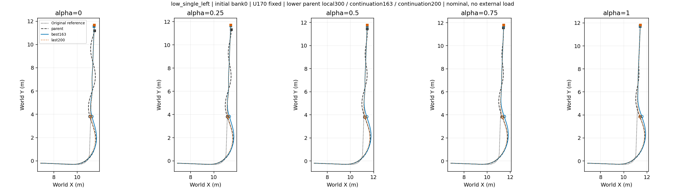
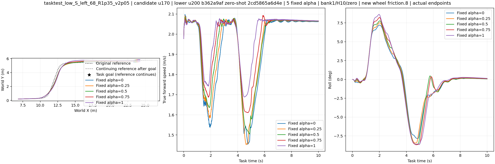

# Task-Specified Path–Speed Preference Control for a Single-Track Robot

Internal working manuscript, 2026-11-01. **Not submission ready.** The nominal and first frozen task-score panels have been checked against saved artifacts; a tuned conventional comparator, independent domain/initial-state validation, human verification and final declarations remain outstanding. The earlier predictor-led draft is preserved in [the dated history](history/20261101_preference_coordinator_snapshot/MANUSCRIPT.md). The current PDF and HTML are generated from this source for local review.

## Abstract

Path tracking and speed regulation can conflict during a turn on a balancing single-track robot. We study one shared preference-conditioned middle controller that adjusts speed and steering references while a frozen lower controller handles local tracking and balance. A task specifies one of five preference values before execution. In a 40-episode nominal development panel, all preferences reached the original destination and survived 10 s; mean turn speed rose from 2.115 to 2.295 m/s as original-path cross-track RMSE rose from 0.173 to 0.328 m between endpoint preferences. A second prospective 40-episode task-design panel preserved 40/40 arrivals and survival. In a subsequent frozen task-score panel on new route–speed combinations, all 40 episodes again reached the goal and survived; preassigned path-priority alpha=0 met a buffered narrow-passage score in 2/8 contexts versus 4/8 for fixed alpha=0.5, while speed-priority alpha=1 met a wide speed-preserving score in 3/8 versus 2/8. The shared controller therefore produces a repeatable path–speed response, but these first task results do not yet show a consistent task-completion advantage over the fixed compromise. A tuned conventional comparator and independent domain validation are the remaining tests for an application-level claim.

## 1 Introduction

A single-track two-wheel robot must coordinate steering, forward motion, and balance. On a demanding turn, a strict path objective may require reducing speed, whereas holding speed may increase the lateral excursion or prevent the original destination from being reached. An autonomous controller should expose these consequences to the task, rather than treat every request as the same tracking problem. The application question in this paper is whether **one shared controller** can produce useful behavior for two different, predeclared priorities under the same vehicle, lower controller and actuator limits.

Huo et al. [R1] studied a different bicycle-control problem: path tracking at a controlled 4 m/s in PyBullet. Their hierarchy separates attitude and position control and adds residual reinforcement learning to traditional control at both levels. Their published abstract reports improvements in path tracking and training behavior. This prior work means that hierarchy and residual learning alone cannot be our novelty. Our proposed distinction is **task-specified path–speed execution**: the same middle policy changes both reference channels in response to a user preference, while the original path and destination remain the evaluation targets. The complete Huo article's numerical tables have not been independently verified in this draft; no quantitative cross-paper comparison is made.

The controller is already trained. We therefore do not propose a new reinforcement-learning algorithm or a learned selector of the best preference. The evidence needed for a control-applications claim is more specific: first, that the preference controls a reproducible path–speed tradeoff; second, that preassigning different preferences helps complete distinct spatial and speed tasks; and third, that this effect survives fair comparison with a tuned simple rule and held-out operating conditions. The first proposition has repeated nominal evidence. A first frozen task-score panel gives mixed outcomes; the tuned-rule and independent-domain comparisons remain open.

The intended contributions, conditional on those pending tests, are (i) a task formulation that scores both original-path geometry and requested speed, (ii) a shared conditional middle controller that jointly adjusts speed and steering references while reusing one lower controller, and (iii) task-level evidence separating narrow-corridor passage from a wide-corridor, speed-preserving turn. These are control-application contributions, not claims of a new learning algorithm, formal stability guarantee or universal benefit of any particular preference value.

## 2 Control system and preference objective

### 2.1 Frozen controller and original task

The evaluated middle policy is STTW_MIDDLE_H75_LOW_SPEED_MIXED_U170. It was selected from a continuation of H75 training; the selected checkpoint is update 170, whereas the continuation ran through update 202. The lower policy is STTW_LOCAL_DOMAIN_U200. The middle controller runs at 50 Hz and produces bounded speed and steering-reference corrections. The lower ECBC/ESO plus local residual stack runs at 200 Hz. A deterministic causal geometric reconnection process runs at 10 Hz. Both wheel friction coefficients are 0.8 in the evaluated MuJoCo model. The evaluated task window is 10 s. The fixed original destination is a 1 m disk for the legacy nominal panel. These details and identities are recorded in the [experiment package](../results/sttw-tolerance-20261101/README.md) and [lower-selection record](../results/sttw-tolerance-20261101/lower_base/selection.json).

The original world-frame path, speed request and destination define what the user asked for. If the vehicle departs and receives a reconnecting execution path, task scoring still uses the original geometry and original destination. First entry into the destination disk, sustained post-turn tracking, full-window upright survival and speed tracking are separate quantities. The legacy first-entry measure has no stop, terminal heading or hold requirement; it must not be called complete path tracking.

The user chooses alpha from the evaluated set {0, 0.25, 0.5, 0.75, 1}. Zero emphasizes original-path tracking and one emphasizes requested speed. The same network weights and lower controller are used for all five values. Alpha is fixed for a task episode in the present study. Training sampled the endpoints with probability 0.4 each and a uniform alpha with probability 0.2; the five values are evaluation settings, not five independently trained policies [E1].

### 2.2 Effective training objective

The middle PPO continuation used the implemented path_persistent_preference_v3 reward [E1]. Let H(x) = x² for |x| ≤ 1 and H(x) = 2|x|−1 otherwise. Let e_v be error against the original speed request, e_y the signed original-path cross-track error, e_h the original-path heading error, and chi the configured curvature-demand gate. Before adding balance and reference regularizers, the effective endpoint-mixed running costs include:

- speed: (1−alpha)(10−9chi)H(e_v/0.1) + alpha·10H(e_v/0.1);
- path: 10(1−0.9alpha)[H(e_y/0.1) + 0.5H(e_h/0.1)];
- primary band: 20chi[(1−alpha)H((|e_y|−0.1)_+/0.1) + alpha H((|e_v|−0.05)_+/0.1)].

Each endpoint channel is capped before mixing. Roll, working-roll, roll-rate, overspeed, low-speed and reference-offset terms also apply; the per-lower-step reward is −0.1×0.005 times the sum of effective costs, with a separate early-failure term. The frozen configuration contains an older textual path_weight field, but the V3 implementation overrides it through path_secondary_ratio=0.1. The [reward implementation](../../learning/src/sttw_control/path_command_reward.py) and [frozen configuration](../../learning/configs/h75_low_speed_mixed_finetune_200.json) define the actual formula. The lower continuation was optimized for local speed and delivered-steering-reference tracking, with no alpha, original-path or goal term [E2]. Changing alpha therefore changes the middle task objective and reference output, not the lower policy's own reward.

Training reward is not itself the application outcome. The tests below compare actual speed, original-path error and task events. Different alpha values have different reward weights, so their weighted returns are not ranked as one common physical-performance score.

## 3 Experimental design and evidence roles

### 3.1 Completed nominal preference panel

The completed panel paired four route types—low-speed single turn, low-speed S turn, high-speed single turn and high-speed S turn—with prepared banks 0 and 6. Each of the eight contexts ran all five fixed alpha values with U170/local200, giving 40 physical episodes. Saved XY panels overlay the actual motion and original reference [E3]. The comparison record [E4] contains first arrival, survival, turn-interval mean speed and original-path cross-track RMSE over the common pre-arrival prefix. This is development evidence: the routes and banks were already inspected during controller selection. The two banks are not two independently trained policies or a final holdout.

### 3.2 Two task tests to complete

**Spatially constrained passage.** A declared centerline, corridor width, requested speed and original exit checkpoint define the task. A path-priority alpha is fixed *before* each evaluation. Every actual XY sample is scored against the original corridor, even if the causal execution path reconnects. A trajectory succeeds only if it remains upright, stays inside the corridor, enters the original exit checkpoint and satisfies the declared post-turn continuation condition. Speed loss is permitted but measured.

**Speed-preserving turn with allowed deviation.** The same controller and comparable geometry are used with a wider declared corridor. A speed-priority alpha is fixed *before* evaluation. The task records actual turn speed, requested-speed deficit, lateral excursion, contact, original exit-checkpoint entry and post-turn continuation. Keeping speed while missing the checkpoint is not success.

The completed bounded validation panel froze a **buffered-anchor corridor proxy** before physical execution [E9]: a 0.5 m radius disk around the recorded vehicle XY anchor must stay within an original-path half-width of 0.8 m for the narrow task or 1.4 m for the wide task until first entry into the original 1 m goal disk. Both tasks also require full H10 survival and original-path cross-track RMSE at most 0.2 m during 8–10 s. The wide task additionally requires actual mean turn speed at least 0.88 of the requested speed; the narrow task reports speed loss without a minimum. Alpha=0 and alpha=1 are preassigned to narrow and wide, with alpha=0.5 as a fixed compromise. The 0.5 m disk is an XY scoring proxy rather than an exact swept vehicle mesh. Thresholds were selected from the earlier DEV2 panel. The new route–speed combinations are prospective, but prepared banks may have prior project use; this is not an independent random-domain generalization test.

### 3.3 Comparators, channel diagnosis and holdout

The planned matched comparison retains U170/local200 and the same initial complete state, geometry, filters and actuator bounds within a condition. It compares the two preassigned task preferences with a fixed middle preference alpha=0.5 and a tuned conventional path follower with speed/steering limiting. The conventional rule must be tuned on development data before the holdout is opened; a rule that merely follows an unsafe aggressive command is not a meaningful baseline. Report paired task-success counts with denominators, speed deficit, original-path error, roll/contact, arrival time and actual failure endpoint. Avoid evaluating the path-priority arm only by path error or the speed-priority arm only by speed.

Suppressing one of the middle policy's two correction outputs can reveal which channel drives an observed behavior. This output-masking diagnostic does not substitute for an equally trained or tuned single-channel policy. Any claim that joint correction outperforms the best single-channel method requires that fairer comparator.

The final evaluation should lock policy and comparator parameters before testing route, speed and entry-state combinations not used for selection or tuning. Changes in wheel friction or other physical-domain parameters are separate declared domain tests. A physical robot experiment would require a separate authorized protocol; none is claimed here.

## 4 Results available at this draft stage

Table 1 is recomputed from the selected local200 rows of [E4], eight route-bank contexts per alpha. All 40 episodes entered the original 1 m goal disk and survived the full 10 s observation window. The values are descriptive means over matched development contexts, not confidence intervals or independent training-seed statistics.

| Fixed alpha | First arrivals / episodes | Mean turn speed (m/s) | Mean original-path cross-track RMSE (m) | Mean first arrival (s) |
|---|---:|---:|---:|---:|
| 0 | 8/8 | 2.115 | 0.173 | 5.487 |
| 0.25 | 8/8 | 2.145 | 0.208 | 5.464 |
| 0.5 | 8/8 | 2.180 | 0.248 | 5.443 |
| 0.75 | 8/8 | 2.228 | 0.288 | 5.416 |
| 1 | 8/8 | 2.295 | 0.328 | 5.389 |

In each of the eight paired contexts, turn speed and cross-track RMSE increased at every alpha step [E4]. The first-arrival ordering is weaker: alpha=1 arrived later than alpha=0 in the two high-speed single-right contexts despite being faster during the turn. These results are consistent with a useful preference mechanism but do not establish either declared task-level advantage. A faster turn can produce a larger excursion and need not reach the exit earlier.

A prospectively declared second development screen used four new low/high single/S-turn route–speed combinations and two additional prepared banks with the same U170/local200 stack [E8]. All 40 fixed-preference episodes entered the original 1 m goal disk and survived H10. At the predeclared 0.50 m original-path centerline half-width, the five α levels passed 8/8, 8/8, 6/8, 4/8 and 4/8, respectively; mean actual turn speed increased from 2.079 to 2.278 m/s between α0 and α1. This is stronger evidence that the behavior tradeoff is repeatable across more nominal contexts, but the half-width test uses a centerline proxy, not the vehicle footprint, and does not score the requested-speed threshold or establish independent generalization.

The frozen task-score validation [E9] used four new low/high single/S-turn route–speed combinations, two prepared banks and all five fixed α values, again 40 physical episodes. Every episode entered its original goal and survived H10. Actual mean turn speed rose from 2.116 to 2.297 m/s between α0 and α1. Table 2 reports the two preassigned task arms against the fixed α0.5 compromise, using the declared buffered-anchor corridor, actual speed and 8–10 s original-path tracking.

| Route family (two prepared states each) | Narrow α0 | Narrow α0.5 | Wide α1 | Wide α0.5 |
|---|---:|---:|---:|---:|
| Low-speed single right | 2/2 | 2/2 | 0/2 | 0/2 |
| Low-speed S left | 0/2 | 2/2 | 2/2 | 0/2 |
| High-speed single left | 0/2 | 0/2 | 1/2 | 2/2 |
| High-speed S right | 0/2 | 0/2 | 0/2 | 0/2 |
| **All four routes** | **2/8** | **4/8** | **3/8** | **2/8** |

The narrow α0 failures on the low-speed S turn exceed the buffered boundary by 0.23 and 0.55 mm; these threshold crossings are too small to imply a meaningful geometry disadvantage. On the high-speed single-left route, one wide α1 failure has last-2-s original-path RMSE 0.2016 m against the frozen 0.2000 m limit. The unaltered success counts show a mixed task result: α1 gains two wide-task completions on the low-speed S turn but loses one on the high-speed single-left turn, and α0 has no aggregate narrow-task advantage. The per-case continuous metrics and eight actual/reference XY panels are retained in [E9].

The earlier H75/local300 nominal screen reached 33 of 35 original goals without contact; alpha=1 missed both tested S-turn goals [E5]. A separate low-speed tight-turn screen reached 20 of 20 first goals without contact, yet one alpha=0 trajectory had substantial late path oscillation [E6]. Those screens used an earlier lower-controller identity and cannot be pooled numerically with Table 1. They explain why the final task must score sustained behavior and the original corridor instead of counting only first goal entry.

A disturbance-focused development panel with the later U170/local200 stack gave joint original-goal arrival and full-window survival in 11/12 cases for fixed alpha=0, 10/12 for fixed alpha=1, and 11/12 for both a learned-risk coordinator and its same-timing no-risk variant [E7]. This is a negative boundary for a separate predictor claim. It is not evidence that a tolerance selector improves the two task-specified applications studied here.

## 5 Discussion

The same frozen controller produces an ordered nominal path–speed tradeoff across two 40-episode panels, and the task-score panel shows where that tradeoff is useful and where it is insufficient. The wide preference completes two low-speed S-turn speed tasks that the fixed compromise misses, while another route favors the compromise. The path-priority endpoint has no consistent narrow-task completion advantage under the first frozen threshold. These route-level results direct the next comparison toward task geometry and a tuned simple rule, rather than a claim that either endpoint is universally best.

The lower-level controller was adopted because it improved delivered-steering-reference tracking in its development screen, while some original-path errors increased [E2]. This reinforces the need to measure the full task rather than infer path quality from lower-level tracking or training reward. Replanning supplies an execution reference after deviation but cannot redefine the original scoring path. First arrival without terminal continuation can hide a later tracking failure, as the earlier low-speed diagnostic shows.

The design deliberately excludes automatic alpha selection and disturbance-tolerance prediction from its central claim. The matched coordinator/no-risk result gives no consistent outcome advantage attributable to the predictor [E7]. A task-provided preference may still be valuable without an online selector. The next test is whether a tuned simple rule can reproduce the observed speed–path choices on the same task conditions.

The current evidence has limited geometry, prepared initial banks and development reuse. We have not estimated uncertainty across independently seeded trainings, verified real-robot speed and pose sensing, or evaluated domain-randomized task success under the new two-task definitions. These limits belong in the final claims even if the pending experiment produces a positive result.

## 6 Conclusion

A shared preference-conditioned controller produces repeatable path–speed behavior while maintaining original-goal arrival and upright survival in three bounded 40-episode nominal panels. The first frozen task scores show route-dependent benefits for speed priority and no aggregate advantage for the path-priority endpoint. A tuned rule comparison and broader independent validation are needed before claiming task-level superiority.

## Evidence and references

[E1] [Middle reward, training and configuration map](../results/sttw-tolerance-20261101/README.md); [effective reward source](../../learning/src/sttw_control/path_command_reward.py); [training configuration](../../learning/configs/h75_low_speed_mixed_finetune_200.json). AI artifact checked; human verification pending.

[E2] [Lower-controller selection and objective](../results/sttw-tolerance-20261101/README.md); [40-case lower summary](../results/sttw-tolerance-20261101/lower_base/summary.json). AI artifact checked; human verification pending.

[E3] [Eight actual/reference XY panels](../results/sttw-tolerance-20261101/lower_base/). AI artifact checked; human verification pending.

[E4] [Portable copy of the 120-row lower-selection comparison](evidence/nominal_five_alpha_lower_selection.json), byte-identical to the [archived source](/media/qy/6A7E3DB07E3D75C3/STTW_CONTROL_archives/tolerance_calibration_disk_recovery_20261025/lower_domain_transfer_dev_v1/comparison/results.json). Select model=last200. Table 1 was recomputed from its 40 selected rows with the [analysis script](analysis/nominal_five_alpha.py) and [machine-readable summary](evidence/nominal_five_alpha_summary.json). AI artifact checked; human verification pending.

[E5] [Earlier five-alpha nominal H75 screen](/media/qy/6A7E3DB07E3D75C3/STTW_CONTROL_archives/tolerance_calibration_disk_recovery_20261025/h75_friction08_nominal_five_alpha_v1/analysis/README.md). Different lower controller; AI artifact checked; human verification pending.

[E6] [Earlier low-speed oscillation review](/media/qy/6A7E3DB07E3D75C3/STTW_CONTROL_archives/tolerance_calibration_disk_recovery_20261025/h75_friction08_low_speed_tight_turn_v1/analysis/README.md). Different lower controller; AI artifact checked; human verification pending.

[E7] [Cross-speed paired disturbance results](../results/sttw-tolerance-20261101/cross_speed/comparison.json). AI artifact checked; human verification pending.

[E8] [Prospective nominal screen, eight XY panels and all 40 case outcomes](../results/sttw-tolerance-20261101/task_preference_nominal40/TASK_SCREEN.md); [frozen configuration](../../learning/configs/task_preference_nominal40.json); [diagnostic code](analysis/task_preference_screen.py). DEV2, not independent TEST; AI artifact checked, human verification pending.

[E9] [Frozen task-score results, eight actual/reference XY panels and per-route outcomes](../results/sttw-tolerance-20261101/task_preference_task40/TASK_SCORES.md); [predeclared configuration](../../learning/configs/task_preference_task40.json); [scoring implementation](analysis/task_preference_task_score.py). AI artifact checked; human verification pending.

[R1] Huo, B., Yu, L., Liu, Y., and Chen, Z. “Hierarchical residual reinforcement learning based path tracking control method for unmanned bicycle.” *Robotics and Autonomous Systems* 190 (2025), 104996. [Publisher article](https://doi.org/10.1016/j.robot.2025.104996). Abstract and accessible section snippets checked; full numerical tables remain to be checked.
