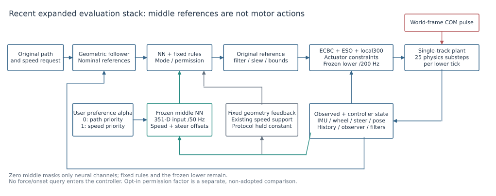

# 冻结底层单轨机器人的偏好条件参考控制与闭环抗扰表现

**Preference Conditioned Reference Control and Closed Loop Disturbance Response of a Single Track Robot with a Frozen Lower Controller**

> 内部研究草稿；证据截止2026-10-27。当前稿更新任务、真实参考接口及已完成仿真结果，不宣称新抗扰协调算法、形式安全保证或实机验证已经成立。它不是投稿就绪稿，人类作者核验与具体Transactions期刊尚未确定。旧2026-09-12直接电机残差稿、导出件和图已逐文件校验归档到history/20260912_snapshot，不与本稿合并计数。

## 摘要

必须动态保持平衡的单轨机器人在跟踪弯道时，路径与速度偏好会改变其进入状态及受扰后的运动。本文研究冻结底层控制器下的偏好条件参考控制，并分别评价原任务效用、目标到达和真实触地。中层输出速度与转角参考修正，经原滤波、变化率和幅值限制后，由ECBC、ESO及冻结local300残差底层执行。已有原生四上下文试验及新增匹配zero对照显示H75可表达路径—速度取舍并降低工作侧倾，但H75/zero均8/8到达，不能以此宣称完成率提升；在匹配低速受扰面板中，当前权重的1米目标到达由H75的66/96提高到75/96，但整窗存活均为85/96，且逐例存在存活新增与丢失。原生较高速任务中H75又保留更好的到达和路径表现，故后继权重不是全域升级。另两路线20秒比较中，标准几何重规划使H75到达从9/12变为12/12、未新增存活；强zero原路亦12/12到达存活，故不构成新抗扰机制证据。另在新70度/R2.1、2.2米/秒的共同20秒重规划合同中，四法均20/20不触地，H75/current各18/20到达，zero/静态规则均20/20；未建立比较性容扰增量。同完整中途状态分支证明有限参考干预存在局部机会，但所用切点具有事件时刻特权。名义参考优化、固定参考选择迁移及解析支持权限分离未建立超过强简单对照的新抗扰机制。现有证据支持条件性的任务收益和任务—稳定性取舍，尚需针对具体任务差异的独立验证，不能把各模块的小正例拼成普遍安全方法。

## 1 研究问题和贡献边界

研究问题是：对于必须动态平衡的两轮机器人，用户路径—速度偏好如何改变任务收益和抗扰表现？在底层不重训、上层仅能修改有界参考的条件下，哪些收益可以兑现，哪些来自进入状态、任务标签或普通反馈？

例如，同一条弯道上，路径优先策略与速度优先策略可能进入不同速度、侧倾和转向状态。随后同一世界方向外力产生的结果可以不同。但“更快”“更平稳”或某个解析余量更大都不自动意味着整段过程不摔，也不意味着受扰后能够到达原目标。

本研究拟发展的核心是**偏好条件下的闭环容扰能力及其有限参考协调**：用户偏好不仅改变任务误差，还可能改变机器人进入怎样的动态平衡状态；中层是否能在保留原用户评价的条件下，用可执行参考调整改善不触地能力，是待检验的控制问题。容扰度仍是研究对象，旧解析能量式不再承担已验证控制模块的角色。此定位是研究命题，不是“偏好必然改变防摔能力”的既成结论。

### 1.1 从已完成实验提炼的研究切入点

|研究切入点|现有证据能支持什么|尚缺什么、何时放弃强主张|
|---|---|---|
|偏好、进入状态与闭环能力的耦合|原生H75在路径优先时更贴路、速度优先时更保速，并保持较低工作侧倾；存在可解释的行为取舍。[E025–E027]|无扰偏好收益不是防摔收益。需冻结方法后在新情境配对比较触地与原任务代价；若只剩侧倾成本优势，就按具体任务效用贡献表述。|
|真实参考权限下的动态协调|固定静态规则的参考目标满足其工作侧倾预算，但实际动态仍超过预算，H75保留条件收益；静态参考评价不能代替执行后果。[E026–E027]|只挑战这套静态规则；没有证明所有动态参考治理或传统控制不如学习。需检验同权限简单动态方法能否覆盖收益。|
|防摔与任务接续的分工|标准重规划使H75目标到达9/12→12/12，而两臂均12/12存活；任务接续与防摔可分别发生，且zero原路已12/12到达存活。[E021–E023]|标准Dubins和延长时限不是算法创新。潜在增量须来自重规划共同存在时仍能兑现的偏好—容扰协调，不能把几何成功算作救车。|

以上是具有具体反例约束的研究切入点与系统发现，不是三个已经成立的新算法。任务贡献可以成立于动态平衡、用户偏好、冻结学习底层和有限参考接口这一明确问题，但组合这些词本身不足以证明新颖性。

### 1.2 拟发展的控制贡献及其可证伪性

**方法提案，尚未实现或验证：**保留用户α与原速度请求，比较现有接口真正可执行的参考方案；在满足指定扰动设计范围内的闭环表现要求的候选中，选择原α任务代价与参考变化代价较小者。若没有候选达到要求，报告能力不足并执行预声明退化方案，不虚构安全保证。容扰评价必须针对“采用该参考方案后的完整闭环”，不能只看当前侧倾或旧z。

这一提案的研究价值在于检验“同等抗扰表现下能否减少偏好代价，或同等任务代价下能否改善抗扰表现”。固定规则、充分普通训练、共同重规划和零中层必须保留；若收益被它们覆盖，则不把选择器或额外网络继续列作主要贡献。现有证据没有完成这项比较，因此正文不将该提案写成已提出并验证的方法，也不宣称Transactions投稿充分性。

### 1.3 相邻方法与本文尚待建立的差异

相关工作已有单策略偏好输入和跟踪—外力顺应取舍[1]、通过修改参考避免侧翻[2]及自行车机器人学习动态行为[3]。进一步的PROMO将运行时任务偏好与固定运动先验分开[6]；PCHC研究偏好条件单策略及分目标Critic[7]；RAYA以有限窗可恢复性预测修改MPC约束，并以有界调度改变任务权重[8]。因此“偏好＋抗扰＋调整参考或优先级”的组合本身不承担首次性。

本文的约束是只能改变冻结闭环外的有限参考，不能直接自由选择执行器输入或修改底层优化问题。这一区别需要通过同权限强对照证明其控制后果，不能仅凭接口不同宣称新方法。固定奖励先验也不等于冻结底层网络。文献[1]还包含瞬时扰动测试，外力顺应目标与本文防摔力扫描仍应区分。上述新近文献按预印本引用；本轮核对[1,6–8]原文方法及相关评价段落，[2–3]仍限既有摘要范围，未完成系统综述或同条件复现。[E035]

## 2 系统与真实控制权限

### 2.1 分层接口



图1：中层改变参考，不直接输出电机动作。灰色比较项在不同实验中按协议固定；近期扩展接口比较中的zero中层仍包含共同底层、路径跟随、几何反馈和短速度支持；原生偏好面板保留原配置。该图为近期扩展评测栈的结构说明，不是新优化器或安全证明。

给定原始空间路径p(s)与速度请求，路径跟随器产生名义参考r0=[v0,δ0]。中层读取351维观测：16帧×20字段、16个有效掩码和15个上下文字段，包含外部偏好α；输出两个latent，顺序为速度、转角。当前单网络采用已冻结的alpha调制结构；评测时权重不更新。[E017–E018]

```text
z_mid = πθ(history, context, α)
Δr_target = tanh(z_mid) × existing asymmetric scales
r_command = original filter/slew/bounds applied to (r0, Δr_target)
```

α=0表示路径优先，α=1表示速度优先。原用户α用于原任务代价评价，不能为安全把它偷偷改成另一个偏好后重新打分。底层自身的lower_alpha与中层α不同，冻结底层身份不随用户偏好变化。

共同底层为ECBC、ESO及冻结local300学习残差，最终经统一执行器约束作用于仿真机器人。底层残差与中层参考网络是不同模型。执行参考改变后，底层实际输出取决于完整物理状态、ESO、历史和执行器状态，不能把转向角速度当成中层可自由选择的输入。

### 2.2 近期共同接口

下表仅描述近期共同参考接口；原生H75试验保留其原生配置，不能把下表反套到全部历史轨迹。[E008]

|量|近期共同配置|
|---|---|
|中层决策周期|0.020秒；动作保持4个底层tick|
|底层周期|0.005秒|
|物理积分|0.0002秒；25子步/底层tick|
|速度修正范围|−1.0至+0.25米/秒，经过tanh|
|转角修正范围|±0.20弧度，经过tanh|
|最终速度参考范围|1.0至3.5米/秒|
|最终转角参考范围|±0.65弧度|
|参考滤波时间常数|速度0.10秒、转角0.08秒|
|速度修正变化率|向下1.0、向上0.5米/秒²|
|转角修正变化率|0.8弧度/秒|
|最终转向/后轮速率限制|3弧度/秒、60弧度/秒|
|执行层转向角行程|±0.8弧度；不是±0.65参考范围。[E013]|

原幅值裁剪触发时按实际发布参考进行antiwindup；正常slew不清滤波历史。既有roll-rate短支持采用原状态机，其0.6秒是可刷新minimum hold，不是硬截断。几何域退出和16个clean blocks重入控制Actor权限；它们不等于摔倒。权限分离实验显式改变原解析速度支持是否随Actor禁用一起清零，没有扩大上述范围；该因素未被采用为默认。[E017,E019–E020]

### 2.3 冻结迭代链

双网络端点、蒸馏单网络及后续权重均已保留在冻结registry。H75是原生偏好基线；当前恢复候选来自H75→task_only64→free_GAE64系列，经recovery45、recovery55等工程恢复目录接续；recovery55计划从认证的第55边界完成余下9次更新，不是另一次独立训练。[E014–E016]不能把两个冻结权重的差异归因于最后一次更新、单个奖励项或某一种教学机制；若提出训练因果主张，仍需同初始化和匹配训练对照。也不能把各历史名字中的“75轮PPO”自动视为同一checkpoint。[E012]

## 3 评价对象和数据角色

### 3.1 目标到达与不触地分开

到达：按各试验预声明的观察窗（旧面板10秒，重规划比较20秒并另报同轨迹10秒前缀），在首次触地或故障之前，有真实记录XY进入原世界目标点1米圆。它不要求末速度、航向或保持窗口，不以几何域退出否决已经发生的到达。1米是当前工作口径；0.5、0.75米和近期预声明1.25米仅作相应敏感性，原标签保留。

整窗不触地：完整观察该试验声明的10秒或20秒且未发生真实非轮触地；数值/控制故障或不完整记录单列，不强行作控制失败。近期contact-only诊断保留侧倾/任务域标记作遥测，不将工作侧倾阈值当真实摔倒。原生评测仍保留原生停止语义；其16条实际均完整且没有原生物理/域失败。[E001,E011]

四类结局应分别报告：到达且全窗活、未到达但全窗活、到达后触地、未到达且触地；另保留未知。到达不是仅穿过路径终点截面，不触地也不是已经回到任务或具备环境避障安全。

### 3.2 原用户效用与实测容扰能力

原用户代价Jα由同一配置的原奖励分项逐实际tick重算；失败终止替代、全部轨迹均值和共同存活条件均值分开。不同α的原始成本不直接互相排名。同一条实测轨迹可以在不同用户效用下重评分，但这不是换α后真实闭环的反事实轨迹。

闭环容扰对象必须指定完整状态ξ、策略π、参考方案、力方向/波形/持续时间、起扰与观察窗。对这些条件固定后，记录实测通过、触地失败与未知标签。未经单调性检查的离散成功档不能视为连续安全区间，也不能断言超过某个已测成功档必然摔倒。本文当前主要报告指定扰动事件的真实结局，不宣称已获得通用牛顿阈值。

为使研究对象可检验，定义（研究定义，不是新增已测结果）：

```text
xi = 完整物理/ESO/控制器/local300历史/FIFO/参考滤波与限幅/时钟
     + 路径与投影/follower/relay与gate/适用的随机状态
sigma = (方向d, 波形h, 持续时间Delta, 起扰时刻tau, 观察窗H)
C(pi, r; xi, sigma) = { F >= 0 : 完整闭环在[0,H]内无非轮触地 }
```

其中r是经原接口执行的参考方案，π包括冻结底层及所声明的中层决策。只有完整、无故障且整窗未触地者才记实测通过；在故障或截断前已明确触地者记触地失败，其余未能完整观察的分支记未知，不放入已测整窗不触地样本集合。比较不同用户α的完整回合，回答“偏好形成的进入过程与抗扰表现如何耦合”；克隆同一完整中途状态后再改参考，回答“此状态下参考干预是否有局部作用”。两种问题不能互相冒充；更换路径/投影后不再称完整闭环状态相同。

实际报告已测事件的通过、触地失败与UNKNOWN三态观测，而不是为所有力档给出完整的C成员判定。若汇总从零开始连续通过的已测网格前缀，其最大档仅为网格摘要，不证明档间连续安全或更大力一定失败。方向、时长和时刻改变后须重新标明条件；当前物理Critic或E_min的标量不能直接换算为该集合的牛顿半径。

候选参考协调的简写为：

```text
min over executable reference plans r:  J_alpha_original(r) + rho * D_reference(r, r0)
subject to:  frozen closed loop meets the declared disturbance-design requirement
```

此式只澄清决策对象，不构成新优化算法或形式安全证明。扰动设计范围可对控制器公开，本次具体起扰时刻与方向不可泄漏。J始终使用原用户α、原速度请求和声明任务；规划后当前路径的V3成本需另作诊断，不能悄悄替换原任务效用。实测容扰集合、预测器有效性与选择器收益必须分别验证。新增正则D及其权重rho尚未确定；它可能改变原J_alpha对候选的排序，因此原用户代价与参考变化须分开报告，不能仅凭组合目标声称用户效用排序完全保持。

### 3.3 比较边界

原生较高速面板、低速迁移面板、新时刻面板和旧教学面板具有不同条件，分别报告，不能合并分母。低速三权重比较匹配原完整task0、路径、用户α和每个实际事件的力/时刻/持续时间；不同力档的旧起扰时刻可能不同，不能将其画成同状态力幅阈值扫描。各策略在受扰前已经可能形成不同状态，不能把完整回合差异全部解释为同状态的受扰后救车动作。

同中途状态实验则继承完整物理、ESO、local300历史/FIFO、滤波、limiter、gate与clock，逐叶克隆，不只匹配位置和速度。当前实验多数来自相关祖先、有限进入状态和已用于开发的面板。新起扰时刻检查仍是DEV迁移证据，不是独立最终TEST；跨力档或同快照多轨迹不是独立训练重复。

## 4 已完成结果

### 4.1 原生偏好功能与后继权重代价


图2：原生四上下文、每模型α0/1共8条，使用实际XY、原始路径和真实观察终点。无扰动结果不新增抗扰结论。[E001]

|模型|0.5米到达|0.75米到达|1米到达|整窗存活|
|---|---:|---:|---:|---:|
|H75|6/8|7/8|8/8|8/8|
|current|4/8|5/8|6/8|8/8|

两模型各四上下文均保留α0路径更准、α1速度更准。固定用户效用为行、实际执行α0/1为列，平均成本如下；每行内部比较，不跨行比较。[E001]

|模型与原用户α|执行α0|执行α1|
|---|---:|---:|
|H75，用户α0|10.551|53.751|
|H75，用户α1|29.882|9.167|
|current，用户α0|84.361|114.881|
|current，用户α1|26.049|17.740|

原生平均效用对角较低，支持偏好功能；current绝对路径能力弱于H75，不能称全域升级。在另一低速进入面板，完整中层对固定原用户效用的平均值反而可能执行α1较低，故偏好输入存在不等于任意分布下已最优对齐。后者不授权把用户α重新映射为1。

### 4.2 同栈低速受扰：到达增益与存活代价并存


图3：同一受扰事件下H75、current和zero中层的完整实际路径；该图只展示+32N，全部五力档图在源报告中。不把代表图作为完整统计。[E002–E003]

|方法|1米到达/96|全窗存活/96|
|---|---:|---:|
|H75|66|85|
|current|75|85|
|zero中层|68|90|

current对H75到达9增0失，即本DEV面板净增9.375个百分点；存活4增4失。对zero到达11增4失、存活2增7失。因此存在真实条件性到达收益，也存在实际任务—稳定性取舍，不构成安全支配。zero仍有共同路径跟随、几何反馈、短支持及冻结底层，不能误称无控制。按0.5米统计的旧72对61不撤销，但不与当前1米75对66混成同一数字。[E002–E003]

### 4.3 同完整状态的局部机会及其部署缺口

96受扰中，full的1米到达/存活75/85；暂停神经双通道或仅神经steer均为76/86，分别一个到达新增、一个存活新增且无丢失。两种mask对应相同两个事件，不是四个独立正例。0.5和0.75米到达均无新增；24无扰各全部到达/存活。[E004]

两个正例均为α1、左55度/R1.8、请求1.1米/秒，在3.76秒的共同完整状态分支后暂停0.4秒。v1.7/yaw0/−32N原分支5.185秒触地，暂停活到10秒，但最近目标距仍约5.379米；v2.1/yaw0/+32N三者全活，最近目标距2.076米变为0.896/0.956米，新增1米到达。暂停神经steer后普通几何反馈仍在，最终steer参考不为零。

切点使用真实计划pulse-end，具有明确特权。它们证明合法后缀可改变结局，不证明已有在线检测器能选择该动作。旧非特权roll-rate relay虽然有救回，但被同gate解析速度支持覆盖，不能据此归因于新学习协调机制。

### 4.4 已闭合对照与负结果

|对照问题|已完成结果|解释边界|
|---|---|---|
|恢复教学是否超充分普通PPO|旧192任务标签教学165、普通164，6增5失|不能将对弱parent的全部收益归因于教学；不是防摔标签。E005|
|名义参考优化是否同时提高抗扰|旧48受扰full39到达/43活，CEM38/42；无扰任务成本下降|任务优化有效，不等于整体抗扰改善。E009|
|固定复杂选择是否优于粗规则|新时刻96：full79/84，完整场景选择79/84，几何+α78/84，α选择78/85|复杂选择必要性未建立；名义成本收益保留。E006|
|保持已触发解析支持是否救回|108候选全部执行，96受扰与full均79到达/84活，主终点逐例0增0失|23例实际override，不是开关未执行；不替换默认。E007|

支持权限因素中有局部物理变化：一例触地延缓0.31秒，另一例最近目标距3.307→2.131米，但仍未达1米；也有末点离目标更远的例子。0.5/0.75米到达同为76/77，预声明1.25米候选81/full80，不据此更换主阈值。该运行实际203037新lower ticks/216000槽、0训练、约205.206秒，含初始化/JIT/积分/I/O/审计，不能当纯积分或对旧批量的加速倍数。全部9张XY已查看；324诊断图已生成，其中5张被逐图查看，未查看部分不冒称完成视觉审阅。[E007]

### 4.5 成熟几何重规划与任务时限：到达接续不等于防摔增量

按用户提出的原目的地接续任务，复用PythonRobotics的MIT Dubins实现[5]。仅在普通1秒时钟检查到当前路径无效或横向偏差超过1米、尚未首达/触地/故障时重规划一次；不读取真实起扰时刻或力方向。新路径从实际位置与朝向到原世界目标，半径1.8米，在有限目标朝向集合中选择六族Dubins候选。保留原α、任务和物理时钟、全部底层/ESO/历史/参考滤波及权限，只重绑几何投影与路径跟随。这是成熟规划工具的适配，不是新算法或动态安全保证；曲率分段跃变仍须由原执行链处理。[E021]

两条用户展示路线×α0/1×原F0/±32N、0.1秒×原路/重规划×当前/zero中层，首先完成48条固定轨迹，再仅补H75原路/重规划的24条，复用旧48而非重跑。两臂均20秒；下表每法12条件，其中4无扰、8受扰，共享进入历史，不能当12个独立训练重复。zero保留共同几何反馈与冻结local300。

|方法|10秒到达/12|10秒存活/12|20秒到达/12|20秒存活/12|
|---|---:|---:|---:|---:|
|current，原路|8|10|8|10|
|current，重规划|8|10|10|10|
|H75，原路|8|12|9|12|
|H75，重规划|8|12|12|12|
|zero，原路|8|12|12|12|
|zero，重规划|8|12|12|12|

表中分母均12，未知均0。current重规划到达2增0失、存活0增0失；正例为同一左弯+32N的两个α分支，6秒重规划后分别12.99/12.63秒进入原1米目标。另两条current−32N仍触地。zero原路四个10秒尚未到达的条件在10.390至10.595秒进入目标，原本均不摔；延时改善了任务到达标签而非生存。zero重规划没有新增到达，部分完成时间反而增加。[E022]


图4：+32N全部两路线/两α/六方法，原始实际XY截于首达/触地/20秒，完整20秒轨迹在各源run另保留；此合并图虚线表示采用重规划的方法，实线表示原路方法，均为真实运动。全72的三力档合并图及H75的完整/截断六图已目视；不只选择正例。原路线到目标段的偏离、路程与请求速度误差在首达之前单列，重规划后路径条件reward只作诊断，不称固定原路线效用。

H75补充24条实际完成，96000lower ticks/96000槽、300.578秒含初始化/编译/I/O、0训练、7次重规划。H75重规划到达3增0失，新增为左弯α0−32N、α0+32N和α1+32N，首达分别15.755、13.565和12.235秒；三例原本都未摔。相对current在重规划接口下到达2增0失、存活2增0失，说明旧偏好资产仍有条件用途，但不是全域升级或H75原生任务复现。[E023]

H75重规划与zero原路在12条上都到达且存活。该相同事件集合上，H75平均首达慢0.860秒、路程长1.011米、首达前平均原路线采样距离大0.314米、速度MAE大0.0176米/秒；逐例仍有6条更快、3条更贴原路。各自首达窗长不同，以上为描述性任务指标，不是原V3效用或随机化因果估计。不同比较的共同成功子集也不能相互排名。低速H75重规划中α1六对均更快，但α0并非稳定更贴原路，因此不能从原生偏好正例推该迁移条件已保持用户偏好。[E023]

该比较支持重新规划的实际接续用途和更合理时限，但强zero原路已在本小面板全部到达，且整体任务代价并不支持H75优势，因此不支持复杂中层/重规划的必要性或新防摔机制。另一次独立直接NumPy审计认证全部72 raw与16个实际规划决策，以上端点和配对一致；current左−32N的α0原路/规划均4.465秒触地且均未执行规划，α1原路5.375秒触地、规划分支在5秒执行后5.410秒触地，多观察.035秒不是救回。[E034] 保留全部冻结权重和成熟规划基线，不扩半径/触发参数追正例；全局默认模型不据本面板替换。

### 4.6 原生匹配zero：偏好取舍存在，用户代价优势不等于到达优势

既有原生面板仅有H75/current，近期扩展低速zero不能替代该接口。本次仅补8条zero：左右90°/R1.8米×2.6/2.8米/秒×α0/1，沿原10秒native归档源码、prepared bank index3/seed77001与冻结local300。上层给显式零修正target，经原滤波/变化率/限幅；保留nominal follower，不增加现代反馈、速度支持或重规划。旧16条逐SHA复用。实际15912lower ticks/16000槽、196.840秒含初始化/编译/I/O、0训练。[E024]

|模型|原目标1米到达/8|完整10秒/8|原生physical标记/8|域早停/8|
|---|---:|---:|---:|---:|
|H75|8|8|0|0|
|current|6|8|0|0|
|zero|8|6|0|2|

zero左2.8两条在3.54秒已到原目标，9.78秒才域停止；整窗存活保留未知，不能称实际摔倒或整窗安全。current右弯两条α1未到1米，尽管完整观察且没有原生physical标记。这里保留原生停止合同，不混称近期contact-only语义。[E024]

原生同用户全窗均值成本，user0的执行α0为H75 10.551、current84.361、zero600.179；user1的执行α1为9.167、17.740、547.637。两网络各端点4/4低zero，共同完整3context/端点中仍3/3低，故并非只来自域终止罚。但大部分奖励差来自roll/working_roll，不能用它替代用户当前的目标到达，也不能把工作侧倾阈值当真实摔倒。24条原V3成本由独立AI另用NumPy重建，最大差约8.1e-7；此为确定性共享DEV的产物核对，不是独立训练重复。[E024]

按首次到达前的实际运动，H75 α0对zero在3/4条件路径RMSE更低，速度RMSE却4/4更高；H75 α1速度RMSE4/4更低，路径RMSE4/4更高。H75首达前峰值侧倾为0.238–0.300rad，zero为0.382–0.475rad。零策略首达前原自身成本均值179.036/173.529，其中roll+working_roll约167.93。原分量与终止替换差单列，首达窗长随执行不同；未到达轨迹不当更便宜的完成任务。[E025]


图5：原10秒完整观察/真实native终点，四context×两α×三方法；路径域停止用菱形，原生physical终点用x，不把域停画成摔倒。原目标1米圆用于观察到达，不能据20米远的后续终点否认早先首达。全部XY已主审目视，8组时序和8组原奖励分量图生成，主审各看1组，其余不称完成视觉审查。

结论是H75原生功能获得匹配zero支持：可选择速度—路径取舍并降低工作侧倾；但zero仍8/8到原目标，尚无任务完成或真实防摔优势的证明。下一强比较应检查同工作侧倾预算的普通速度/转向参考规则能否解释该行为；固定静态规则随后已按4.7节完成，收益边界见其结果；尚不能声称超过全部参考治理方法。无需为了得出正结果而把任务阈值重新收紧。

### 4.7 静态平衡参考规则：H75保留收益，但不是通用传统控制比较

新增8条普通参考规则并复用24条原生缓存。用原controller的q(v)定义静态phi_eq=delta_ref/q(v_ref)，预算0.3rad固定取原V3工作侧倾成本起点。α0固定nominal转角、在合法65速度格点中选最大静态通过速度；α1固定nominal速度、压缩转角至±0.3abs(q(v))。目标映回原latent权限并经过原filter/slew/bounds；原v_user/α/路径和评分不改。该静态工作量不是不摔倒容扰度，也不保证实际动态roll≤0.3。[E026]

|方法|原目标1米到达/8|完整10秒/8|自身α0原成本均值|自身α1原成本均值|
|---|---:|---:|---:|---:|
|H75|8|8|10.551|9.167|
|current|6|8|84.361|17.740|
|zero|8|6|600.179|547.637|
|静态参考规则|8|8|88.486|50.403|

规则两端各4/4成本低zero，H75两端又各4/4低该规则；current α0只2/4低规则，不能由平均数宣称全域升级。规则全部静态速度网格有可行点且未发生latent权限饱和，但首达前真实峰值roll为0.334–0.418rad，仍高于静态0.3。H75为0.238–0.300rad。按各自首达窗，H75 α0路径RMSE4/4低规则、速度RMSE0/4低；α1速度RMSE4/4低、路径0/4低。两者均8/8到目标；这支持有条件的偏好取舍与工作成本优势，不支持完成率或真实防摔优势。[E026–E027]

新8条实际16000lower ticks/16000槽、196.741秒含初始化/编译/I/O、0训练。32份raw和同用户10组配对经独立AI重算；规则target另用NumPy q/网格/反映射核验，latent最大差2.62e-7、原V3成本最大差8.1e-7。全32XY保留在E026源目录，原生停止语义及共享DEV关系不变。此比较不代表最优参考治理、全部传统规划器或独立测试；固定预算/网格不继续补考。下一应在冻结方法后检查新任务与扰动，而非重新拟合旧能量式。

### 4.8 新情境80条确认：全窗不触地一致，到达未超过简单对照

冻结四方法，在左右70度/R2.1米、请求2.2米/秒、α0/1下，完整交叉无扰与1.6/2.6秒各±32N、持续0.1秒五事件。每法20条（4无扰、16受扰），同prepared bank index3/physical700、原生参考权限、20秒原worldgoal1米、contact-only及相同发布mask；共用普通1秒一次因果Dubins重规划。它是新的共同任务合同，不能作旧native的单因素消融；新几何/需求与共同祖先也不是独立训练重复或最终TEST。[E028–E029]

|方法|10秒到达/20|20秒到达/20|20秒不触地/20|受扰到达/16|
|---|---:|---:|---:|---:|
|H75|16|18|20|14|
|current|17|18|20|14|
|zero|20|20|20|16|
|静态规则|20|20|20|16|

无扰四法各4/4到达，全部80无触地/故障/未知。H75/current分别对zero或规则到达0增2失；H75与current各有1个对方未到达事件，不能称同样两个失败。四条未入圈轨迹最近原目标距离为1.060–1.339米，均已重规划且完整存活；这不是摔倒或离任务极远，不为制造成功事后改1米主口径。所有非零事件均在各自首次到达之前开始施加。[E028]

实际320000lower ticks/320000槽，262.398秒含初始化/编译/I/O，16次重规划、0训练。所有raw、时钟、原目标、原用户速度、实际世界脉冲及参考滤波链经分析核对；独立AI另从80 raw重计端点/触地而不调用相同endpoint helper，结果一致。fresh native-only审计核80lane prepared物理字段及20组60个完整carry方法对，原α及真实滤波初值认证；这不是独立物理复现。完整5张任务XY与5张整窗XY保留，避免到达后行驶末点被误判；当前路径reward在改路后仅作诊断。[E028–E029]

裁决：本组防摔结局全通过，因此没有比较性容扰优势的区分力；到达却已有强对照差异，不能笼统称整组无信息。保留原生偏好与较低工作侧倾的具体用途，不将其扩写为此新任务栈的到达或防摔优势。固定面板封存，不自动加力、改起扰时刻或延长到满足神经策略。此结果也不证明其他状态/方向/时长下容扰能力相同；后续先复盘已有真实触地证据及机制缺口，而非再开启同类调参。

### 4.9 低速真实触地面板的联合结局复盘

为区分实测容扰改善与任务完成，事后复用右90度/R1.1米、请求1.5米/秒、五个α的历史90条轨迹。task64原策略与同Actor的CONSTANT参考支持，各45条；2.28秒开始0/±16/32/48/64N、持续0.1秒，观察至10秒。当前原世界目标1米口径应用于旧数据，不改变历史物理标签或旧严格任务标签。全部90 raw SHA、连续时钟、真实接触/故障认证，并由独立AI直接NumPy重计而不调用共同到达helper；0新增物理或训练。[E030–E031]

原策略/支持的整窗不触地为20/45与30/45，配对10增0失；到达为14/45与13/45，4增5失。受扰子集均到达9/40，是4新增与4丢失抵消；另1个到达丢失来自无扰。10个防摔改善中4个进入原目标圈，6个未进入，后者最近距离1.090–2.663米；全部到达者也整窗存活。这既反驳“防摔收益必然解决任务”，也不能说支持没有任何任务兑现。[E030–E031]

该普通参考规则在扰动前已经改变进入状态，不能称同完整受扰状态的救回，也未证明学习选择器必要。旧10秒不能外推20秒；其参考权限、模型及任务栈与4.8不同，不能合并分母。保留条件性实测容扰增益，下一问题是如何在原用户效用下减少其任务代价；旧解析式未参与本组控制，不能承领这10个防摔改善。[E030–E031]

进一步在同90条上以五个历史用户权重重评已执行轨迹，90条有效奖励窗均等于实际执行窗，原请求速度保持1.5米/秒。无扰时，固定原策略执行α.5在全部五种历史V3权重下成本最低；全10候选共同存活的±16N上，全部运行成本仅user0选择原策略/.25，其余选择支持/.5，对第二低成本差.094–.290。排名未使用触地剩余罚；独立NumPy实现重计450行一致。但共同存活集合及候选赢家均事后选择，原10秒V3也不同于1米首达效用，不能据此开发或宣称必要的α选择器。训练不足、结构或迁移影响尚未分离，不否定其他原生偏好证据。[E032–E033]

### 4.10 原物理信用终点的条件用途：不能由存活覆盖推整体无用

对原online_preference_survival_v1_attempt3的固定task_only64/physical_credit64重新审查联合结局；它们不是后来free/finite GAE候选的别名。原488按已有认证最小距离重组，隐藏时刻110则重读全部原始轨迹及路径，复现原四半径440标签并计算当前1米首达；不改旧标签、不新增物理。两个面板及动作噪声样本不混为独立训练重复。[E038–E039,E041]

|面板/条件|普通task64 到达/存活|物理credit64 到达/存活|floor 到达/存活|分母|
|---|---|---|---|---:|
|原确定性，无扰|10 / 10|10 / 10|2 / 10|10|
|原确定性，受扰|0 / 7|1 / 10|0 / 10|10|
|隐藏时刻，无扰|4 / 4|4 / 4|1 / 4|4|
|隐藏时刻，受扰|6 / 15|7 / 15|4 / 16|16|

隐藏受扰中credit对ordinary到达2增1失、存活0增0失；对floor到达5增2失、存活0增1失。floor覆盖存活表现不等于覆盖所有联合任务用途，但credit也不构成对floor整体支配。较小0.5米半径时credit到达2/16、ordinary4/16，不能只报当前7对6而掩盖尺度敏感性。两个新增最近距为.954对1.090米、.556对1.303米；丢失为4.678对.107米，包含真实米级退化。[E038–E039]

以上支持保留旧信用终点的条件性任务用途，未证明原用户Jα改善、未知时刻防摔增量或信用训练的可重复机制，不自动恢复训练或采用为当前默认。全部命中在脉冲后；credit的7次受扰首达中3次Actor动作有效、4次禁用，只是当步遥测，不能将禁用Actor解释为恒参考尾段或将最后动作归因于整段收益。[E040]

## 5 早期解析容扰代理回答的是什么

早期固定速度局部模型采用不稳定模态坐标和折算脉冲：

```text
λ = sqrt(a4),     b = a1 + a2/λ
z = ω + λφ + (a2 δ + d_hat)/λ
Kτ = γ exp(−λτ) [1 − exp(−λΔ)] / λ
W = b² [1 − exp(−2λT)] / (2λ)
E_min(F) = (z + Kτ F)² / W
```

该式在其假设下衡量自由实际转向速率使终点z归零的最小L2控制努力。实际中层只能改有界参考，经过冻结闭环、历史、滤波与执行器后才改变实际速率；终点归零不保证中途不触地。变速和ESO变化也改变坐标导数。故本文不将能量预算拟合成经过验证的全过程防摔阈值，也不把代理的性能标签误判直接写成真实摔倒误判。原推导和适用性审计保留于[公式解释报告](../evidence/tolerance_progress_20261022/formula_explainer/README.md)，当前仅作解释对照。

### 5.1 当前保留的实测容扰度

实测容扰能力针对指定完整状态、闭环及参考规则、力方向/施力点/波形/时长/起扰时刻和观察窗。输出是各已测力档的PASS、CONTACT或UNKNOWN，并分别记录原目标首达；不是从旧解析式直接输出一个认证牛顿阈值。α及扰动前参考改变可同时改变进入状态，此时比较的是完整闭环结果，不是同一受扰状态的恢复。[E030–E031,E035]

对固定方向的幅值网格0=a0<a1<…<am，只汇总从0开始逐档PASS的最长已测前缀；零力不通过或未知时该前缀能力未定义。UNKNOWN或CONTACT均阻断前缀，后续孤立PASS仍保留。此汇总不填补网格间隙、不证明单调性，也不把最大成功力档称连续安全边界。任务接续改善与该物理能力增量分开；第4.5节重规划的到达收益不能代替防摔收益。[E021–E023,E035]

### 5.2 旧低速捕获状态：偏好差异与速度排序解释

复核既有H75左右90度/R1.1、请求1.5/1.8米/秒、α0/1的8个真实进入状态。原几何进度50%首次控制步跨越处捕获完整状态，随后停用中层更新，保持捕获时已经执行的参考，由原ECBC/ESO/local300及执行器继续控制；不锁实际速度或实际舵角。每状态0/±16/32/48/64N持续0.1秒，后缀观察4秒。72原始轨迹、8快照及归档运行源码身份核对，原标签不改。[E036–E037]

|路线/请求速度|α0实际速度|α1实际速度|α0负/正网格前缀|α1负/正网格前缀|
|---|---:|---:|---|---|
|左 / 1.5m/s|1.178m/s|1.429m/s|16 / 16N|32 / 32N|
|左 / 1.8m/s|1.407m/s|1.685m/s|32 / 32N|48 / 48N|
|右 / 1.5m/s|1.076m/s|1.472m/s|16 / 16N|48 / 32N|
|右 / 1.8m/s|1.311m/s|1.765m/s|32 / 32N|48 / 48N|

非零64分支为33未触地、31触地；按同路线/请求速度及本地施扰规则比较，α1为9增0失。但8状态按实际速度排序，两个方向前缀均不下降：28状态对×2方向共56个派生序比较无反转。它们不是56个独立样本，16N粗网格也可能隐藏差异。该事后诊断与速度排序解释相容，未证明速度因果、速度充分性或α无额外信息，不据此开发选择器。[E036–E037]

施扰轴由各自捕获姿态的横向单位向量确定，后续保持该世界方向。四组α配对的世界施力方向相差11.67–13.45度，因此并非固定同一世界推力、只改变α的反事实。侧倾、转向、ESO、历史与捕获时刻也同时变化。这些结果只描述偏好生成状态及捕获参考的4秒能力，不代表持续中层、同状态恢复、原目标到达或10/20秒存活能力。全部零力通过、全部±64N触地；前缀仍不是连续阈值。[E036–E037]

## 6 讨论：现有成果和剩余科学问题

已有证据并不为空：偏好功能在原生上下文中成立，当前权重有低速到达用途，合法参考存在局部后缀机会。困难在于这些事实尚未组成一个在原α下兼顾正常任务与抗扰、且强简单对照不能解释的可部署决策。将任务失败改叫摔倒、相对弱父模型的改善改叫方法创新，或将特权见证改叫在线选择，都会超出现有证据。

当前拟检验的组织假设是“偏好可能塑造进入状态，真实参考权限可能约束可兑现的闭环容扰表现，规划用于接续到原目标”；已有条件差异尚不足以识别整条因果链，三个环节必须有各自证据，不能由任务到达替代不触地。旧解析式失去控制模块地位，不代表容扰问题消失。

任务与系统贡献仍是允许路线，并不要求每篇论文必须提出全新算法。但需要明确动态平衡、偏好和真实参考权限耦合所带来的具体问题，解释既有工作为什么没有在相同条件下回答它，并给出公平、独立的证据。当前不把更多曲线或一次小正例当作已经达到Transactions要求，也不要求策略无敌、每个指标全胜。

## 7 下一项独立验证的设计要求

新情境固定80已按4.8完成；以下是尚未完成的后续机制与独立验证要求，不是重跑该面板或自动启动新实验的依据：

1. 以完整路线/速度/起始状态组合划分验证来源，冻结模型、normalizer、参考权限、目标半径和停止语义后才评价；不同力档/时刻不能替代独立任务或独立训练重复。
2. 匹配H75、current、zero与任何已采用简单规则；若主张选择方法，还须排除固定任务条件选择和同权限普通反馈。无需人为要求零损失，报告全部增失和原α代价。
3. 改变起扰时刻/方向/时长时，控制器不得读取本次计划事件。先前pulse-end暂停只作为机会诊断；部署方法必须另给可观测的信息—动作—后果链。
4. 若主张某训练机制有效，须匹配初始化、交互量、无扰保持与独立优化重复；已有不同权重、旧教学重复和新时刻轨迹不能相互冒充。
5. 输出原路径/实际XY、真实终点、各α连续任务代价与四类物理结局。保留失败和未知，旧解析式不作必须有效的模块。

上述独立路线与训练重复验证尚未启动；4.5节为已用DEV的任务接续对照，不能充当独立确认。实机部署尚未启动。既有数据是已用DEV，不能重新命名为未见最终测试。下一投入应由明确的新信息缺口决定，不因尚未穷尽控制而继续扩库或扫描。

## 8 证据索引与待完成事项

E001：current_native_preference_v1_attempt2/analysis/review.json，原生16记录及原用户效用矩阵。E002：h75_disturbed_common_interface_v1/analysis_reconstructed_v2/results.json。E003：同目录h75_review/review.json，三策略配对结果。E004：same_state_reference_pause_v1/analysis_partial_block_fix_v1/results.json及其完整carry认证。E005：long_baseline_transfer/results.json，旧教学强对照。E006：reference_bias_opportunity_v1/production/analysis及preservation_timecheck_v1/analysis。E007：support_permission_factor_v1/analysis。E008：近期common_environment_config.json。

E009：reference_bias_opportunity_v1/production/analysis/summary.json，名义优化的受扰结果。E010：support_permission_factor_v1/analysis/existing_witness_scope_review.md，局部见证范围。E011：learning/src/sttw_control/contact_only_environment.py，实际接触/故障停止语义。E012：learning/configs/frozen_middle_registry.json，历史冻结身份。E013：learning/src/sttw_control/actuator.py，执行器行程及速率约束。E014：finite_value_online_v1_recovery55/plan.json，工程恢复谱系与父模型。E015：current_native_preference_v1_attempt2/plan.json，当前free_GAE64身份。E016：online_preference_survival_v1_attempt3/plan.json，task_only64的H75父身份。

E017：learning/src/sttw_control/path_command_policy.py，观测组装和参考滤波/antiwindup。E018：path_command_env.py，历史/上下文和真实控制时序。E019：reference_reserve_gate.py，既有可刷新minimum hold。E020：reference_reentry.py，Actor权限与重入条件。这些实现定位绑定本次读取的工作树源码，不表示所有历史运行均使用当前完整文件。

E021：goal_replanning_github_v1/plan.json及_vendor/pythonrobotics/UPSTREAM.json，规划来源、完整运行合同。E022：同run的analysis/{summary,paired,receipt}.json及independent_result_review.md，固定48原始审计及完整结果。E023：goal_replanning_h75_v1/combined_analysis/{summary,paired,task_cost_readback,receipt}.json及DECISION.md，新24与缓存48的同条件结果。

E024：native_zero_preference_v1/{plan,evaluation/status,analysis/review}.json及analysis/independent_result_review.md，8新zero＋16缓存原生强对照。E025：同run task_scope/review.json，首达前分量、误差、侧倾及终止替换差。

E026：native_equilibrium_rule_v1/{plan,evaluation/status,analysis/review}.json与analysis/independent_result_review.md，8新规则＋24缓存原生比较。E027：同run task_scope/review.json，H75-vs-rule首达前分量与误差。

E028：native_goal_confirmation_v1/{plan,evaluation/status}.json及analysis/{summary,results,paired,receipt,independent_result_review}.json，新情境固定80与完整正负。E029：同run analysis/initial_carry_review.json，实际初态、80物理lane/60方法对认证及其核验范围。

E038：joint_endpoint_tradeoff_review_v1/analysis/review.json，分面板联合结局及逐例增失；E039：同run independent_review.json，独立读回；E040：同run arrival_mode_audit.json，首达遥测；E041：同run model_identity_receipt.json，归档模型身份。

E036：preference_capacity_order_v1/analysis/review.json，既有72原始分支的身份、物理标签、α配对及排序审查；E037：同run independent_review.json，独立NumPy重计，未重演物理或capture。

E035：finite_value_online/PRIOR_ART_AND_CONTRIBUTION_BOUNDARIES_20261027.md，原始文献URL、阅读定位、实测定义与未验证边界；人类核验未记录。

完整路径、SHA和核验范围在evidence_manifest.json；可复算跨面板脚本为learning/cli/audit_sttw_paper_claims.py。原报告与台账分别保留工程历史与当前研究事实。本文引用的数字经AI读取产物/配对重算；人类作者核验、完整相邻文献方法比较、最终期刊要求、独立确认以及硬件证据尚未完成。本稿不含虚构作者、资助、利益冲突声明、实机结果或提交记录。

## 参考与流程软件

[1] Preference-Conditioned Multi-Objective RL for Integrated Command Tracking and Force Compliance in Humanoid Locomotion. [arXiv:2510.10851](https://arxiv.org/abs/2510.10851)。原文方法与瞬时扰动评价段落已作AI核对，人类作者核验未记录；未借其硬件结果为本项目背书。

[2] Bencatel, R., Girard, A., and Kolmanovsky, I. Reference Governor Strategies for Vehicle Rollover Avoidance. [arXiv:1608.02266](https://arxiv.org/abs/1608.02266)。相邻汽车防侧翻任务不等于本项目单轨闭环。

[3] Bicycle Acrobatics with Reinforcement Learning. [arXiv:2608.00880](https://arxiv.org/abs/2608.00880)。不以硬件/任务不同单独推首次性。

[4] Kassis, T., Agarwal, V., He, Y., Patel, D., and Brueckner, A. M. (2026). Scientific Agent Skills: A Library of Procedural Knowledge for Research Agents. [DOI](https://doi.org/10.48550/arXiv.2609.00065)。scientific-brainstorming、scientific-writing与scientific-visualization用于证据/叙事/图表核对；流程工具不是控制有效性证据。当前arXiv v2书目已核，非人工同行评审。

[5] Sakai, A., et al. PythonRobotics, Dubins path planner. [Pinned source](https://github.com/AtsushiSakai/PythonRobotics/tree/8c392897c7f41a6e4d9aab9cb2e9737a7a6fa031/PathPlanning/DubinsPath), MIT license. 本项目仅复用其规划实现，不将源码依赖本身列为创新。


[6] Mousa, A., Rachman, R., Karavis, N., Caprio, M., and Allmendinger, R. PROMO: Preference-conditioned Multi-Objective Reinforcement Learning for Quadrupedal Robots. [arXiv:2610.01260v1](https://arxiv.org/abs/2610.01260)，2026。预印本，非已核录用记录。

[7] Li, H., Wang, D., Wang, X., Liu, X., Liu, P., Bai, C., and Li, X. PCHC: Enabling Preference Conditioned Humanoid Control via Multi-Objective Reinforcement Learning. [arXiv:2603.24047v1](https://arxiv.org/abs/2603.24047)，2026。预印本。

[8] Mahajan, I., Chen, C., Dümbgen, F., and Plancher, B. RAYA: Learning Where and When to Intervene for Robot Recovery. [arXiv:2609.21690v1](https://arxiv.org/abs/2609.21690)，2026。预印本。
