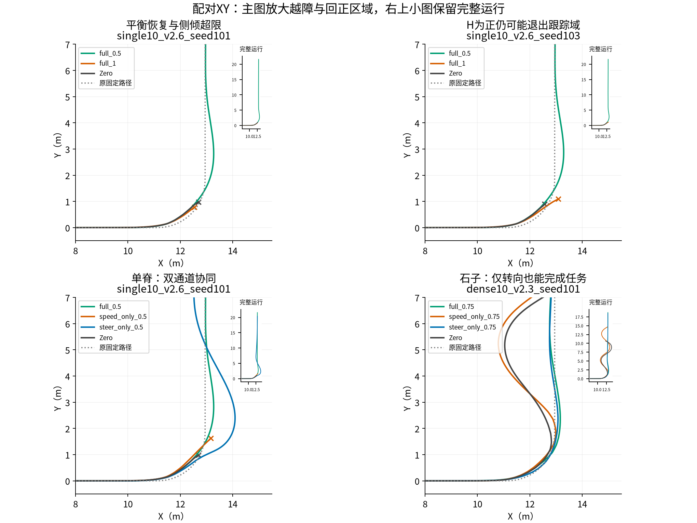
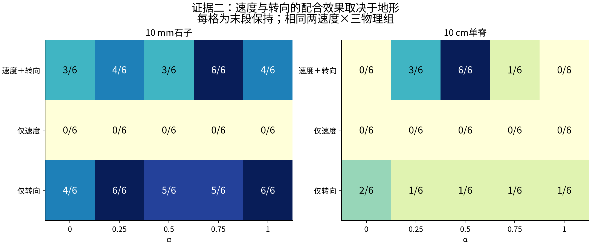
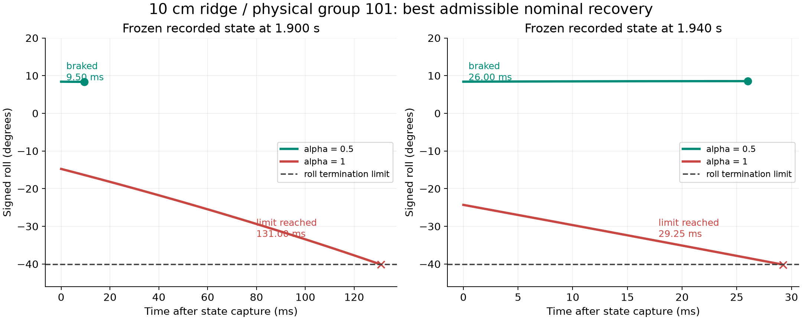
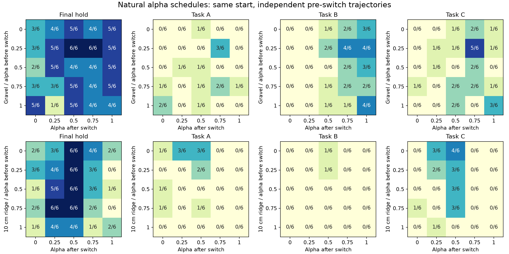

# 单轨双轮车辆越野中的偏好条件参考调节：速度—路径取舍与恢复约束

**Preference-Conditioned Reference Adjustment for Off-Road Single-Track Vehicles: Speed–Path Trade-offs and Recovery Constraints**

## 摘要

单轨双轮车辆通过转向维持侧倾平衡，因而速度保持、路径跟踪与受扰恢复共享有限的控制能力。地形接触进一步改变车速、姿态及转向响应，使固定的速度—转向配合难以适应不同任务。本文研究一种偏好条件化参考调节方法：保留冻结的平衡控制层，由同一中层网络根据偏好参数α输出速度与转向参考修正。首先，从实现中的线性标量化目标推导完整端点代价的条件单调性，明确偏好参数与物理误差之间的区别。其次，针对限转角、限转向速度的名义侧倾模型，证明最有利恢复控制对应的最小侧倾包络，并以跟踪器前视域补充平衡之外的任务约束。最后，通过冻结策略的平地、单脊、石子和自然切换仿真检验行为差异。单脊通道消融中，α=0.5双通道末段保持为6/6，仅转向为1/6，仅速度为0/6；石子中对应为3/6、5/6和0/6。五档自然切换的300条主车道显示，单脊后段α=0.5与1的末段保持分别为28/30和5/30，而石子速度任务通过数分别为5/30和16/30。结果表明，α形成具有地形及任务依赖性的行为族。名义恢复包络进一步解释了失败状态中转向建立速度与倾倒增长之间的竞争，为依据任务和恢复余量选择α提供了物理依据。

**关键词：** 单轨车辆；偏好条件控制；速度—路径协调；越野恢复；执行器约束。

## Abstract

A single-track vehicle uses steering both to follow a route and to recover lean, coupling these tasks to forward speed. Terrain contact changes the operating state and can make a fixed speed–steering response unsuitable. We study a preference-conditioned middle policy that adjusts speed and steering references above a frozen balance layer. We derive conditional monotonicity for the complete endpoint objectives of the implemented scalarization, and prove a minimum-roll envelope for a nominal model with steering-angle and steering-rate constraints. Simulations distinguish roll-limit termination, tracking-domain exit, and task completion. In ridge ablations at α=0.5, joint correction achieves final hold in 6/6 cases, compared with 1/6 for steering-only and 0/6 for speed-only correction. The corresponding gravel counts are 3/6, 5/6, and 0/6. Across natural preference schedules, the middle setting retains an advantage on the ridge, whereas high speed priority achieves more successes on the gravel speed task. These results identify terrain- and task-dependent advantages within a shared policy and motivate preference selection using task constraints and recovery margins.

## 1 引言

单轨车辆的平衡依赖运动中的转向作用。遇到凸脊或石子后，控制器不仅需要压制侧倾，还要使车辆继续沿原路径行驶，并满足速度和到达要求。因此，“侧倾峰值更小”与“任务完成得更好”并不等价。恢复平衡时产生的航向变化可能使路径跟踪失效；反之，较好的瞬时路径跟踪也不能说明车辆仍有足够能力刹住快速倾倒。

参考调节提供了一种在已有平衡层上处理这些冲突的途径。参考与命令治理器通过修改输入参考处理预稳定系统的约束，其保证依赖预测模型及相应可行性条件[1]。残差强化学习将模型控制与学习修正组合，用于处理难以精确建模的作用[2]。偏好条件多目标学习则通过目标权重控制共享网络的行为[3]。本文通过偏好条件化参考接口连接任务要求与已有平衡控制器，重点研究单轨车辆在不同地形中的速度—转向配合。

研究问题具体为：同一冻结平衡层上，不同α能否形成可区分的行驶方式；这种差异为何会在不同地形和任务中产生不同结局；哪些数学关系能够解释这些结果，并为后续选档提供依据。本文从偏好目标、名义恢复能力和真实任务结局三个层面回答这些问题。本文的贡献在于将偏好目标的取舍结构、受限转向下的恢复能力和地形相关的任务表现联系起来：目标结构解释为何保留一族行为，恢复包络解释部分状态为何失效，配对实验则确定各档行为的适用条件。

## 2 任务与控制方法

### 2.1 原始任务与评价

任务由固定世界坐标路径、请求速度和终端要求给定。所有α使用同一原始评价参考，网络修正后的参考不替代原路径和请求速度。车辆状态包括位置、航向、速度v、侧倾φ、转角δ及其动态量；完整闭环状态还包含观测历史、ESO状态、参考滤波、动作延迟和路径投影状态。

本文分别统计完整运行、侧倾终止、跟踪域退出、到达、末段保持及任务合格。近期越野回合为10s，侧倾终止阈值为0.7rad；该阈值是程序姿态判据，不等于确认车体已碰地。任务A/B/C均要求完整运行且满足原末段保持判据，并分别满足表1中的全程误差要求。速度RMSE和路径峰值按真实有效轨迹计算，提前终止不能仅凭短窗口误差较小获得任务合格标签。

**表1　近期越野任务的冻结门槛。**

|任务|路径绝对误差峰值上限/m|速度RMSE上限/(m/s)|共同要求|
|---|---:|---:|---|
|A|0.30|0.20|完整10s及末段保持|
|B|0.60|0.10|完整10s及末段保持|
|C|0.40|0.15|完整10s及末段保持|

完整的目标截面、末段保持实现及原始指标见证据E2、E5；它们在本次分析中未重新定义。

### 2.2 分层参考调节

当前越野主系统采用H75中层、Local300冻结底层及ECBC/ESO。H75输入包含16个20维历史帧、16个有效性标志和15个上下文字段，共351维。上下文包含α、路径与航向误差、曲率预览、请求速度及修正器状态。网络隐藏层宽度为128、128、64，使用ELU，并在后两层施加与α相关的特征调制。网络在50Hz更新潜动作，参考修正在200Hz执行，物理步长为0.2ms。本文复用冻结权重，不在这些实验中更新策略。

潜动作经双曲正切映射后，速度修正目标范围为−1.00至+0.25m/s，转向修正目标范围为±0.20rad。两通道一阶滤波时间常数为0.10和0.08s；速度修正的下降、上升速率分别限制为1.0和0.5m/s²，转向修正变化率限制为0.8rad/s。修正与名义参考相加后，还受参考幅值约束。因此α调整的是带记忆和限速的参考生成过程，而非直接修改平衡反馈增益。

底层前轮接口为转向角速度，后轮接口为轮轴转速。本文所用±3rad/s最终前轮命令限制，与碰撞期间的实际关节角速度不同。名义推导若将实际转向速度也限制在该范围，需要额外声明理想执行假设。Zero基线关闭H75中层修正，仍保留同场景的冻结底层及ECBC/ESO。

### 2.3 偏好目标的实现

H75沿用偏好条件PPO训练得到的冻结策略。原策略训练与近期评测的初始化方式分别记录：原训练资料含完整父策略状态的重置分布，本文新自然切换评测则从共同保存起点持续运行，未恢复中途快照。二者不能混称为同一训练协议。本文以冻结策略的实际任务表现评价其能力。

令共同代价为C，两个偏好端点的非共同代价为J₀、J₁。对固定策略在共同初始分布和任务定义下进行反事实重评分，目标满足

$$J_\alpha(\pi)=C(\pi)+(1-\alpha)J_0(\pi)+\alpha J_1(\pi).\tag{1}$$

这里C包含姿态、角速度、超速、低速、修正幅值和变化率等共同项，以及按实际终止计入的共同失败代价。源码先对速度及主任务的端点分项截断，再线性混合，因而有效代价仍对α仿射。不能先混合后施加另一种总截断来替代原实现。

在未触发分项截断时，速度Huber项系数为10−9χ(1−α)，路径和航向项的共同系数为10(1−0.9α)。χ为冻结的转弯需求门控；当前运行源码的路径系数不再乘χ。χ=1时速度与路径系数分别为1+9α和10−9α，α=0.5使这两个系数相等。除此之外仍有主任务带外代价、航向项及共同项，所以等权不意味着物理误差相等，更不意味着任务最优。

## 3 偏好几何及其可证明范围

### 3.1 完整端点目标的条件单调性

定义完整端点目标F₀=C+J₀、F₁=C+J₁，则式(1)等于(1−α)F₀+αF₁。以下命题要求策略类与初始任务分布相同，并且每个α的策略均达到该标量目标的全局最优；它用于说明目标结构，不预设有限训练的H75满足最优性。

**命题1。** 对0≤a<b≤1，若πₐ和πᵦ分别最小化上述标量目标，则F₀(πᵦ)≥F₀(πₐ)，F₁(πᵦ)≤F₁(πₐ)。

**证明。** 记Δᵢ=Fᵢ(πᵦ)−Fᵢ(πₐ)。两个最优性不等式给出

$$(1-a)\Delta_0+a\Delta_1\geq0,\qquad (1-b)\Delta_0+b\Delta_1\leq0.\tag{2}$$

相减得Δ₁≤Δ₀。若Δ₀<0，则两者均负，与第一个不等式矛盾；若Δ₁>0，则两者均正，与第二个不等式矛盾。因此Δ₀≥0且Δ₁≤0，证毕。

命题不能直接用于裸速度误差与裸路径误差。共同代价C会随策略变化；例如两个策略的(C,J₀,J₁)分别为(10,0,10)和(0,15,16)，增加α会使最优策略从前者切换到后者，两个裸任务代价都增加，但完整端点目标仍满足命题1。因此，目标空间中的取舍由完整端点代价描述，速度和路径指标的取舍由实际轨迹评价。

### 3.2 评价偏好与有限策略族

若评价者使用与训练完全一致的目标Jθ、相同任务分布和策略类，则全局最优πθ自然不劣于族内其他策略。这个结论不扩展到不同地形、不同终止规则、不同任务门槛，也不保证近似学习策略满足“α=θ最优”。

对已经测得的有限候选，可用统一评价代价比较速度与路径误差：

$$Q_i=V_i+\eta^2 P_i,\qquad \eta^2=\frac{V_j-V_i}{P_i-P_j}.\tag{3}$$

式(3)右侧给出候选i、j代价相等时的交点，前提为分母非零且交点为非负实数。V与P若分别是速度误差平方和路径误差平方，η的单位为s⁻¹。交点将评价尺度划分为不同候选占优的区间，使有限策略族与具体任务偏好建立联系。η应由任务尺度指定；通过数据估计交点时，将其作为描述性前沿分析。

若某固定条件下速度误差随α不增、路径误差随α不减，则同时满足两个误差容差的α集合为区间，也可能为空。真实策略出现非单调或物理失败时，该区间性质不再成立。即使两个容差经归一化后相等，余量平衡点也不必位于0.5：误差曲线1−α与α²的交点约为0.618。因而端点、中间档的选择必须结合实际响应曲线。

## 4 地形作用下的恢复与跟踪约束

### 4.1 名义侧倾动态

固定速度的名义小角度模型为

$$\ddot\phi=a_1(v)\dot\delta+a_2(v)\delta+a_4\phi+d(t).\tag{4}$$

由当前ECBC参数得到a₄=40.7619s⁻²，a₁(v)=−1.51526v，a₂(v)=1.78195−9.23941v²，其中各系数按SI单位使用。忽略参考、ESO补偿、滤波、限幅和学习底层作用时，转向速度反馈写为

$$\dot\delta=-k_\delta\delta-k_\phi\phi-k_p\dot\phi.\tag{5}$$

其特征多项式为

$$p(s)=s^3+(k_\delta+a_1k_p)s^2+(a_1k_\phi+a_2k_p-a_4)s+a_2k_\phi-a_4k_\delta.\tag{6}$$

在增益求解未进入保护分支的工作点，源码配置p(s)=(s+5)³。扰动到侧倾的传递函数为

$$G_v(s)=\frac{s+k_\delta(v)}{(s+5)^3}.\tag{7}$$

相同极点并不意味着相同扰动响应，因为分子随速度改变。单位侧倾速度冲量的响应为

$$\phi(t)=\exp(-5t)\left[t+\frac{k_\delta-5}{2}t^2\right].\tag{8}$$

源码增益独立复算显示，从2.25到2.567m/s，式(8)峰值增加约4.87%。这一结果揭示了速度改变恢复响应的动力学途径。各α通过实际速度和转向参考进入这一过程。

### 4.2 有限转向建立速度下的最优恢复包络

考虑d=0、固定v、a₁<0、a₂<0，并约束实际转角及实际转向速度：|δ|≤δmax、|δ̇|≤umax。令λ=√a₄，对式(4)中的δ̇项分部积分，得

$$\phi(T)=\phi_0\cosh(\lambda T)+\frac{\omega_0-a_1\delta_0}{\lambda}\sinh(\lambda T)+\int_0^T K(T-t)\delta(t)\,dt,\tag{9}$$

$$K(\tau)=a_1\cosh(\lambda\tau)+\frac{a_2}{\lambda}\sinh(\lambda\tau)<0.\tag{10}$$

**命题2。** 对正向倾倒，δ*(t)=min(δ₀+umax t,δmax)在每一个时刻使φ(t)最小。若该最小包络仍越过正侧阈值，则所有允许的转向控制都必在该时刻或之前越限。

**证明。** 由初始转角和速度约束，任意允许控制均满足δ(t)≤δ*(t)。式(10)的核为负，代入式(9)即得φ(t)≥φ*(t)。因此φ*(T)>φc时，所有允许控制的侧倾角在T时也超过φc。对负侧倾倒同时变换φ、ω、δ的符号，结论成立。

这个结果显式计入当前转角和建立纠偏转向所需的时间。因此，失败可以发生在转角尚未达到幅值上限时：转向变化速度已经不足以赶上倾倒增长。若最优包络先使外倾角速度归零，则当前方向能够完成制动；后续任务继续由路径、速度和终端要求评价。

### 4.3 双侧停止余量与实际接触

若在分析区间内可独立给出总回正角加速度的上界B>0，则停止外倾至少需要角位移ω²/(2B)。定义

$$H^+=\phi_c-\phi-\frac{\max(\omega,0)^2}{2B},\qquad H^-=\phi_c+\phi-\frac{\max(-\omega,0)^2}{2B}.\tag{11}$$

H=min(H⁺,H⁻)<0是相应假设下的必越限条件，H≥0只表示未被该必要条件排除。本文名义参数范围v∈[0.5,3]m/s、|δ|≤0.8rad、|δ̇|≤3rad/s、|φ|≤0.7rad对应的保守绝对加速度界为

$$B_{\mathrm{nom}}=\max_v\left(3|a_1(v)|+0.8|a_2(v)|+0.7a_4\right).\tag{12}$$

其值为6146.05°/s²，计算时与式(11)保持一致单位。真实轮地接触可能使实际加速度和关节速度超出名义假设，因此本文将该H用于轨迹诊断，不将其阴影区域标为完整车辆的认证安全域。

地形影响还包括输入本身随通过方式变化。恒速沿一维地面h(x)运动时，ḣ=vh′、ḧ=v²h″；这些是运动学关系，不能将ḧ直接等同侧倾扰动。接触力、作用位置、轮胎变形和姿态共同决定实际侧倾作用。冲量随v线性增长仅在碰撞及作用时间的附加假设下成立，本文不把它当通用定律。类似地，前后轮间隔L/v只能作为近似接触时差，不能替代真实前后轮事件记录。

### 4.4 跟踪域与任务可行性

令pℓ为原路径上的前视点，p为车体位置，ψ为车体航向。跟踪器前向余量可以直接计算为

$$m_{\mathrm{dom}}=[\cos\psi,\sin\psi](p_\ell-p)-0.05.\tag{13}$$

m_dom≤0触发当前跟踪器的工作域退出。该几何表达适用于曲线路径的实际前视点；以切线近似推得的Ld cosψe±e sinψe必须另行固定误差符号并说明近似条件。

平衡恢复余量和跟踪域余量约束不同的失败过程。前者不足可能造成侧倾超限，后者不足可能使车辆尚未倒下就无法继续使用当前跟踪器。即使两者均满足，仍须检查速度、路径和终端条件。这种区分使“恢复成功”与“任务成功”能够分别评价。

## 5 实验设计与证据分层

本研究复用已完成记录，按模型身份与协议分开分析。表2列出主要证据块；不同块不相加为一个总成功率。

**表2　主要实验及角色。**

|证据|模型和实验|规模|角色|
|---|---|---:|---|
|E1|H75与Local200的历史四路线平地面板|所列每档8个路线/初态条件|阈值经历史开发调整的DEV|
|E2|原H75与Local300：高度、侧推、通道、布局四阶段|1432条；通道部分216条|开发与冻结规则布局测试分开|
|E3|名义最优包络及LP|360初态、36优化问题|低阶数学/数值验证，非PhysX回合|
|E4|同一216条轨迹的H及跟踪域诊断|216条|已有数据的描述性复算|
|E5|五前段×五后段自然α切换|300主车道＋36基线/重复|熟悉地形DEV，336条|

近期越野主模型、策略身份与时间步长固定，物理参数组与地形条件由运行合同给出。各自然切换回合从同一保存起点开始，在原路径进度2.5m切换α，未恢复中途快照。三个物理组不是三个独立训练种子；同一配置的重复车道也不计作新增独立条件。

先展示原始轨迹，再报告聚合指标。图1保留原参考、实际运动和配对Zero；图2覆盖近期五档及通道消融。全部声明场景的XY、奖励、速度及失败终点均由证据索引提供。

## 6 实验结果

### 6.1 平地偏好行为

历史四路线面板中，H75的α从0、0.5增加到1时，平均转弯速度分别为2.202、2.339、2.452m/s，平均到达前最大原路径偏差为0.149、0.371、0.705m。对应窄任务通过数为8/8、4/8、0/8，宽任务为4/8、8/8、6/8。所有所列回合均进入原目标并保持至10s。[E1]

随着α增加，车辆提高转弯速度，同时接受更大的原路径偏差。窄任务偏向低α，宽任务在中档达到最高通过数，表明任务容差决定了偏好取舍的价值。此面板的Local200及开发判据与表2一致。历史几何规则在部分平均速度和路径指标上更优；本节关注共享策略内部的可调取舍。

### 6.2 地形相关的通道协调

10cm单脊、α=0.5时，完整双通道末段保持6/6，独立重复车道也为6/6；只保留转向为1/6，只保留速度为0/6。10mm石子中，同一α的三种模式分别为3/6、5/6、0/6。[E2]

这两个对照表明，速度修正和转向修正的组合效果依赖地形。单脊要求两个通道配合，而所测石子工况更适合保留较强的转向调节。地形改变了有效的协调方式，这正是保留可调行为族的理由。只保留转向的单脊101回合虽然最终保持，但路径峰值误差达到1.143m，未通过A/B/C，进一步说明姿态保持不等于任务完成。

### 6.3 失败过程与名义包络

216条通道回合中，97条完整运行、39条侧倾超限、78条运行域退出，另有2条终止原因未完全解析。以同一B_nom复算，39条侧倾超限均在真实姿态越限前出现H<0；97条完整回合H均非负。78条运行域退出全部触发式(13)的前视点条件，其中74条H始终非负。[E4]

单脊2.6m/s、物理组101的α=1在后轮再接触附近出现快速负向倾倒。取1.940s记录状态，φ约−24.30°、ω约−534.13°/s、δ约0.0115rad；固定该时刻速度并去掉未来接触作用，名义最优转向包络仍在29.25ms内越限，而真实记录30ms后终止。α=0.5同一时刻φ约8.40°、ω约10.53°/s，名义最优控制26ms后刹住该方向倾倒。[E3]

36个受约束线性规划独立核对了离散最优包络，最大终点差3.20×10⁻¹⁴rad。360个声明初态中170个满足名义必越限条件，190个先刹住当前方向。事件时间由0.25ms网格搜索，包络值采用解析解。这些是名义模型内的证明与计算，不是360条完整车辆仿真。

同一失败轨迹从1.900s冻结状态计算，名义越限时间为131ms，真实仅70ms后终止；这一差距揭示了接触阶段的重要性：从较早状态预测时，还需计入后续接触输入；再接触后的状态已进入名义不可避免越限区。另一个物理组103的α=1在2.220s退出跟踪域时，侧倾仅11.29°、前视点前向距离0.030m。该回合由跟踪几何失效触发停机，属于与侧倾超限不同的失败机制。

### 6.4 五档自然切换

336条评测中242条完整运行、36条侧倾超限、58条跟踪域退出。表3将300条主车道按后段α汇总；每格30条包含五种前段、两种速度及三个物理组，Zero和重复车道单列，不扩大主比较的分母。[E5]

**表3　自然切换中不同后段α的表现。**

|后段α|单脊末段保持|单脊任务C|石子末段保持|石子任务B|
|---|---:|---:|---:|---:|
|0|9/30|1/30|16/30|0/30|
|0.25|22/30|6/30|18/30|0/30|
|0.5|28/30|13/30|25/30|5/30|
|0.75|13/30|0/30|22/30|11/30|
|1|5/30|0/30|24/30|16/30|

单脊后段α=0.5获得28/30末段保持，其中13/30同时满足任务C；石子速度任务B则由α=1获得更高通过数。两种地形上的优势档位不同，说明选档应同时依据地形和任务。单脊低α的侧倾失败还表明，恢复能力随α的变化可以具有中间优、两端差的形状。

本矩阵比较从共同起点自然运行的不同配置。接触积分使各车道的切换前状态发生分化，60个前段组均未通过冻结的同状态检查；因此将其数据角色记为自然配置比较。

### 6.5 自动选档的实际结果

既有简单规则在10mm石子新布局的A/B/C通过数分别为1/16、8/16、5/16；测试后最佳固定档对应为3/16、9/16、4/16。这说明该规则只在C多完成一例，尚未形成普遍选档收益。[E2]

在共同状态检查失败后，进一步用每条车自己的切换前观测进行探索性预测。整物理组留出、固定三个近邻，与同地形和同目标α的训练组平均结果比较。完整运行、任务A、B、C的状态预测Brier分别为0.1800、0.0789、0.0885、0.1041；仅地形/档位统计分别为0.1688、0.0777、0.0710、0.1157。只有任务C改善，因而当前近邻规则未被采用。这是已执行动作的结果预测，不是未执行动作的反事实验证。[E5]

## 7 讨论：如何从适用范围走向选档

当前证据支持按三个层次组织选择。首先依据任务容差保留候选；其次检查预测的平衡和跟踪余量；最后在候选内比较同一任务代价。若使用最大最小余量原则，角度余量与距离余量应先按事前声明的尺度归一化：

$$\alpha^*=\arg\max_{\alpha\in\mathcal{A}_{\mathrm{task}}}\min\left(\frac{\widehat{m}_{\mathrm{roll}}(\alpha)}{s_{\mathrm{roll}}},\frac{\widehat{m}_{\mathrm{dom}}(\alpha)}{s_{\mathrm{dom}}}\right).\tag{14}$$

帽号表示对未来响应的预测，而非本回合结束后计算的余量。s_roll和s_dom的选择影响排序，不能通过测试结果倒推；若候选集合为空，还需要预先规定减速、改变路线或终止等任务行为。式(14)给出下一阶段在线选择器的设计目标，其预测模型与收益需在新布局上检验。

仅在两个归一化余量连续且一增一减等条件成立时，交点才构成最大最小解的一种候选；若无交点，应比较端点。单脊中低α与高α均可能侧倾失败，已经说明不能假定恢复余量对α全程单调。实际可行集合可能不连续，选档因此应覆盖完整候选族，而不是预设只有中间档可用。

从论文证据看，低α适合路径容差紧且允许速度损失的部分条件；高α在石子的速度任务中更有利；中间档在所测单脊中有较大的保持范围。这三类结果形成了选档的实验依据。面向新状态的预测应进一步结合运行状态、接触条件和参考建立过程。300次真实H75参考模块导数检查中，222次速度参考对α的即时导数为零，也说明网络输出偏好不能立即转化为相同幅度的速度响应。[E3]

本研究限于仿真与一个冻结中层策略实现。名义模型忽略强接触与完整执行器动态，历史平地和当前越野使用不同底层版本，固定物理组不提供独立训练不确定性。重复车道差异与选档负结果均保留。接触因果分解、细α响应曲线及新布局在线选档属于后续验证，不作为本稿已完成贡献。

## 8 结论

本文将单轨车辆的越野偏好控制表述为受恢复与跟踪约束的速度—转向参考协调。线性偏好目标能够提供完整端点代价的条件单调性，但不会自动保证物理误差单调或某一α最优。限转角和限转向速度的名义最优包络证明了部分状态为何即使采用最有利转向仍会越限；前视工作域则解释了未摔倒而停机的另一类结果。

冻结策略的通道消融和自然切换实验显示，不同地形和任务需要不同的协调方式。单脊中档保持较多，石子速度任务高档通过较多，支持保留一个可调行为族。这些结果将选档问题具体化为：依据任务容差和当前状态，选择能够保留恢复与跟踪余量的参考调节方式。后续工作将以新布局上的在线决策检验这一选择原则。

## 参考文献

[1] Garone E, Di Cairano S, Kolmanovsky I. Reference and command governors for systems with constraints: A survey on theory and applications. *Automatica*, 75, 306–328, 2017. [作者机构原文](https://merl.com/publications/docs/TR2016-102.pdf)；[出版记录](https://doi.org/10.1016/j.automatica.2016.08.013)。

[2] Johannink T, Bahl S, Nair A, et al. Residual Reinforcement Learning for Robot Control. arXiv:1812.03201, 2018. [作者原文与元数据](https://arxiv.org/abs/1812.03201)。

[3] Abels A, Roijers D, Lenaerts T, Nowé A, Steckelmacher D. Dynamic Weights in Multi-Objective Deep Reinforcement Learning. *PMLR*, 97, 11–20, 2019. [会议正式全文入口](https://proceedings.mlr.press/v97/abels19a.html)。

## 附录：实验来源与复算入口

|编号|可追溯来源|本稿使用范围|
|---|---|---|
|E1|[历史四路线报告](/home/qy/STTW_CONTROL/runs/worktrees/tolerance-calibration/docs/results/sttw-tolerance-20261101/frozen_middle_comparison/README.md)|仅H75行，Local200、开发阈值|
|E2|[四阶段结果](../evidence/h75_evidence_queue_20261110/final_results/README.md)|1432条实验来源；通道与冻结规则布局测试|
|E3|[数学验证](../evidence/h75_mathematical_verification/README.md)|包络证明、360初态、36LP、参考导数|
|E4|[理论图谱](../evidence/h75_theory_atlas/README.md)|216条H和前视域复算，完整失败分类|
|E5|[五档自然切换](../evidence/h75_state_alpha_scan/README.md)|336条、五档矩阵、状态检查及预测负结果|

源码对应：`torch_path_reward.py`、`torch_controller.py`、`torch_path_policy.py`；数学回归测试为`learning/tests/test_paper_preference_theory.py`。本稿引用的近年仿真数据可从上述仓库报告进入原始运行目录；未随精简仓库发布的高频时序仍保存在原数据卷。原始策略、完整配置和评价规则不得仅以图中数值替代。
