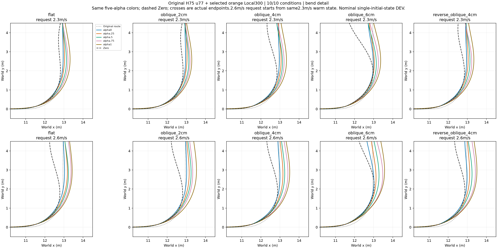
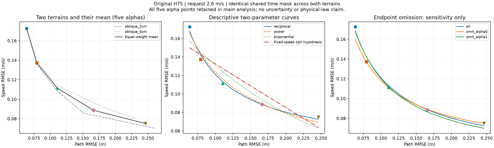
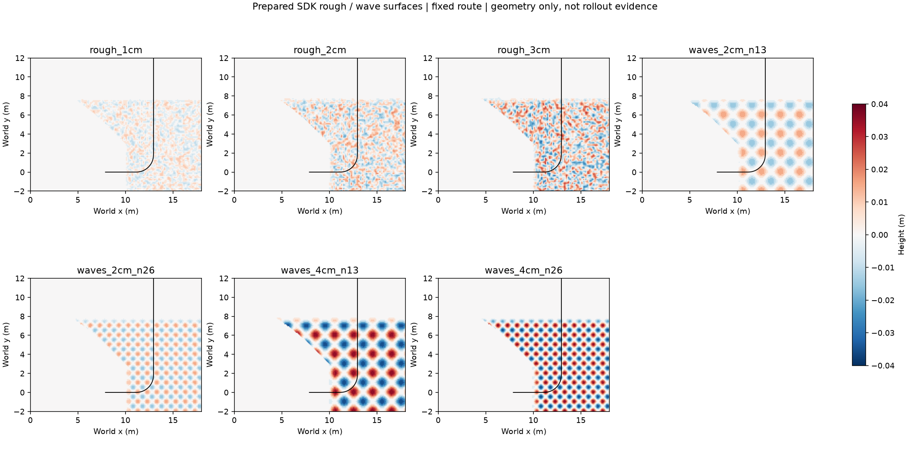

# STTW 越野结果与曲线推理交接包

这是供其他 agent 审阅和推理的仿真 DEV 证据包，不是论文定稿。当前只推进 STTW；新章节、带摆车/RB 接续延后。原始 H75 u77 + 用户指定橙色 Local300，五档 alpha=0/.25/.5/.75/1；未采用续训奖励峰值模型替代原策略。

## 先看实际轨迹，再看拟合





- [所有条件完整XY](terrain/xy_matrix_full.png)
- [十条件取舍连线（含Zero）](terrain/tradeoff_common_window_connected.png)、[H75放大](terrain/tradeoff_common_window_connected_detail.png)
- [全部指标](terrain/metrics.json)、[拟合输入/权重/参数/留一预测/敏感性](terrain/tradeoff_shape_analysis.json)
- [速度—曲率代理—侧倾响应](terrain/tradeoff_bend_dynamics.png)、[对应数据](terrain/tradeoff_bend_dynamics.json)
- [同状态五alpha查询图](queries/same_state_alpha_overview.png)，各入口/出口快照的CSV和身份位于 queries/。
- [前轮接触对齐](contact/front_aligned.png)、[后轮接触对齐](contact/rear_aligned.png)，原始派生数组和统计在 contact/。
- [入口通道干预XY](interventions/entry_projection_hold_zero_xy.png)、[出口干预XY](interventions/exit_projection_hold_zero_xy.png)、[全条件统计](interventions/hold_zero_comparison.json)。各phase/alpha子目录包含XY、短时响应和metrics。
- [同状态偏好切换XY](switch/original/xy.png)、[参考/姿态/奖励响应](switch/original/responses_short.png)、[重规划小修复后XY](switch/tangent_repair/xy.png)。两协议独立保留，不混合窗口。

## 已观察到什么

十个地形速度条件×五alpha：50/50 H75完成原协议goal/hold，0提前失败。10个Zero均进入goal但0完成hold、6提前失败；进入目标区不等于后续保持，不将程序failure自动解释成摔倒。条件是平地、2/4/6cm斜凸起、反向4cm斜凸起，各2.3/2.6m/s，每条件一个保存初态。2.6m/s是从同一2.3m/s初态改变请求。不是随机重复或独立TEST。

alpha端点全部表现为更保速度时路径RMSE更大；中间档不要求严格排序。同状态查询支持alpha直接影响双通道目标。接触对齐仅是时序关系；同快照短时置零/保持干预支持局部通道作用，但不是双通道策略始终最优的证明。PhysX缓存不随快照复制，自然/恢复对照差异必须保留。

协调限速未显示可靠收益：在共享切换状态的0.5s窗口，独立/共同/转向优先的路径RMSE为.219157/.219092/.218943m；速度RMSE为.062553/.061783/.062885m/s。XY差异约.5–.6mm，接近恢复对照差异，转向优先未触发。保留原独立限速。

## 当前拟合与要推理的问题

指定2cm/4cm、2.6m/s两工况统一使用0–6.26s共同有效样本（1252个5ms步），按相同alpha等权平均两项RMSE坐标，未删任何点。拟合：

`E_speed [m/s] = 0.039477 + 0.0081632 / E_path [m]`

这里第二系数单位m²/s。R²=.990312，拟合RMSE=.003430m/s；留一alpha预测RMSE=.007048m/s。两地形分别反比例拟合R²=.986951/.988932。端点删除只作敏感性，不把低alpha的大速度误差当异常。均值坐标不等于合并样本RMSE，二者都在JSON保留。

对比幂律/指数/线性/固定速度平方根两参数曲线；原始参数和留一结果全部保留。平方根方案在(2.6-E_speed)²变换域拟合，其余直接拟合速度RMSE；分数统一为速度误差单位。留一只有五个确定性alpha点，不是独立泛化或概率分布检验。不能用高R²证明动力学定律，不能把.039477当物理误差下限。不要外推到E_path=0或无限大。

ECBC源码中m1含v、m2含v²及拖距修正。低滑移稳态近似tan(phi)=v²*kappa/g能解释耦合，但不能直接把径向外扩换成全程路径RMSE。实际统计十条件速度升/曲率代理降，9/10侧倾均值升，说明恒侧倾假设不严格。yaw_rate/v是低滑移曲率代理，不是含侧滑时的精确XY曲率；yawrate取相邻post-step姿态5ms差分，侧倾/速度均post-step。

请后续agent判断：反比例是否只是有限区间近似？奖励、滤波、策略输出映射和路径积分分别如何影响曲率？是否可以用已保存逐步数组区分这些解释？不要为得到漂亮曲线删掉有效点，不要求把所有场景硬拟合成同一公式，不继续训练或修改主稿。

## 凸起不等于陡坡

本包主图的6cm是局部凸起高度，不是最大爬坡能力。此前另有8/16/24cm上升坡道，原设计沿1.2m上升，余弦轮廓名义最大坡度约6/12/17.4度（离散网格会影响局部坡度）。[坡道原指标](uphill/uphill_metrics.json)及[运行状态](uphill/status.json)独立保留，不混入主图。用户新要求：补充全路段坑洼和连续起伏，作为后续评估；本包不冒称已完成这些新场景。

## 训练与运行代码（随本分支推送）

- [H75续训入口](../../../learning/cli/train_go2_path.py)：复用Go2 runner/PPO，保留H75策略接口。
- [底层训练入口](../../../learning/cli/train_go2_local.py)
- [H75训练配置](../../../learning/configs/go2_h75_offroad_horizon.json)、[另一训练配置](../../../learning/configs/go2_h75_offroad.json)
- [H75训练环境](../../../learning/src/sttw_control/go2_path_env.py)、[PPO适配](../../../learning/src/sttw_control/go2_ppo_adapter.py)
- [闭环采样/奖励调用](../../../learning/src/sttw_control/isaac_path_rollout.py)、[奖励](../../../learning/src/sttw_control/torch_path_reward.py)
- [Isaac Lab物理接口](../../../learning/src/sttw_control/isaaclab_vector_env.py)、[域随机化](../../../learning/src/sttw_control/isaaclab_randomization.py)
- [ECBC动力学](../../../learning/src/sttw_control/controller.py)、[当前冻结评估入口配置](../../../learning/configs/isaaclab_h75_offroad_selected.json)
- [SDK地形库](../../../learning/cli/prepare_isaac_terrain_library.py)、[地形放置](../../../learning/cli/place_isaac_terrain.py)

这是当前代码，不表示本包图由新训练产生。训练依赖Isaac Lab、配置指定的Go2/rsl_rl外部checkout及本地模型/权重路径；没有把外部依赖或模型权重随包上传。因此可以离线复现拟合，不宣称仅clone即可重训全部实验。

## 复现拟合（从仓库根目录运行）

需要Python、NumPy、SciPy、Matplotlib；不需要Isaac、GPU或权重。

```bash
python learning/cli/analyze_tradeoff_shape.py --evaluation docs/results/sttw-offroad-evidence-20261106/terrain
python learning/cli/plot_tradeoff_curve.py --evaluation docs/results/sttw-offroad-evidence-20261106/terrain --route docs/results/sttw-offroad-evidence-20261106/route.npz
```

terrain/每工况trajectory.npz仅包含原始lower_trace、progress、pose、measurement完整数组，六lane及提前终止标记均保留。lower_trace最后维顺序为post_x,post_y,true_speed,signed_cross_track,peak_abs_roll,step_reward,active_before_step,physics_stop_tick,governed_speed,governed_steer,rear_wheel_speed_estimate；控制dt=.005s。旧数据形状[500,4,6,11]，reshape为[2000,6,11]。模型/全物理快照不在此包，干预与切换用指标/图支持审阅，不能从本包完整重演PhysX快照。

source_manifest.json给出来源、提取方式和文件哈希；内部历史绝对路径仅用于原机器溯源。所有主要入口使用本包相对路径。主稿未修改，实车证据尚缺。

## 新增地形准备（尚无物理评测结论）



七个SDK地形已实际生成，黑线是原始参考路径，不是车辆轨迹。粗糙面实际高度范围分别为±1/2/3cm；波形SDK参数2/4cm经网格离散后的实际高度范围为±1.5/3.5cm，世界轴波长约2.008/1.004m。不可将名称参数直接写成实测振幅。原路径进度1.8m后用1m平滑渐入，12.3m处结束，覆盖弯道及出口观察段。地形没有按车辆位置移动，横向覆盖整个网格，凹处无额外平面填平。

[几何实测](terrain_preparation/geometry_metrics.json)的max_grid_grade是离散高程梯度，不是已测车辆爬坡能力。[场景配置](../../../learning/configs/isaac_h75_route_terrain_scenes.json)、[生成器](../../../learning/cli/place_isaac_terrain.py)复用NVIDIA terrain_utils；逐场景把scene对象保存为JSON，使用`--scene-config <scene.json> --terrain route_rough或route_waves --output <目录>`生成。使用既有Go2 IsaacGym环境及其库路径。新场景属于DEV准备，不混入先前10条件的结果表或拟合。

低速坡段筛查正在另行执行，尚未确认alpha0摔倒而更大alpha通过。新增全路段评测配置为`learning/configs/isaac_h75_route_terrain_sweep.json`，14条件×6轨迹，10秒，上限420万physics lane steps，0optimizer；等待低速筛查完成后再登记启动。

## 当前小车物理模型

[完整物理资产及说明](../../../assets/sttw_bicycle/README.md)已随同分支提交：当前实际URDF、轮子OBJ、转换契约、ECBC参数和Isaac Lab物理选项，并链接原MuJoCo XML/STL。身份与已评测模型一致；此处为小车物理模型，不是H75/Local300策略权重。

## 低速坡段筛查：阶段结果及设计局限

[已完成条件的XY/速度/侧倾与数据](low_speed_feasibility/FEASIBILITY.md)。当前快照4条件24轨迹，无提前失败；其余条件仍运行。1.4m/s低于冻结H75参考下限1.5m/s，两坡段alpha0/1执行参考触底比例100%，这会遮蔽速度偏好差异。该筛查不证明alpha0无法通过，也不证明动态alpha收益。完整数据保留，不降低限幅制造差异。
