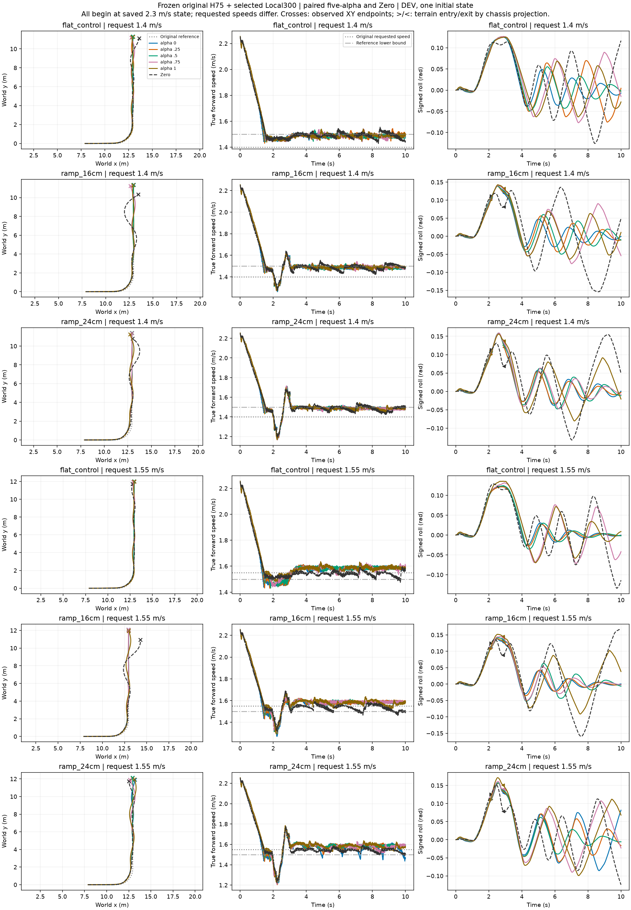

# Paired terrain feasibility — completed cases only

Frozen original H75 and selected Local300; DEV, one matched initial state per condition. No training. All outcomes retained.
The initial saved speed is 2.3 m/s; requested lower speeds are deceleration-approach conditions, not equilibrated starts.
The frozen speed-reference lower bound is recorded per row; a request below that bound cannot test an unrestricted low-speed preference difference.
Failure is the existing combined termination flag, not automatically a physical fall. Goal crossing and final hold are separate.
Terrain exit is chassis route projection, not a measured rear-wheel clearance. Metrics use individual observed windows.

|Terrain|Request m/s|Alpha|Early failure|Goal crossed|Final hold|Entry speed|Min terrain speed|Path RMSE m|Speed RMSE m/s|
|---|---:|---|---|---|---|---:|---:|---:|---:|
|flat_control|1.4|alpha 0|False|True|True|—|—|0.049|0.227|
|flat_control|1.4|alpha .25|False|True|False|—|—|0.072|0.230|
|flat_control|1.4|alpha .5|False|True|False|—|—|0.051|0.230|
|flat_control|1.4|alpha .75|False|True|False|—|—|0.094|0.231|
|flat_control|1.4|alpha 1|False|True|False|—|—|0.075|0.232|
|flat_control|1.4|Zero|False|True|False|—|—|0.159|0.226|
|ramp_16cm|1.4|alpha 0|False|True|False|1.333|1.262|0.077|0.229|
|ramp_16cm|1.4|alpha .25|False|True|True|1.330|1.272|0.077|0.231|
|ramp_16cm|1.4|alpha .5|False|True|False|1.326|1.269|0.081|0.233|
|ramp_16cm|1.4|alpha .75|False|True|False|1.334|1.271|0.123|0.234|
|ramp_16cm|1.4|alpha 1|False|True|False|1.336|1.274|0.097|0.234|
|ramp_16cm|1.4|Zero|False|True|False|1.334|1.270|0.371|0.227|
|ramp_24cm|1.4|alpha 0|False|True|False|1.294|1.174|0.106|0.233|
|ramp_24cm|1.4|alpha .25|False|True|False|1.282|1.169|0.104|0.235|
|ramp_24cm|1.4|alpha .5|False|True|True|1.276|1.169|0.104|0.236|
|ramp_24cm|1.4|alpha .75|False|True|True|1.287|1.165|0.103|0.237|
|ramp_24cm|1.4|alpha 1|False|True|False|1.288|1.168|0.143|0.237|
|ramp_24cm|1.4|Zero|False|True|False|1.279|1.194|0.306|0.230|
|flat_control|1.55|alpha 0|False|True|True|—|—|0.043|0.168|
|flat_control|1.55|alpha .25|False|True|True|—|—|0.038|0.170|
|flat_control|1.55|alpha .5|False|True|True|—|—|0.039|0.170|
|flat_control|1.55|alpha .75|False|True|False|—|—|0.077|0.169|
|flat_control|1.55|alpha 1|False|True|True|—|—|0.073|0.169|
|flat_control|1.55|Zero|False|True|False|—|—|0.088|0.160|
|ramp_16cm|1.55|alpha 0|False|True|True|1.344|1.270|0.072|0.172|
|ramp_16cm|1.55|alpha .25|False|True|True|1.327|1.292|0.070|0.173|
|ramp_16cm|1.55|alpha .5|False|True|True|1.328|1.296|0.077|0.173|
|ramp_16cm|1.55|alpha .75|False|True|True|1.340|1.308|0.073|0.174|
|ramp_16cm|1.55|alpha 1|False|True|False|1.376|1.300|0.145|0.173|
|ramp_16cm|1.55|Zero|False|True|False|1.386|1.318|0.444|0.165|
|ramp_24cm|1.55|alpha 0|False|True|False|1.293|1.207|0.117|0.179|
|ramp_24cm|1.55|alpha .25|False|True|False|1.296|1.203|0.099|0.179|
|ramp_24cm|1.55|alpha .5|False|True|True|1.307|1.213|0.096|0.179|
|ramp_24cm|1.55|alpha .75|False|True|False|1.315|1.207|0.154|0.180|
|ramp_24cm|1.55|alpha 1|False|True|False|1.312|1.223|0.197|0.179|
|ramp_24cm|1.55|Zero|False|True|False|1.329|1.227|0.127|0.170|

[Per-condition full XY and paired reward diagnostics](RESULTS.md)

No automatic feasibility or dynamic-switch benefit claim is made from this table.

All six conditions complete:36/36 full-window survival and goal crossing. Final hold:13/36 (H75 13/30, Zero 0/6); this is not a physical-fall advantage. The1.4m/s slope cases have100% speed-reference floor activation across all lanes. The1.55m/s cases retain some alpha-dependent speed correction, but every lane traversed.

[Source and packaged array subset manifest](source_manifest.json). Contract paths preserve original local provenance.
