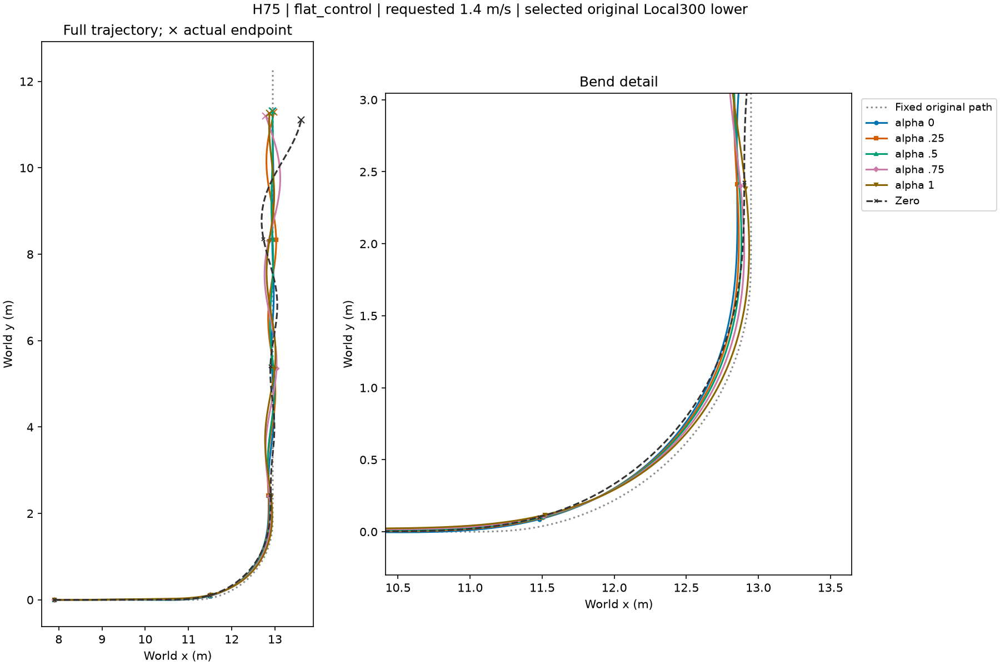
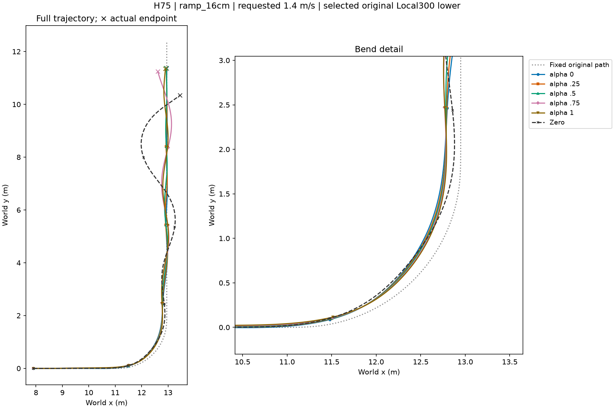
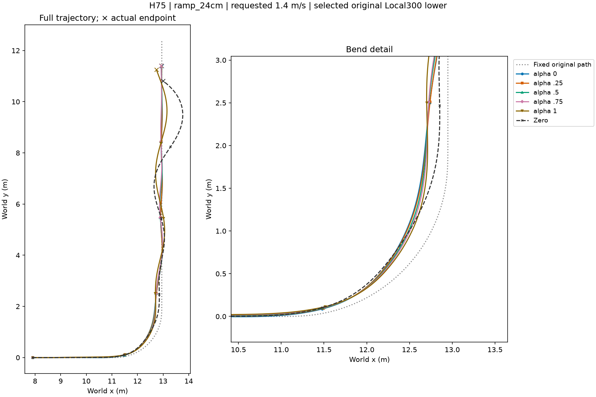
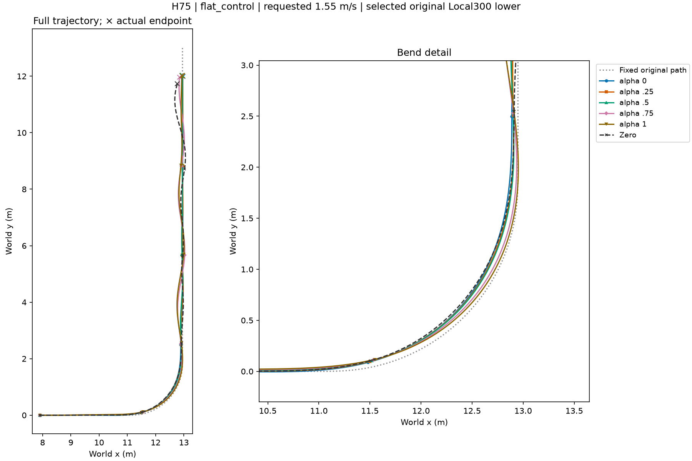
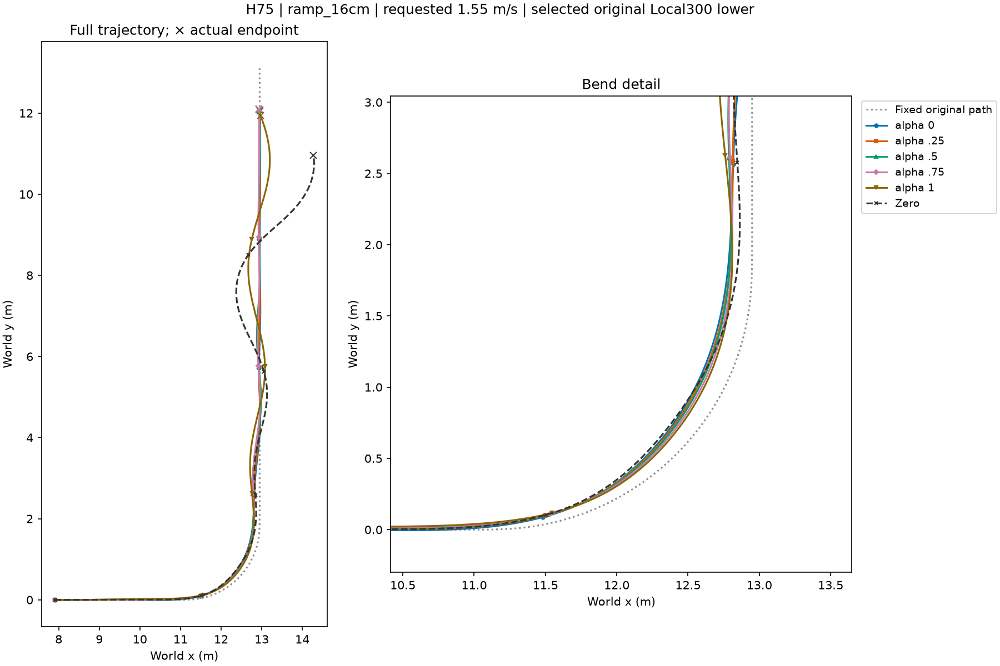
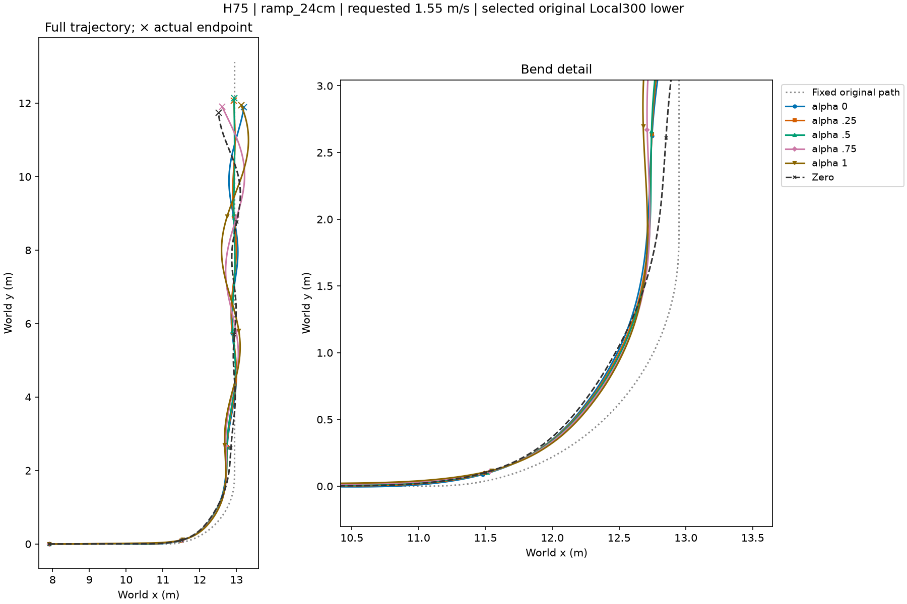

# All six completed low-speed conditions

All five alphas and matched Zero; saved data only. Initial speed2.3m/s, requests1.4/1.55m/s.

## flat_control_v1p4

[Per-step and cumulative rewards](flat_control_v1p4/overview.png)
[Trajectory subset](flat_control_v1p4/trajectory.npz)

## ramp_16cm_v1p4

[Per-step and cumulative rewards](ramp_16cm_v1p4/overview.png)
[Trajectory subset](ramp_16cm_v1p4/trajectory.npz)

## ramp_24cm_v1p4

[Per-step and cumulative rewards](ramp_24cm_v1p4/overview.png)
[Trajectory subset](ramp_24cm_v1p4/trajectory.npz)

## flat_control_v1p55

[Per-step and cumulative rewards](flat_control_v1p55/overview.png)
[Trajectory subset](flat_control_v1p55/trajectory.npz)

## ramp_16cm_v1p55

[Per-step and cumulative rewards](ramp_16cm_v1p55/overview.png)
[Trajectory subset](ramp_16cm_v1p55/trajectory.npz)

## ramp_24cm_v1p55

[Per-step and cumulative rewards](ramp_24cm_v1p55/overview.png)
[Trajectory subset](ramp_24cm_v1p55/trajectory.npz)

