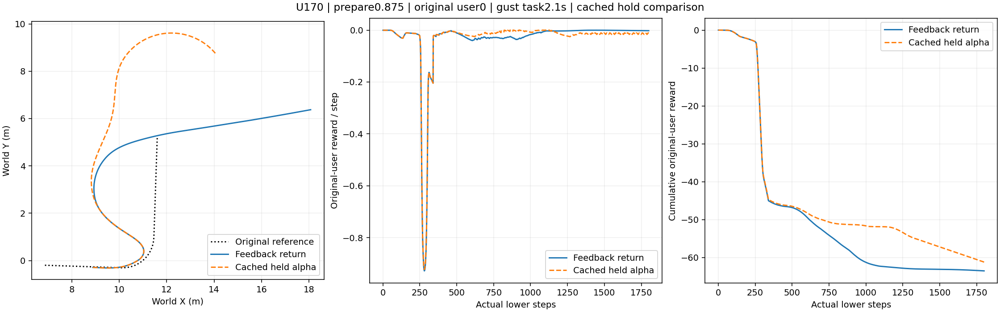
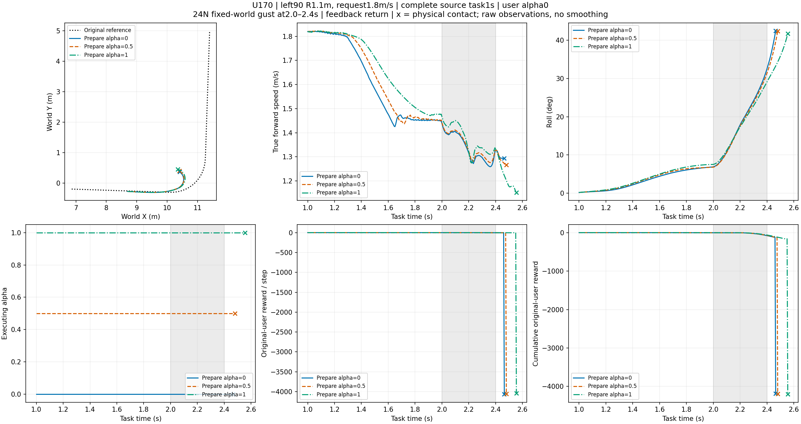

# STTW 当前结论与结果 · 2026-10-29

**结论：保留“容扰预测＋偏好调整＋条件恢复”主线。已经得到低速仿真中的有效案例，也确认了较强扰动下的失败边界；目前是有限工况原型，尚非通用安全控制器。**

实际/原始参考 XY 轨迹先看这两张：

同源、同扰动下，暂用 α=0.875 后恢复用户 α=0 能到达原目标；持续保持 α=0.875 的这一例未到达。

1.8 m/s、R=1.1 m 左弯、24 N 扰动下，三个已测候选均失败。全部场景图与逐例数据见 [证据索引](EVIDENCE.md)。

## 当前实际方案

- **固定底座 U170**：H75 低速混合续训候选；原 H75 保留。α=0 偏路径，α=1 偏速度。
- **小型容扰网络**：43→16→16→4，三成员集成；评价候选 α、假设扰动、准备时间与既定返回策略的闭环结果，输出不触地/到达分数、路径误差和速度峰值。
- **非学习协调器**：一次预先声明时刻的神经查询选择候选；状态条件恢复后返回用户 α。返回阶段限速 1/s，不读取真实未来起扰/撤扰时刻。
- **几何接回保持 10 Hz**，中层 50 Hz，底层 200 Hz；两轮摩擦 0.8。没有将一次神经决策称为全程滚动神经规划。

## 已得到什么

| 证据组 | 结果 | 支持的结论 |
|---|---|---|
| 固定五档 α 的 2 m/s、R1.3、24 N 示例 | α=0/.25 触地；.5 到达；.75/1 存活未到达 | 存活与任务完成不同；不能声称所有固定 α 都失败 |
| 同源 .875 保持/返回配对，三个起扰时刻 | 返回 3/3 到达；保持 1/3 到达 | 恢复原偏好有实际任务收益，但各项原任务代价并非全部改善 |
| 模型冻结后的五个确认案例 | 5/5 存活并到达；其中四个网络选择、一个固定端点测试 | 两种几何、三个相关源状态内可行；不是五个独立随机重复 |
| 新增左右弯无扰动，1.8 m/s、R1.1 | 2/2 到达 | 新场景基础任务可执行 |
| 同左右弯，20/24 N 扰动 | 3/4 到达，左弯 24 N 触地 | 网络均输出空候选集，实际保持原 α；这三个成功不算自主调整成功 |
| 左弯 24 N 追加 α=.5/1 | 0/2 到达，分别 2.480/2.555 s 触地；原 α0 为 2.465 s | 不能把失败仅归因“网络选错 α”；未证明所有 α/时序都无解 |

配对返回实验中，起扰 2.1 s 的保持/返回最近目标距离为 **2.079 / 0.073 m**；起扰 1.9 s 的保持轨迹仅比 1 m 到达阈值多 **2.5 cm**，须保留这个边界敏感性。新增确认与失败诊断均按真实车体前向速度核验低速，未用轮速估计或触地后的速度冒充低速能力。

## 结论边界与下一步

当前“到达”指触地/故障前进入**原始世界目标 1 m 圆盘**，不要求停车、航向保持或精确沿原路径。网络路径误差门槛为开放平面的 4 m，不能解释成道路边界约束；输出分数尚未可靠性校准，离散合格候选之间也未验证。

训练数据 232 条查询来自 188 个独特物理回合，含派生失败标签，不能当作 232 次独立实验。上述各证据组用途不同，不合并总体成功率。扰动是质心处固定世界方向的等效外力，20/24 N、持续 0.4 s，并非已标定风速或完整气动风场。

面向 TCST，保留“偏好执行时序与闭环容扰能力耦合、条件恢复原用户任务”的研究定位。现有证据支持继续推进；不宣称网络不可替代、普遍领先或实车安全。停止该强扰动案例的无限扫参，后续优先补少量独立重复/实车证据及正式论文表达。

## 证据与身份

[全部图、逐例结果](EVIDENCE.md) · [数据来源与文件校验](manifest.json)

中层：`STTW_MIDDLE_H75_LOW_SPEED_MIXED_U170`，Actor SHA256 `07f1bd3965d4458979e01f56f73cc1aa947480f4187b4c1ba9f4b8e4c7b50ef9`。
预测器：`STTW_ALPHA_RANGE_U170_RETURN_V1`，参数 SHA256 `67ad7f65d50a01430e868c525f28cf78671f2914cf926396d0ea092d26789f4e`。

本分支仅发布精简结果，研究代码快照为本地提交 `1adff30`；分支继承的旧代码/论文不代表当前实现。本包不含模型权重、完整训练日志或完整可复现运行环境。本次复用已完成记录整理，新增训练与物理仿真均为零。
