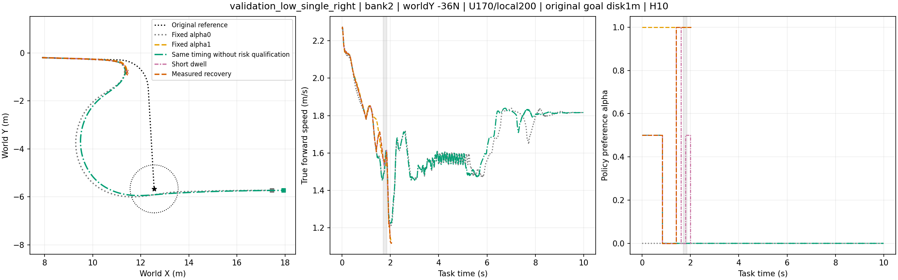
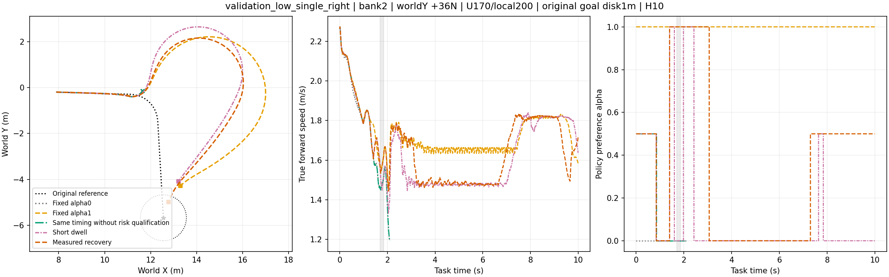

# STTW preference and disturbance results — 2026-11-01

Frozen comparison: middle `STTW_MIDDLE_H75_LOW_SPEED_MIXED_U170`, lower `STTW_LOCAL_DOMAIN_U200`, 50 Hz middle/200 Hz lower, 10 Hz geometric reconnection, wheel friction 0.8, 10 s task window. The original goal is a 1 m disk; arrival and full-window survival are separate. All routes here are development cases, not an independent generalization test. The main cross-speed panel uses one shared prepared bank2; the earlier lower-base selection uses banks0/6.

## Actual/reference XY first

The [eight lower-base selection panels](lower_base/) cover two prepared banks and four routes with five α values. The [six measured-return](measured_return/), [four later-onset](onset_transfer/) and [four shared-heading-planner](heading_fallback/) panels cover the preceding engineering checks. The [12 matched low/high, single/S-bend panels](cross_speed/) show all five strategies under nominal and ±36 N side loads. The [three same-state intervention panels](directional/) show both disturbance directions and the later measured trigger. The [six lower-continuation panels](lower_u140/) show both speeds, nominal and ±36 N, and all five α values. The [nominal u1](lower_u1_nominal/), [nominal u200](lower_u200_nominal/) and [disturbed u1](lower_u1_disturbed/) folders cover every condition in their respective bounded checks. Each comparison folder contains its numerical summary; the main comparison JSON files include per-condition outcomes and raw-file hashes. Raw trajectories, training logs, and model weights remain in the immutable local run archive.

## Results and decision

| Paired study | Original-goal arrival and H10 survival | Interpretation |
|---|---:|---|
| Local-domain lower selection, four routes × two prepared banks × five α | Parent, update163 and update200 each 40/40; update200 low-speed delivered-steer RMSE 2.002°→1.552°, high-speed 1.147°→0.950° versus parent | Adopt update200 as `STTW_LOCAL_DOMAIN_U200`; the modest path-error increase and absence of independent domain TEST remain recorded. |
| Measured return, two low-speed turns × nominal/±36 N | New 5/6 joint versus previous commitment 4/6 joint | One development gain after observable settling; not an independent test. |
| Later-onset transfer, two turns × ±36 N | Measured return 2/4 joint, short dwell 2/4; both 4/4 survival | Earlier gain does not transfer to these onset times. |
| Shared terminal-heading fallback on those four cases | Measured return 3/4 joint, short dwell 2/4; both 4/4 survival | Improvement is shared path-execution repair, not predictor calibration. |
| Four routes × nominal/±36 N, 12 conditions per method | Measured-return risk coordinator 11/12; same-timing without risk 11/12; fixed α0 11/12; fixed α1 10/12; short dwell 10/12 | Risk coordinator gains one and loses one versus the matched no-risk rule. Its added arrival versus short dwell is real but does not establish consistent risk-selection benefit. |
| Pulse-trained lower u140, two routes × five α × nominal/±36 N | Parent local200 23/30; u140 10/30; paired gains 0, losses 13 | Reject u140. High-speed nominal turning fails to reach the original exit in all five α cases. |
| Pulse-trained lower u1/u200, low/high nominal × α0/1 | Parent 4/4; u1 4/4; u200 2/4 | u1 retains nominal tasks; u200 regresses. |
| Pulse-trained lower u1, low-speed single right × α0/1 × ±36 N | Parent 1/4; u1 1/4; paired gains 0, losses 0 | No disturbance-recovery gain; retain local200. |

The lower pulse continuation used the existing on-policy PPO framework: local200 Actor/Critic weights, fresh optimizer, 200 updates and 25,804,800 simulation transitions. Each episode had a 50% probability of no added pulse; otherwise it received a random signed 24–36 N world-Y pulse for 0.15 s at 1–6 s. Its local speed/steering commands and reward did not include the complete H75 preference-switch-and-return task. Training reward alone was not a reliable adoption criterion; the tested pulse candidates are not adopted.

Same-complete-state directional intervention provides the mechanism question: at task time 1.40 s, held α values that survive [−36 N](directional/held_minus36.png) and [+36 N](directional/held_plus36.png) are disjoint; by the measured 1.72 s response, [all five tested held α continuations fail under −36 N](directional/feedback_minus36.png). This supports studying an observable, recoverable preparation window, while the present held-candidate predictor does not label the full online switch-and-return policy. The working [research design](../../paper/RESEARCH_DESIGN.md) separates these hypotheses from established results. The existing manuscript PDF describes an earlier controller generation and has not been updated to these results.

## What was trained, and with which objective

The following objectives belong to different modules and must not be interchanged. Here `H(x)=x²` for `|x|≤1` and `H(x)=2|x|−1` otherwise; all terms and caps are fixed in the linked configuration.

| Module and training | Actual objective | Code and frozen configuration |
|---|---|---|
| H75/U170 middle policy: shared α-conditioned path/speed reference corrections; mixed straight, single-turn and S-turn paths, 1.6–3.2 m/s requests. The continuation completed update202; U170 is the selected deployed checkpoint, not the final checkpoint. | `path_persistent_preference_v3`: per lower step reward `−0.1×0.005×Σ capped cost`. With speed error `e_v`, original-path cross-track `e_y`, heading error `e_h` and curvature-demand `χ`, speed cost is `[10−9χ(1−α)]H(e_v/0.1)`; path cost is `10(1−0.9α)[H(e_y/0.1)+0.5H(e_h/0.1)]`. A `20χ` primary term penalizes path-band excess at α0 and speed-band excess at α1. Shared roll, roll-rate, overspeed, low-speed and reference-offset costs, plus an early-failure tail, also apply. Original geometry defines path error; delivered steering-reference error is not the path objective. | [Reward implementation](../../../learning/src/sttw_control/path_command_reward.py), [training](../../../learning/src/sttw_control/path_command_training.py), [frozen 202-update configuration](../../../learning/configs/h75_low_speed_mixed_finetune_200.json). |
| `STTW_LOCAL_DOMAIN_U200` lower residual: 200-update continuation using randomized local speed/steering command families and a grouped physical-domain bank. The later pulse continuation changes only episode disturbance exposure and begins from its Actor/Critic weights with fresh optimizer/RNG. | `local_tracking_component_bounded_v1`: per 200 Hz step reward `−0.1×0.005×Σ capped cost`, where the leading terms are `8H(e_v/0.1)` and `8H(e_δ/0.04)`. Roll beyond 0.26 rad, working roll beyond 0.30 rad, roll-rate beyond 0.8 rad/s, residual magnitude/change and a discounted early-failure tail add cost. This lower objective has no α, original path, goal or return term. | [Lower reward and pulse application](../../../learning/src/sttw_control/lower_command.py), [PPO trainer](../../../learning/src/sttw_control/lower_command_training.py), [domain continuation](../../../learning/configs/lower_domain_finetune.json), [pulse continuation](../../../learning/configs/lower_pulse_finetune.json). |
| Container of three 41-input, 16–16 hidden-unit tolerance MLPs; 800 labeled training branches and 160 related-source development branches, three fixed-last seeds ×1000 optimizer updates. | Supervised `BCEWithLogits + 0.5×paired ranking loss`, **not** a vehicle control reward. A label is no contact through a hypothetical ±48 N, 0.15 s pulse and three seconds after its end, after holding the queried α for 0.2 or 0.6 s. The development Brier score was 0.0652; the old fit on the same rows scored 0.5625. These 160 rows had no discordant-α ranking groups, so that metric alone does not establish selection quality. | [Label protocol](../../../learning/configs/u170_lower200_tolerance_force48.json), [MLP fitting and loss](../../../learning/src/sttw_control/tolerance_predictor_pilot.py), [actual expanded-coverage fit](../../../learning/configs/u170_lower200_diverse_coverage_fit.json). |

The closed-loop panels above are **evaluations with zero optimizer updates**. They report original-goal entry, full-window survival, original-path/velocity errors and the logged per-step reward components under their frozen configuration. A different α weights the H75 cost differently; weighted returns alone are not a common physical-performance ranking.

The online coordinator has **no learned reward**. It first checks candidate reference feasibility (`v² × max preview curvature ≤ 3 m/s²`) and, when enabled, the minimum predicted no-contact probability across the hypothetical force/preparation queries (`≥0.8`, or `≥0.85` for a latched user return). Among eligible choices it minimizes a fixed quadratic cost of speed-reference change, steering-reference change, distance from user α and distance from previous α; a qualified user α takes priority. A real support switch can be held for at most 3.75 s, with earlier user return after at least 0.6 s support and 0.2 s of measured roll/roll-rate settling. The matched `noq` experiment removes risk qualification while keeping the same timing, task gate and fallback. Exact coefficients and release conditions are in [the coordinator](../../../learning/src/sttw_control/tolerance_coordination.py) and [frozen full protocol](../../../learning/configs/u170_lower200_cross_speed_timing_recovery.json).

## Experiment and configuration map

| Run family / purpose | Frozen protocol and code | Data role / key result |
|---|---|---|
| `h75_low_speed_mixed_finetune_200_v1`: broaden tight, low-speed and earlier path coverage; select U170. `lower_domain_transfer_dev_v1`: choose the lower base against the parent and u163. | [H75 train config](../../../learning/configs/h75_low_speed_mixed_finetune_200.json); [lower train](../../../learning/configs/lower_domain_finetune.json) and [paired selection](../../../learning/configs/lower_domain_transfer_dev.json). | Training plus previously inspected DEV. The lower-selection [eight XY panels and summary](lower_base/) support local200 adoption; this is not a fresh domain-randomization TEST. |
| `u170_lower200_tolerance_force48_completed_v1` and `u170_lower200_diverse_coverage_predictor_v1`: branch five α values from complete states, fit a contact predictor. | [Branch/label config](../../../learning/configs/u170_lower200_tolerance_force48.json), [fit config](../../../learning/configs/u170_lower200_diverse_coverage_fit.json), [fitting code](../../../learning/src/sttw_control/tolerance_predictor_pilot.py). | Related-source TRAIN/DEV; held-α labels do not describe a future online return sequence. |
| `u170_lower200_recovery_release_online_v1`, `onset_transfer_recovery_v1`, `terminal_heading_recovery_v1`: test measured return, onset transfer and a shared replanning repair. | [Release](../../../learning/configs/u170_lower200_recovery_release_online.json), [later onset](../../../learning/configs/u170_lower200_onset_transfer_recovery.json), [shared heading fallback](../../../learning/configs/u170_lower200_terminal_heading_recovery.json); [coordination](../../../learning/src/sttw_control/tolerance_coordination.py), [replanning](../../../learning/src/sttw_control/goal_replanning.py). | Diagnostic DEV. Their [6](measured_return/), [4](onset_transfer/) and [4](heading_fallback/) paired XY panels and JSON preserve the gains and transfer failures. |
| `cross_speed_timing_*_v1`: matched fixed α0/1, full predictor, same-timing no-risk and short-dwell control on four routes × nominal/±36 N. | [Fixed](../../../learning/configs/u170_lower200_cross_speed_timing_fixed.json), [full](../../../learning/configs/u170_lower200_cross_speed_timing_recovery.json), [no-risk](../../../learning/configs/u170_lower200_cross_speed_timing_noq.json), [short dwell](../../../learning/configs/u170_lower200_cross_speed_timing_short_dwell.json); [native evaluator](../../../learning/src/sttw_control/native_goal_run.py). | One complete prepared-state bank, four previously inspected geometries, requested low/high speed; [12 matched XY panels](cross_speed/) and 60 numerical condition records. |
| `cross_speed_directional_branch_v1` and `cross_speed_feedback_return_v1`: keep the exact complete state, vary held α at early and measured-feedback boundaries. | [Early direction config](../../../learning/configs/u170_lower200_directional_branch.json), [feedback config](../../../learning/configs/u170_lower200_feedback_return.json); [branch runner](../../../learning/src/sttw_control/native_goal_run.py). | Diagnostic DEV, 10 early and 5 late suffixes; [three XY panels](directional/). No actual future force direction is supplied to the online rule. |
| `lower_pulse_finetune_v1`, `lower_pulse_transfer_dev_v1`, `lower_pulse_nominal_retention_v1`: add episode pulses, then screen u140, u1 and u200 with H75 frozen. | [Pulse training](../../../learning/configs/lower_pulse_finetune.json), [five-α transfer](../../../learning/configs/lower_pulse_transfer_dev.json), and frozen run-local [u1/u200/low-disturbance protocols](protocols/); [checkpoint export](../../../learning/src/sttw_control/lower_transfer.py), [paired comparison](../../../learning/cli/compare_lower_transfer.py). | Pulse TRAIN plus previously inspected DEV. [u140](lower_u140/), [u1 nominal](lower_u1_nominal/), [u200 nominal](lower_u200_nominal/) and [u1 disturbed](lower_u1_disturbed/) XY/JSON show no adopted pulse model. |

The thin command entries are [middle PPO](../../../learning/cli/train_path_command.py), [lower PPO](../../../learning/cli/train_lower_command.py), [predictor fit](../../../learning/cli/tolerance_predictor_pilot.py), [native evaluation](../../../learning/cli/run_native_goal_confirmation.py) and [evaluation analysis](../../../learning/cli/analyze_native_goal_confirmation.py). Each frozen run's manifest and status in the local archive remain the execution record; the linked repository configs describe the intended protocol.

These native closed-loop evaluations retain the original path/goal, 10 Hz causal reconnection, 50 Hz middle/200 Hz lower control, 0.8 wheel friction and the stated 10 s horizon. The cross-speed panel uses user α0, five candidate α values, route-specific onsets and ±36 N/0.15 s world-Y loads; its predictor queries hypothetical ±48 N/0.15 s loads. Prepared bank2 is shared within that panel. The three run-local JSON files are frozen descriptors with original local checkpoint paths, not portable weights. Full source manifests and raw trajectory NPZ files remain in the local archive.

This review package contains the experiment map, frozen code/configuration links, actual/reference XY panels and numerical comparisons, without checkpoint binaries or duplicate raw trajectories.
