# Frozen middle controller comparison: actual XY first

Four frozen middle policies were evaluated with the same local200 lower controller, wheel friction 0.8, 10 Hz geometric reconnection, 10 s horizon and five fixed alpha values. All actual trajectories below are overlaid with the **original task path**; each image shows all five alpha values for one route and prepared initial bank. H75, W400 and U170 have all four task routes and banks 1/3. u325 has the two selected conflict routes and the same banks.

The original H75 execution was externally terminated after 400 lower steps (exit 143). Its partial record remains in the archive. The identical H75 panel was run manually to completion in a new directory. All five completed new panels contain 20/20 episodes and 40,000/40,000 lower steps each, with zero training updates. All panels reuse the existing same-shape vmap, scan(50) and shared JAX compilation cache. The five completed new evaluations took 179.4, 203.1, 202.4, 202.3 and 202.7 s respectively, including initialization; the original scoring path was unchanged.

## Four-route result

The table uses the declared relaxed **development** score: original goal entry, upright survival to 10 s, original-path cross-track RMSE ≤0.25 m during 8–10 s, a 0.5 m anchor buffer inside the narrow 0.9 m or wide 1.4 m corridor, and at least 85% requested turn speed for the wide task. The relaxed thresholds were selected after inspecting U170's earlier task panel. Each cell below contains eight matched route/bank episodes, not independent training seeds.

| model | alpha | original goal / H10 | narrow | wide | mean turn speed (m/s) | mean pre-goal max original cross-track (m) |
|---|---:|---:|---:|---:|---:|---:|
| U170 | 0 | 8/8 | 6/8 | 3/8 | 2.116 | 0.369 |
| U170 | 0.5 | 8/8 | 6/8 | 4/8 | 2.195 | 0.396 |
| U170 | 1 | 8/8 | 4/8 | 8/8 | 2.297 | 0.539 |
| H75 | 0 | 8/8 | 8/8 | 4/8 | 2.202 | 0.149 |
| H75 | 0.5 | 8/8 | 4/8 | 8/8 | 2.339 | 0.371 |
| H75 | 1 | 8/8 | 0/8 | 6/8 | 2.452 | 0.705 |
| W400 | 0 | 8/8 | 6/8 | 6/8 | 2.279 | 0.187 |
| W400 | 0.5 | 8/8 | 4/8 | 8/8 | 2.400 | 0.429 |
| W400 | 1 | 8/8 | 0/8 | 6/8 | 2.463 | 0.715 |

H75 is the working base for the next path-priority experiment: alpha 0 clears all eight narrow conditions, its turn speed rises across the five alpha levels, and its low-speed S-turn XY is well tracked. U170 remains the better speed-priority endpoint under this score (8/8 wide at alpha 1 versus H75 6/8). W400 is faster but has low-speed single-right post-goal tracking loss. The first two-route screen alone would have selected W400; the remaining routes changed that decision. No controller was retrained in this comparison.

[All five alpha levels and every case in the four-route comparison](full_route_comparison.json) · [Per-route table](FULL_ROUTES.md) · [Four-model two-route screen](COMPARISON.md) · [Two-route case data](comparison.json)

## Source runs and configuration

- U170: `task_preference_task40_v1` (previously completed 40-case frozen task panel)
- H75: `task_preference_middle_h75_recheck_v1` and `task_preference_middle_h75_extension_v1`
- W400: `task_preference_middle_w400_v1` and `task_preference_middle_w400_extension_v1`
- u325: `task_preference_middle_u325_v1` (two-route screen only)

The raw runs are under `/media/qy/6A7E3DB07E3D75C3/STTW_CONTROL_archives/tolerance_calibration_disk_recovery_20261025/`. Frozen run declarations are in `learning/configs/task_preference_middle_*.json`. The comparison implementation is in `docs/paper/analysis/compare_frozen_middles.py` and `compare_full_route_models.py`. Initial banks are paired complete closed-loop states. This package contains the per-case metrics and all actual/reference XY panels; raw control traces and native analysis stay in their source runs.

## Actual/reference XY panels

### U170

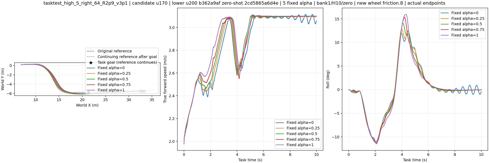

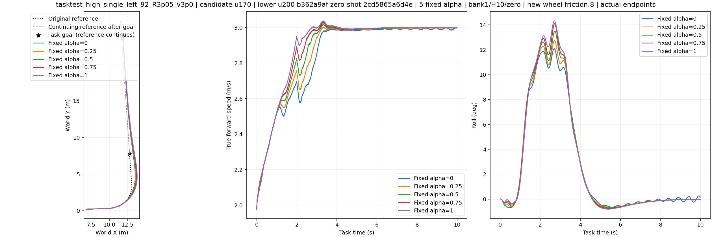

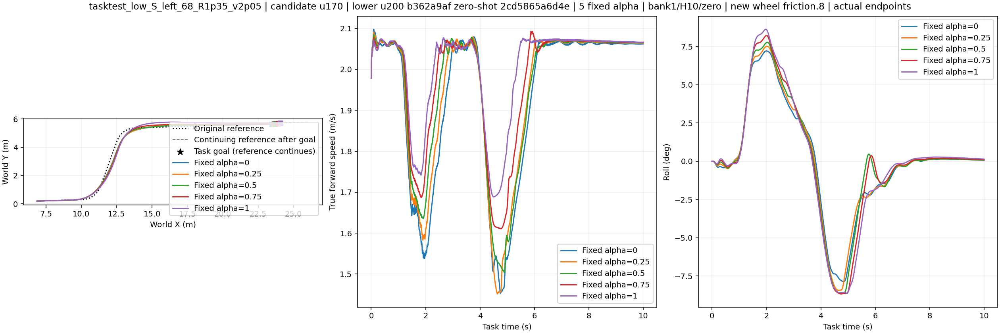

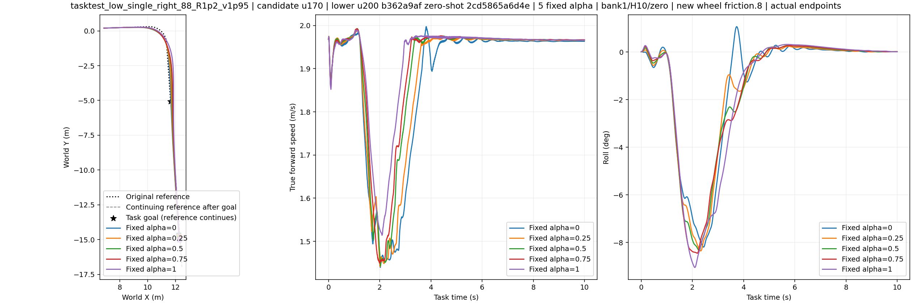

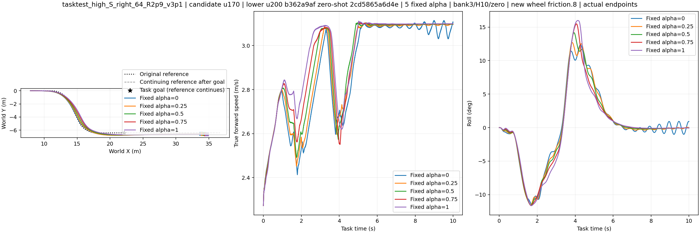

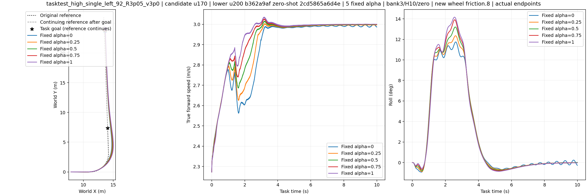

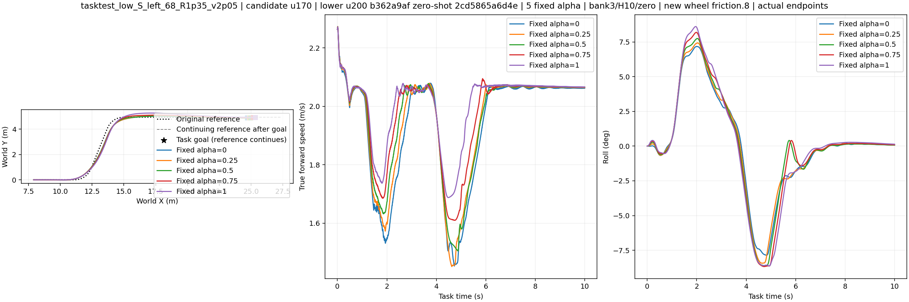

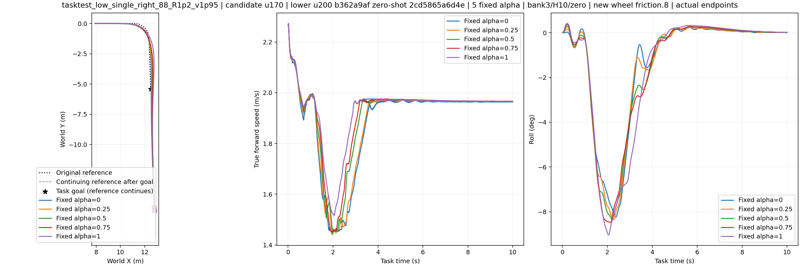

### H75

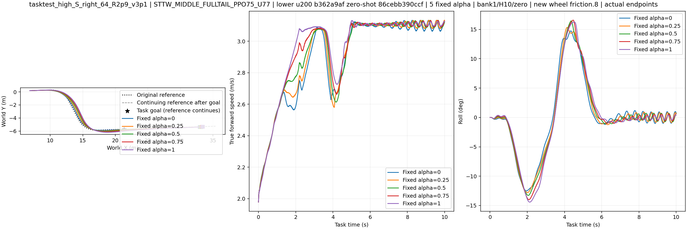

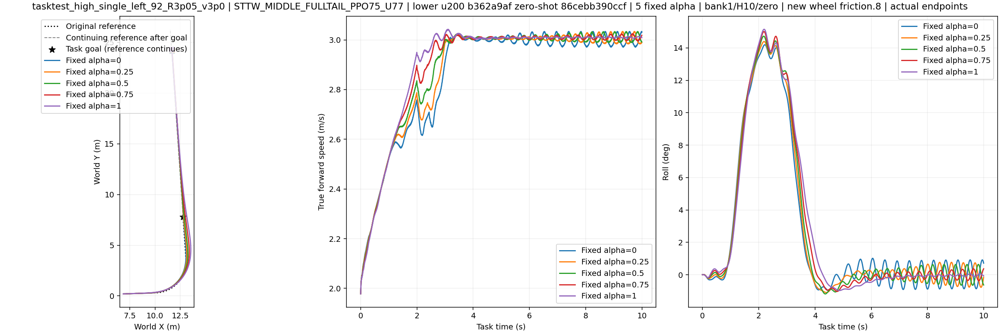

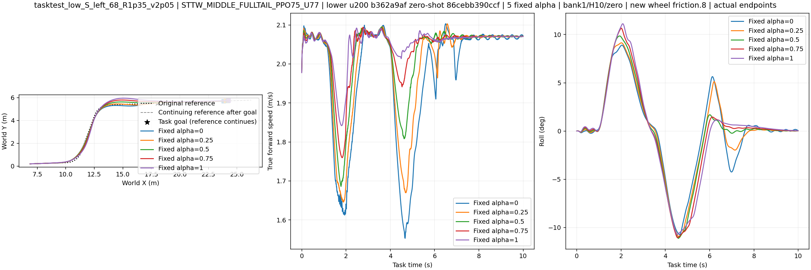

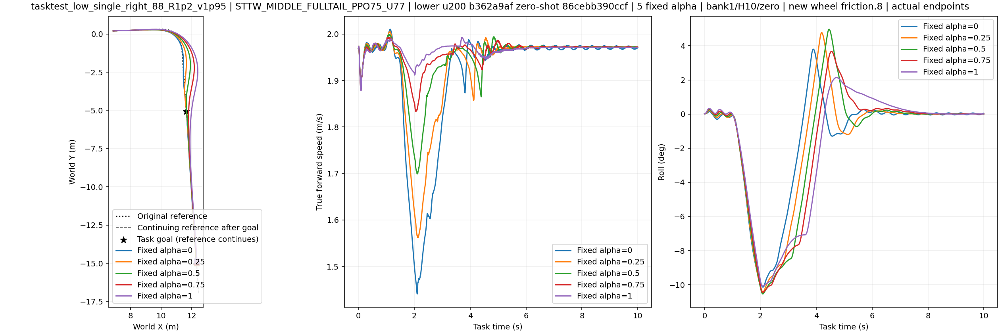

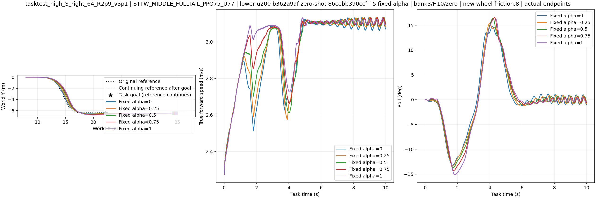

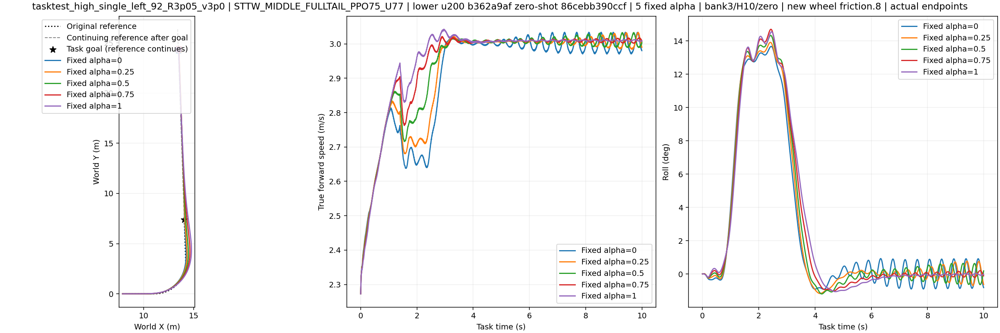

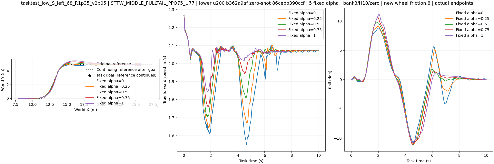

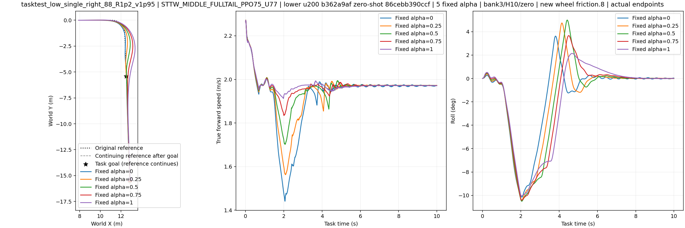

### W400

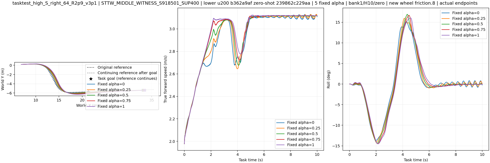

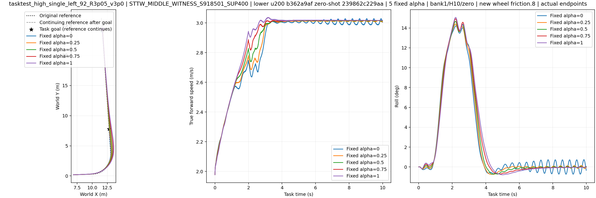

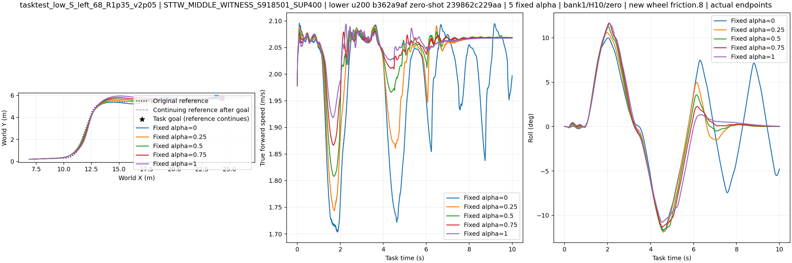

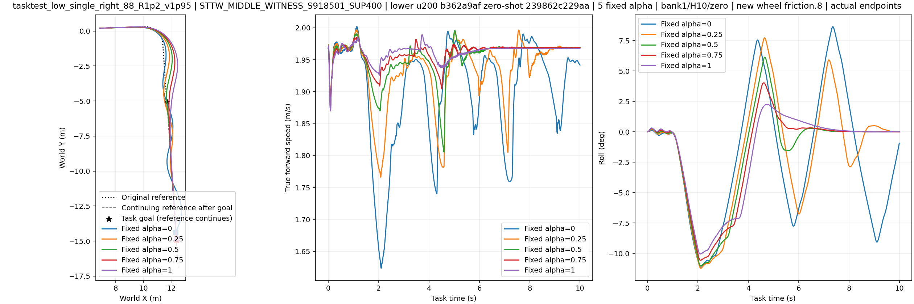

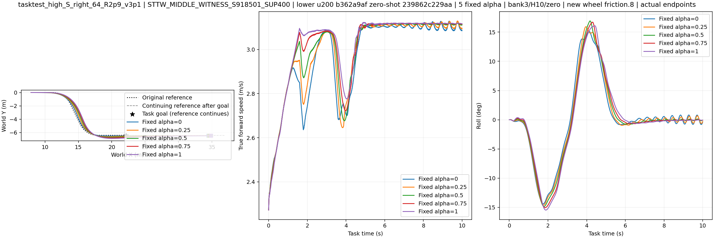

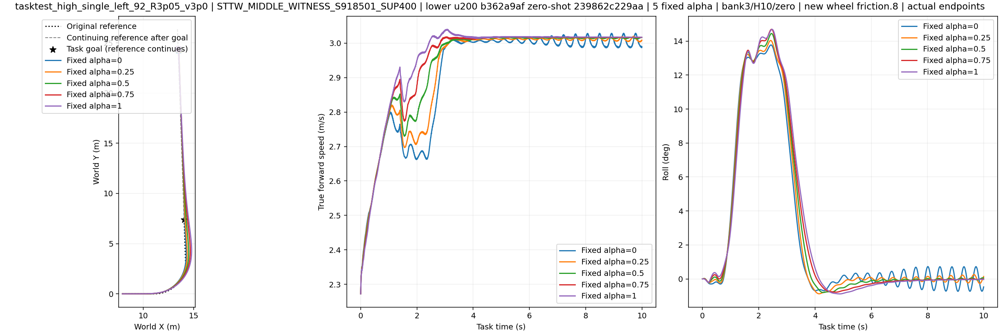

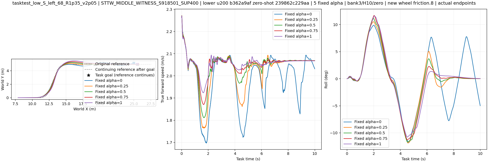

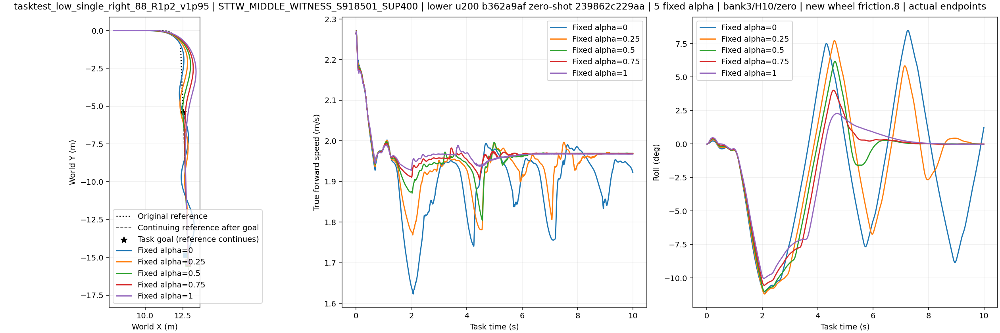

### u325

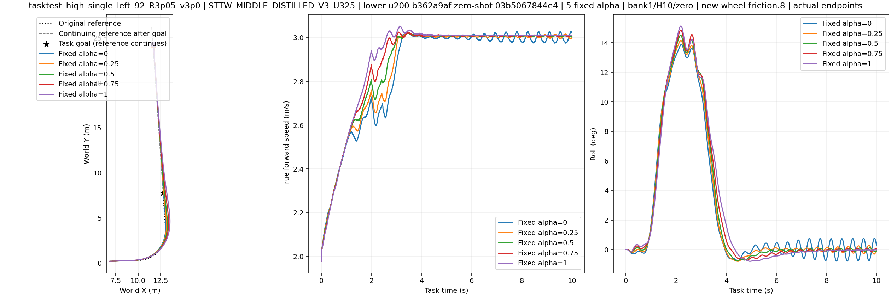

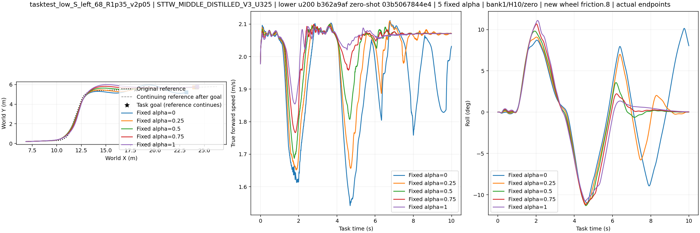

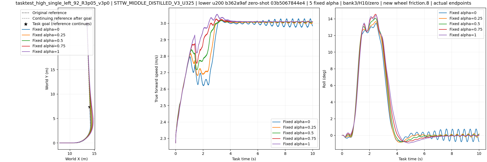

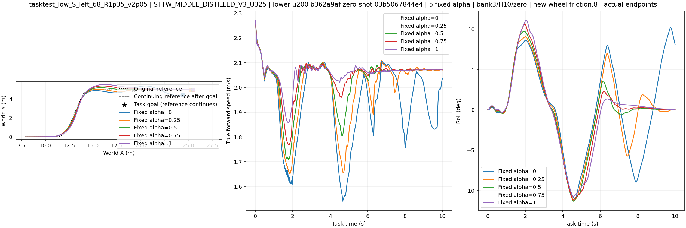
