# New task-combination check: actual XY first

H75 and U170 used the same local200 lower controller, 0.8 wheel friction, 10 Hz geometric reconnection and four newly declared low/high single/S turns with prepared banks 2 and 5. Every panel below overlays all five fixed alpha executions and the original task path. The two model panels for each route/bank are paired by complete initial state. Each frozen model completed 40/40 physical 10 s episodes, 80,000 lower steps and zero training updates.

[Per-route five-alpha results](HOLDOUT.md) · [All 80 case rows and scoring contract](holdout_comparison.json) · [H75 protocol](../../../../learning/configs/task_preference_holdout_h75.json) · [U170 protocol](../../../../learning/configs/task_preference_holdout_u170.json) · [Comparison code](../../../paper/analysis/compare_holdout_middles.py)

The relaxed buffered-anchor task score was fixed before these exact route/bank results: narrow half-width 0.9 m, wide half-width 1.4 m, anchor buffer 0.5 m, wide mean turn speed at least 85% of the request, post-goal 8–10 s original-path cross-track RMSE at most 0.25 m, original-goal entry and 10 s upright survival. These are new task combinations after model/threshold development, not a new physics domain or independently trained policy seeds.

H75 alpha=0 repeats 8/8 narrow-task success, compared with 4/8 at alpha=0.5. Its alpha=1 wide score is 5/8, below alpha=0.5's 8/8. U170 alpha=0 reaches 6/8 narrow versus alpha=0.5's 4/8; U170 alpha=1 reaches 8/8 wide versus alpha=0.5's 6/8. Thus U170 provides a modest two-task gain from preassigned endpoint preferences in these new combinations, while H75 is stronger for the path-priority narrow task. All 80 cases entered the original goal and survived 10 s. Individual route outcomes, turn speed and pre-goal cross-track are in the linked table and JSON. H75 alpha=0 retains visible late speed oscillation in some high-speed turns despite passing this bounded task score.

Raw control traces, execution receipts and rewards remain at `/media/qy/6A7E3DB07E3D75C3/STTW_CONTROL_archives/tolerance_calibration_disk_recovery_20261025/task_preference_holdout_{h75,u170}_v1/`.

## Every actual/reference XY panel

### H75

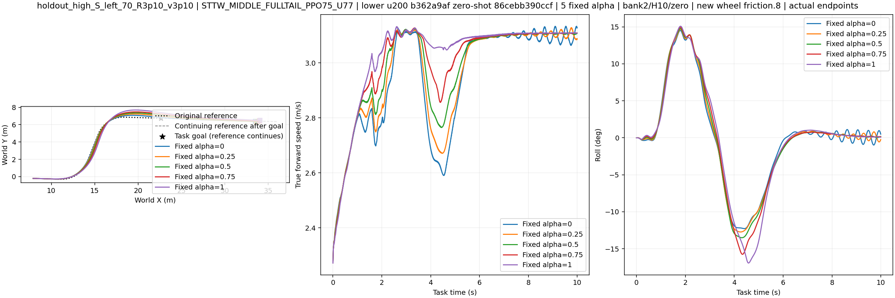

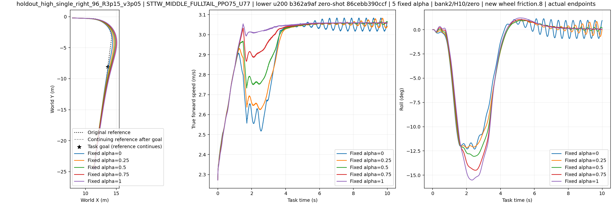

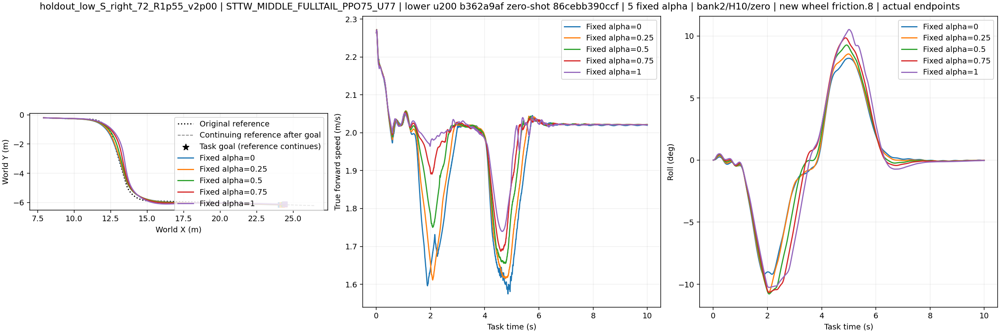

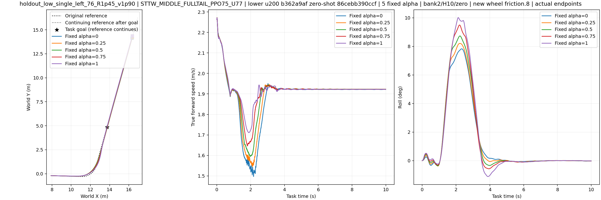

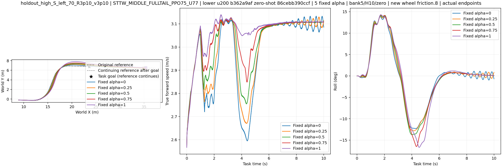

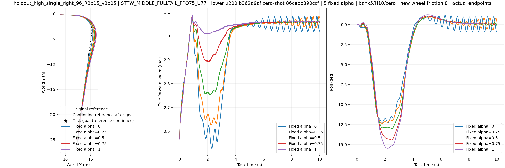

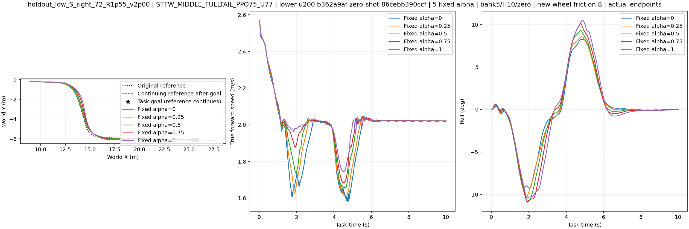

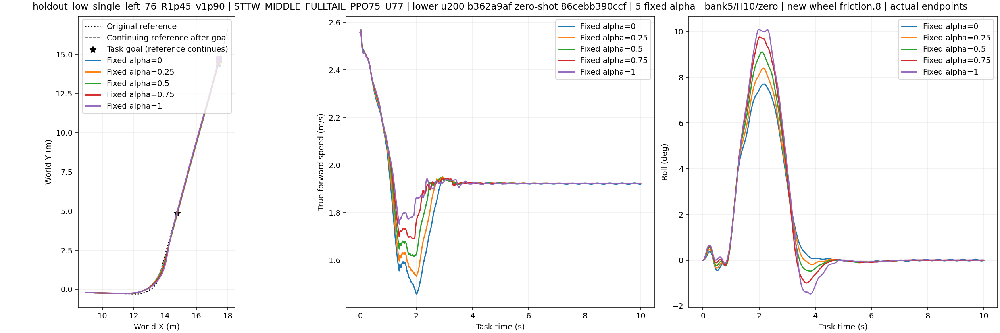

### U170

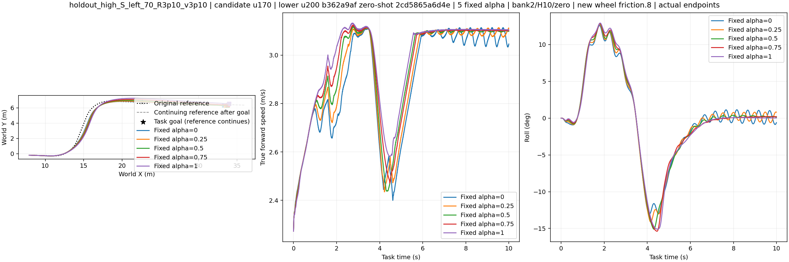

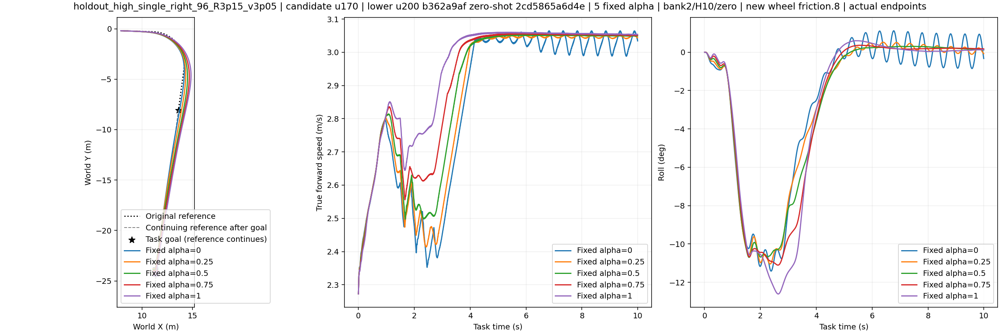

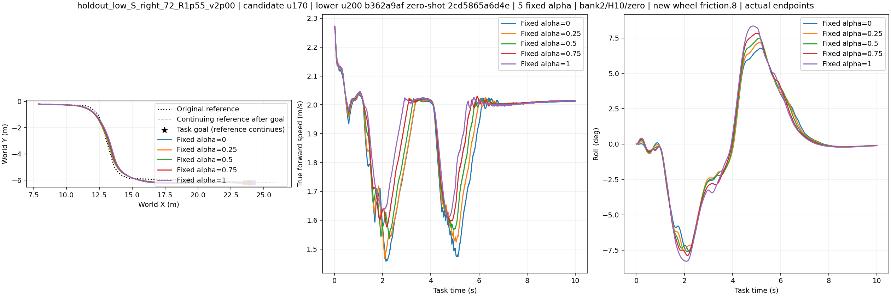

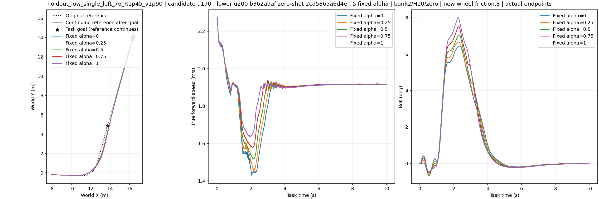

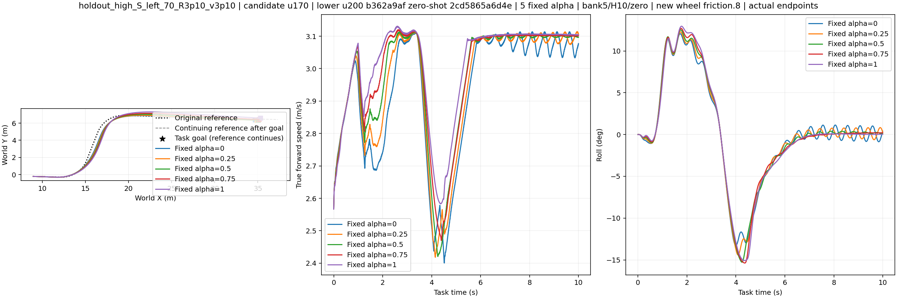

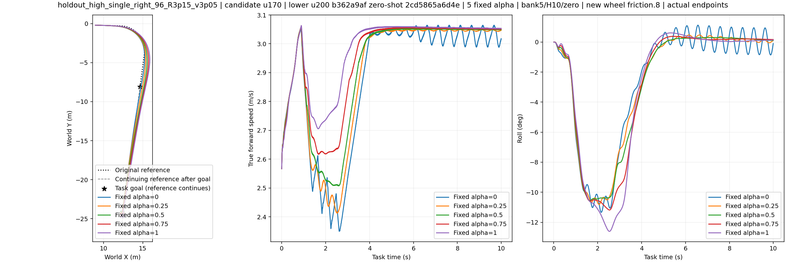

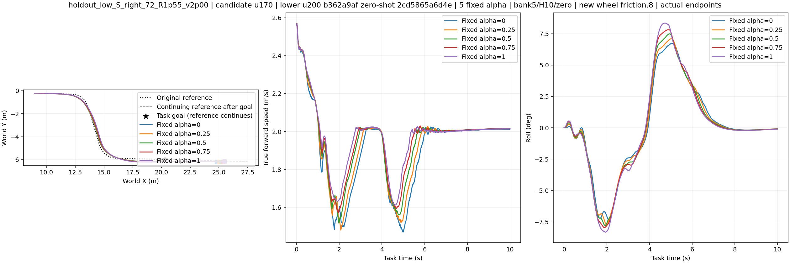

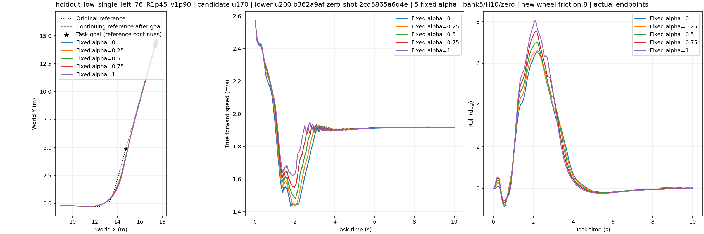
