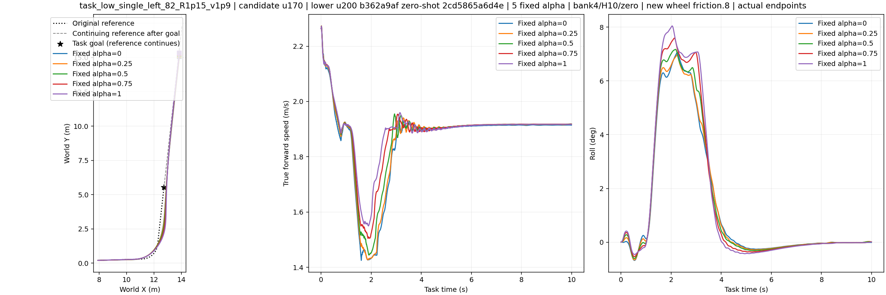
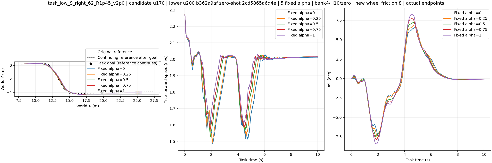
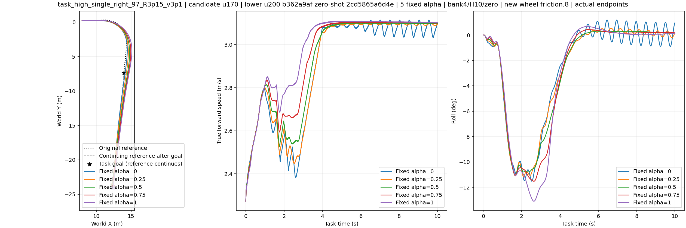
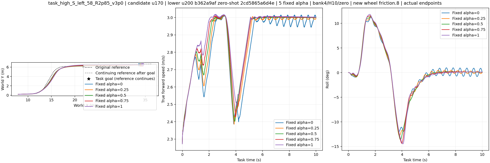
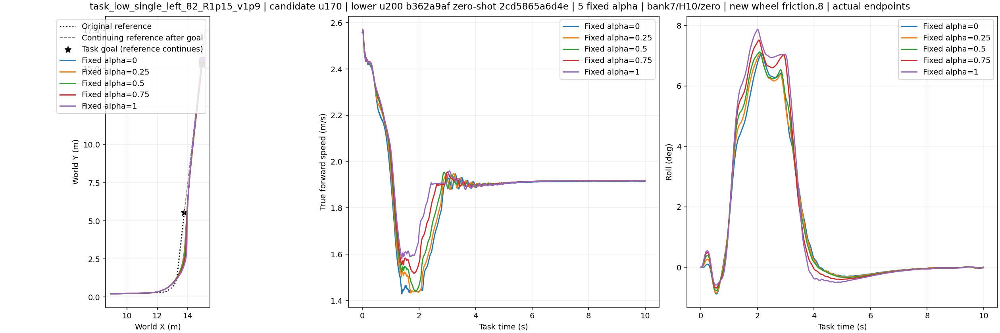
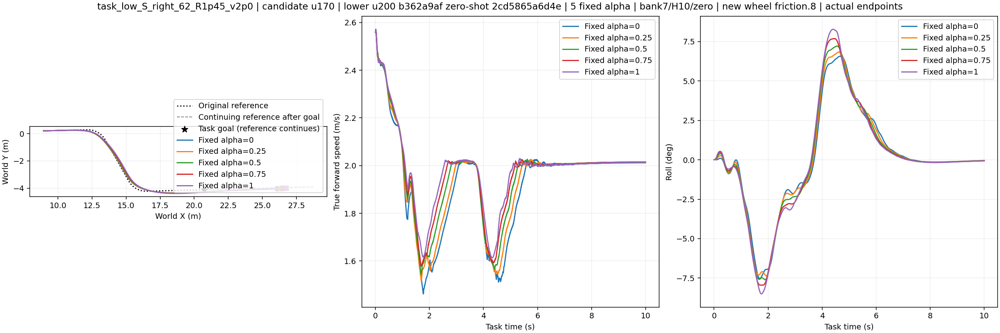
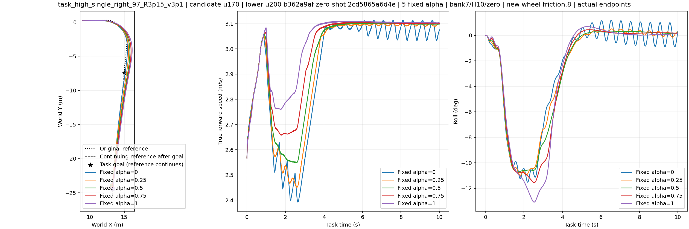
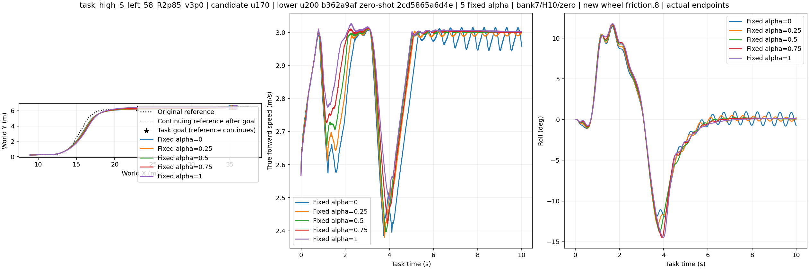

# Task preference nominal screen

Centerline diagnostic only. Original-path deviations are measured before first original-goal entry; the 8–10 s error is reported separately. The centerline proxy does not certify vehicle-body corridor passage or the speed-preserving task.

## Actual/reference XY panels

## All five fixed preferences

| alpha | n | original goal | survived H10 | narrow centerline proxy | wide centerline proxy | mean turn speed (m/s) |
|---:|---:|---:|---:|---:|---:|---:|
| 0 | 8 | 8/8 | 8/8 | 8/8 | 8/8 | 2.079 (8/8) |
| 0.25 | 8 | 8/8 | 8/8 | 8/8 | 8/8 | 2.111 (8/8) |
| 0.5 | 8 | 8/8 | 8/8 | 6/8 | 8/8 | 2.156 (8/8) |
| 0.75 | 8 | 8/8 | 8/8 | 4/8 | 8/8 | 2.213 (8/8) |
| 1 | 8 | 8/8 | 8/8 | 4/8 | 8/8 | 2.278 (8/8) |

All 40 individual outcomes and speed/path measurements are in [task_preference_diagnostic.json](task_preference_diagnostic.json); [native analysis rows](results.json) preserve the recorded reward and terminal summaries. This screen used the frozen U170/local200 controller and 10 Hz causal reconnection, with zero optimizer updates. It is development evidence; no tuned conventional comparator, vehicle footprint check or independent final test has been run.
