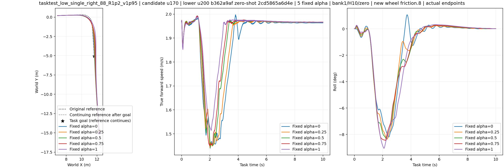
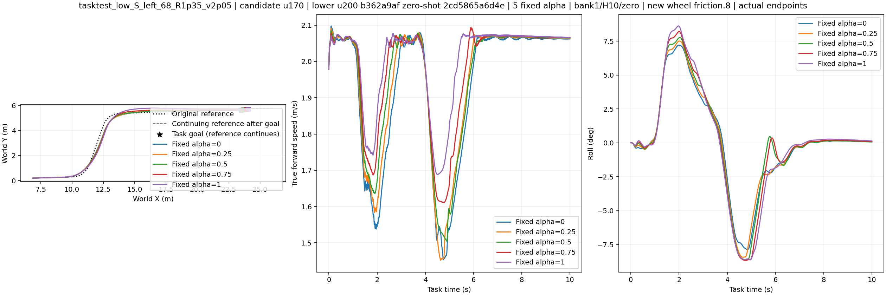
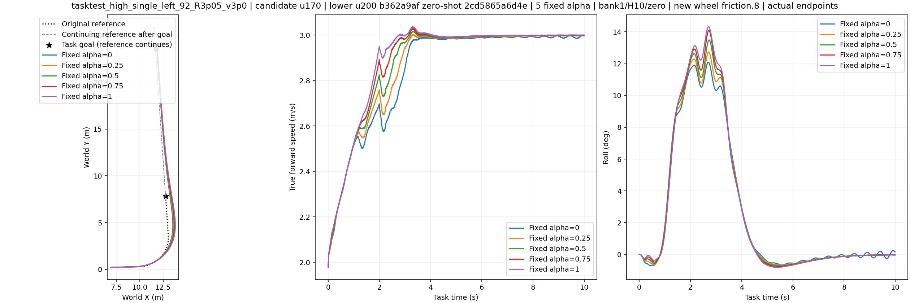
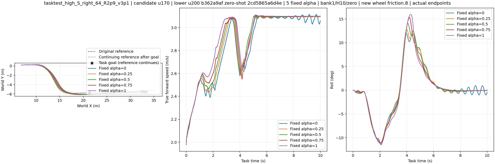
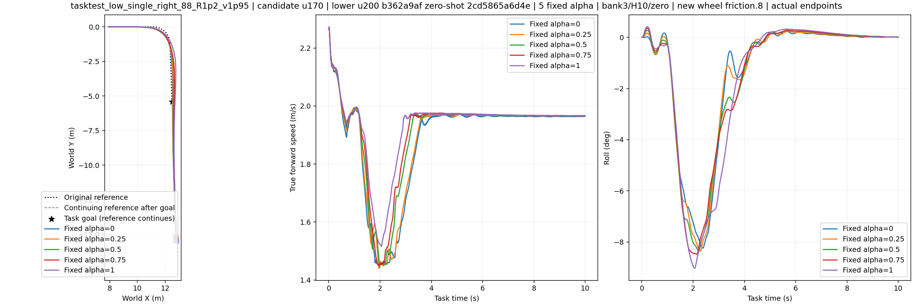
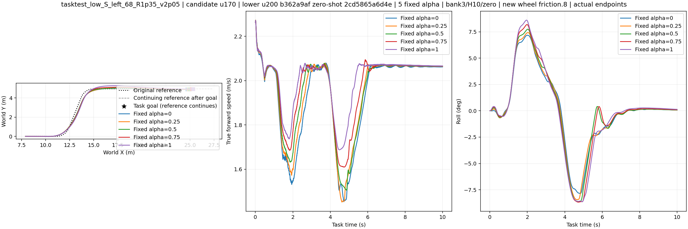
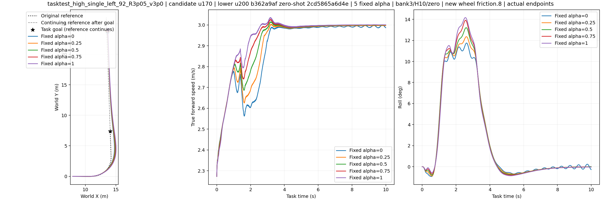
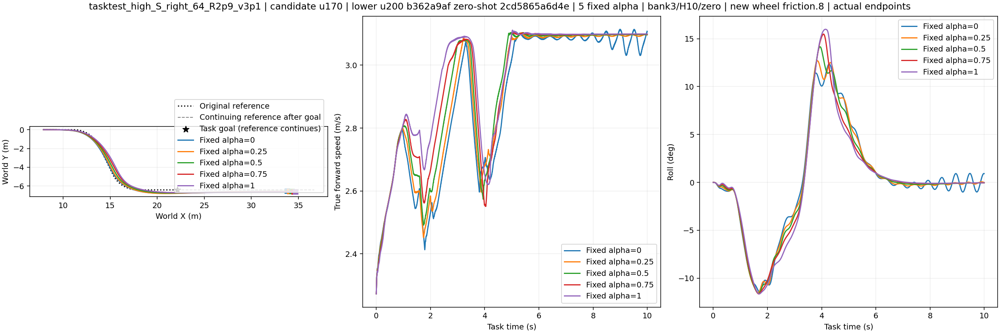

# Frozen task-preference score

The corridor uses a 0.5 m circular buffer around recorded vehicle XY. This is an anchor-disk proxy, not an exact swept-mesh or real-wall test. The original goal, H10 survival and 8–10 s original-path tracking are required for both tasks. Widths and speed threshold were fixed from the earlier DEV2 panel before this run.

## Actual/reference XY

## Outcomes by fixed alpha

| alpha | narrow task | wide task | narrow corridor proxy | wide speed threshold |
|---:|---:|---:|---:|---:|
| 0 | 2/8 | 2/8 | 2/8 | 2/8 |
| 0.25 | 4/8 | 2/8 | 4/8 | 2/8 |
| 0.5 | 4/8 | 2/8 | 4/8 | 2/8 |
| 0.75 | 2/8 | 2/8 | 2/8 | 3/8 |
| 1 | 0/8 | 3/8 | 0/8 | 6/8 |

## Preassigned arms by route

| route | narrow α0 | narrow fixed α0.5 | wide α1 | wide fixed α0.5 |
|---|---:|---:|---:|---:|
| tasktest_low_single_right_88_R1p2_v1p95 | 2/2 | 2/2 | 0/2 | 0/2 |
| tasktest_low_S_left_68_R1p35_v2p05 | 0/2 | 2/2 | 2/2 | 0/2 |
| tasktest_high_single_left_92_R3p05_v3p0 | 0/2 | 0/2 | 1/2 | 2/2 |
| tasktest_high_S_right_64_R2p9_v3p1 | 0/2 | 0/2 | 0/2 | 0/2 |

All 40 paired outcomes and failure reasons are in [task_scores.json](task_scores.json). The preassigned comparison is narrow α0 versus fixed α0.5, and wide α1 versus fixed α0.5; the other levels diagnose the preference response. No tuned conventional rule has been tested in this panel.
