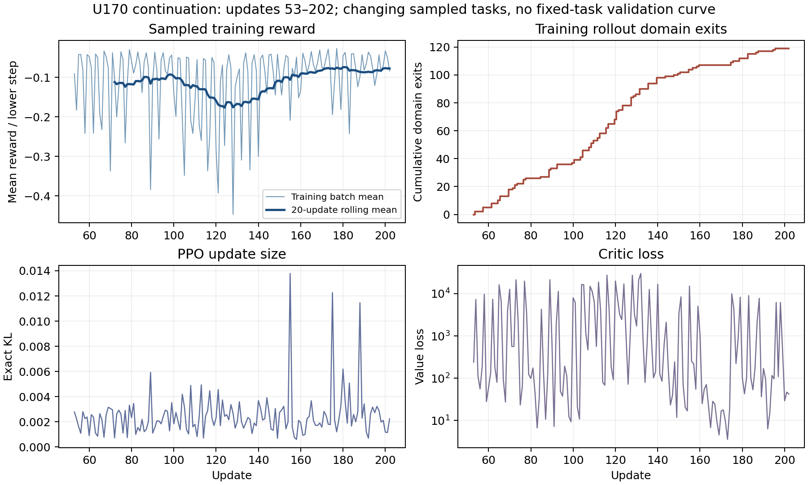

# U170 training log review

The source is the archived 150-record continuation `metrics.jsonl`, updates 53–202. The plot uses sampled training batches; the rollout mix changes, so its reward curve is not a fixed-task validation curve.

| Window | Updates | Mean reward/step | SD | Physical failures | Domain exits | Mean exact KL | Accepted minibatches |
|---|---:|---:|---:|---:|---:|---:|---:|
| early | 53–92 | -0.1075 | 0.0890 | 0 | 33 | 0.0021 | 640 |
| middle | 108–147 | -0.1458 | 0.1154 | 0 | 53 | 0.0025 | 640 |
| late | 163–202 | -0.0763 | 0.0457 | 0 | 12 | 0.0029 | 624 |

Across all 150 records: 0 physical failures, 119 domain exits, 2376 accepted minibatches; target-KL shortened updates [155, 175, 188], with 0 nonfinite stops. The late mean improves over the middle window, but no fixed-task performance plateau is demonstrated. The frozen checkpoint is judged by physical task panels, not this training trace alone.
